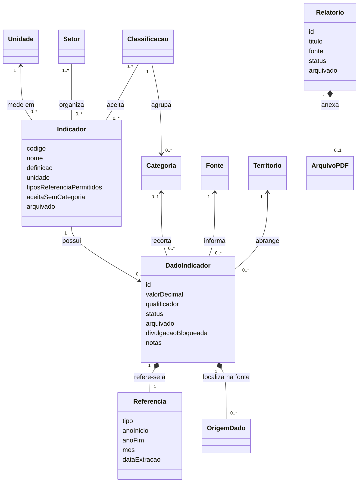

# Estrutura dos indicadores e dicionário

**Revisão 3 — 05/11/2026.** Definições aprovadas para as correções da entrega de Testes. A documentação descreve o comportamento a implementar; sua existência não comprova integração no banco, na API ou nas telas.

Este documento define os conceitos, relacionamentos e campos. O [documento dos dados](02-dados-e-integracao.md) explica o pacote recebido; os [fluxos de uso](03-fluxos-de-uso.md) definem as ações das telas. O [contexto para IAs](CONTEXTO-PARA-IAS.md) reúne um resumo para implementação.

## 1. Indicador e Dados do indicador

| Conceito | O que representa | Exemplo |
| --- | --- | --- |
| Indicador | Definição da medida, com nome, significado, uma unidade, setores e compatibilidades. | Cidade vista como: Acolhedora; unidade % dos entrevistados. |
| Dados do indicador | Cada valor recebido, com referência, fonte, categoria quando houver e notas. | Moradores, anual 2025, 44,5% dos entrevistados. |
| Setor do Observatório | Agrupamento associado à definição, usado no filtro geral. | Economia criativa. |
| Classificação | Critério que organiza os recortes dos dados de um indicador. | Público da pesquisa. |
| Categoria | Opção pertencente a uma classificação. | Amostra total, Moradores ou Visitantes. |
| Relatório | Documento independente, novo cadastro por envio de PDF. | Relatório do Observatório; publicar um dado não gera um PDF. |

O nome de interface aprovado é **Dados do indicador**. Lançamentos e Observações deixam de identificar cadastros distintos. Ressalvas textuais usam **Notas**.

A definição não guarda valor, ano fixo ou fonte única. Um novo ano ou categoria da mesma medida acrescenta dados, sem criar outro indicador. Um indicador novo exige outra definição quando muda a medida ou sua unidade, como quantidade de pessoas, percentual e razão por mil habitantes.

## 2. Relações do domínio

Um indicador tem uma unidade e um ou mais setores; pode ter muitos dados. Cada dado tem uma referência, uma fonte, o município e zero ou uma categoria. Cada categoria pertence a uma classificação. Um indicador pode aceitar várias classificações, mas isso não cria cruzamentos estatísticos ausentes na origem.

O diagrama representa conceitos, não obriga uma tabela SQL por classe. Os nomes de atributos do UML são conceituais. [Abrir o modelo editável no StarUML](g7-modelo-de-dominio.mdj) ou [o anexo Mermaid](g7-modelo-de-dominio.mmd).

## 3. Setores, classificações e CNAE

| Setor do Observatório | Indicadores associados no pacote |
| --- | --- |
| Dados gerais | 20 |
| Economia criativa | 5 |
| Eventos | 11 |
| Pesquisa e inovação | 10 |
| Turismo | 15 |
| Vale da Eletrônica | 6 |

São **61 indicadores únicos e 67 associações**, com seis indicadores em mais de um setor. Somar a coluna de associações não fornece o total de indicadores únicos.

O antigo Tema é reaproveitado como **Setor do Observatório**, sem manter duas dimensões iguais. `catalogos.setores` e `indicador.setores` são os campos do pacote atual. Preservar códigos existentes, mesmo com prefixo histórico `tema_`.

Setor econômico (Sebrae), como Comércio e Indústria, é uma classificação local de dados. Não se confunde com os seis setores gerais. CNAE permanece opcional e só pode ser associado quando houver código informado pela fonte. Nenhum código CNAE individual está disponível no pacote atual.

Setor pertence à definição. Ano/Período pertence ao dado. Alterar a associação setorial não cria cópias de valores e não participa da identidade do dado. O total municipal 116 de empreendimentos mantém esse significado ao aparecer em Economia criativa; o subtotal criativo 18 continua identificado em seu recorte.

## 4. Dicionário da definição do indicador

Os nomes em `snake_case` correspondem ao intercâmbio preparado. Os campos de estado são requisitos do modelo de aplicação; o pacote não determina seus valores no banco. Os contratos HTTP e os mapeadores do frontend devem documentar a correspondência, preservando as convenções do código existente.

| Campo | Obrigatório | Regra |
| --- | --- | --- |
| `codigo` | Sim | Identificador estável. Nome não é a chave; renomear não duplica os dados. Preservar os códigos atuais quando a medida continuar equivalente. |
| `nome` | Sim | Nome público específico: “Meios de hospedagem cadastrados”, e não somente “Quantidade”. |
| `definicao` | Sim | Explica o que se conta ou mede e seus limites. Não prometer cobertura integral da cidade quando a fonte é um cadastro ou uma pesquisa. |
| `unidade_codigo` | Sim | **Decisão confirmada:** uma unidade por definição. Pessoas, percentual e pessoas por mil habitantes são medidas distintas. |
| `setores` | Sim | Lista não vazia de Setores do Observatório. O filtro global consulta essa associação antes de listar indicadores. Um setor novo não exige componente específico no frontend. |
| `tipos_referencia_permitidos` | Sim | Conjunto não vazio: anual, mensal, acumulada, levantamento ou retrato, conforme a medida. Não é uma promessa de que todos já possuem dados. |
| `classificacoes_permitidas` | Sim, podendo ser vazio | Critérios de recorte aceitos. As opções concretas vêm das categorias e dos dados disponíveis. |
| `aceita_sem_categoria` | Sim | Indica se existe dado sem recorte, como um total informado pela fonte. `false` exige categoria. Não preencher categoria ausente com “Total” sem conferir a origem. |
| `nota_metodologica` | Não | Orientação comum a todos os dados. Ressalvas específicas de uma pesquisa ou período ficam no dado. |
| `arquivado` | Sim | Começa como `false`. Arquivado: fica fora da seleção ativa e da consulta pública. |

**Uma definição não contém valor, ano fixo, fonte única nem fórmula de cálculo obrigatória.** O Observatório envia valores consolidados. As fontes e os períodos pertencem aos dados. A mesma medida pode receber fontes diferentes, mantidas separadas na consulta.

Não será criado um editor de fórmulas nem cálculo automático de indicadores. Acrescentar um indicador, categoria ou fonte será uma operação de cadastro, sem criar colunas ou componentes específicos para cada um.

## 5. Dicionário de cada dado do indicador

| Campo | Obrigatório | Regra |
| --- | --- | --- |
| `id` | Sim | Identificador interno estável durante a edição. Preservar o identificador na migração e em correções; não recalcular a partir de campos editáveis. |
| `indicador_codigo` | Sim | Definição existente. Para cadastrar ou editar ativamente, o indicador deve estar ativo. |
| `territorio_codigo` | Sim | Abrangência real da fonte. O pacote ativo foi limitado a Santa Rita do Sapucaí. Dados antigos de outras abrangências ficam fora da carga e são destinados a arquivamento na migração. |
| `categoria_codigo` | Conforme o indicador | Vazia somente se `aceita_sem_categoria=true`. Quando preenchida, sua classificação precisa ser permitida pelo indicador. |
| `referencia` | Sim | Objeto descrito na seção 6. Período desconhecido não é um tipo válido. |
| `valor` | Sim | Decimal exato, não negativo, intercambiado como texto. `"0"` é válido; vazio não vira zero. Respeitar números inteiros e limites da unidade. |
| `qualificador` | Sim | `igual` ou `maior_que`, para preservar “mais de”. |
| `fonte_codigo` | Sim | Fonte identificável. Uma URL não é obrigatória quando a origem é um documento recebido. |
| `notas` | Não, salvo ressalvas necessárias | Cobertura, denominador, respostas múltiplas, amostra e restrições de interpretação. Não apagar uma ressalva necessária ao publicar. |
| `origens` | Conforme a origem | Importado: preservar arquivo/aba/célula disponíveis. Cadastro manual: não inventar célula ou planilha. Não contém quem editou nem versões anteriores. |
| `status` | Sim | `rascunho` ou `publicado`; cadastro novo começa em rascunho. |
| `arquivado` | Sim | `false` por padrão. Não altera o status guardado. |
| `divulgacao_bloqueada` | Sim | Impedimento de divulgação já existente. Não confundir com rascunho ou arquivo. |
| `motivo_bloqueio` | Se bloqueado | Motivo concreto. Restaurar ou editar não remove o bloqueio. |
| `demonstracao` | Sim | Preserva a identificação de eventual dado fictício. Dados reais preparados não recebem essa marca. |

Unidade e setores são obtidos da definição do indicador. Não repetir esses vínculos no novo dado. Um adaptador transitório deve manter coerência até a migração dos consumidores. O CNAE é obtido da categoria quando houver correspondência explícita; não é outro campo livre para contradizer a categoria.

Metadados como tamanho de amostra podem continuar nas notas quando a origem não oferece um campo uniforme. Não inventar cobertura, denominador ou número de respondentes para preencher um cadastro.

### Identidade e correção

A combinação de **indicador + território + categoria (ou ausência dela) + referência completa + fonte** não pode se repetir. A unidade é determinada pelo indicador. A identidade da M6 também inclui unidade; a migração deve preservar a equivalência com a unidade única da definição.

- Alterar somente o valor corrige o mesmo dado.
- Corrigir fonte, categoria ou referência também pode manter o mesmo dado, após validar a nova combinação.
- Se a combinação já existir, recusar a gravação e indicar o conflito; não sobrescrever outro dado nem fundir automaticamente.
- O frontend usa o identificador do dado, não a combinação editável como endereço.
- Mudanças em medida/unidade que representem outro significado exigem outra definição de indicador e remapeamento validado. Não converter o valor automaticamente.
- Se o dado publicado for corrigido, o valor corrigido passa a valer imediatamente após a confirmação. Não há versão publicada separada da versão editada.

## 6. Referências, unidades, fontes e origens

| Tipo de referência | Campos | Exemplo e comportamento |
| --- | --- | --- |
| Anual | Um único ano | 2024. Pode compor série anual com referências e medidas compatíveis. |
| Mensal | Um único ano e mês de 1 a 12 | Janeiro/2024, somente quando a fonte mede aquele mês. |
| Acumulada | Ano inicial e final, início ≤ fim | 2000–2024. Não é um ponto anual de 2024. |
| Levantamento | Ano inicial e final, início ≤ fim | Pesquisa realizada em 2022 e 2023. Não distribuir o resultado entre os dois anos. |
| Retrato | Ano único e data de extração compatível | Extração de uma base em 04/10/2026. Não tratar como produção anual. |

O mês fica vazio nos demais tipos. A data de extração pertence ao retrato; os rótulos de apresentação são derivados dos campos estruturados. “Janeiro” como resposta de um questionário pode ser uma categoria de uma pesquisa anual, e não um período mensal.

**Unidade:** código, nome/símbolo, exigência de inteiro, máximo quando conhecido e casas de exibição. O mínimo numérico segue a regra atual de zero. Percentual de 0 a 100 e índice de 0 a 1 são unidades distintas. O arredondamento serve à exibição, preservando o decimal recebido.

**Fonte:** código, nome e links disponíveis; edição identificada quando conhecida. Fontes/edições diferentes não são somadas nem substituídas por parecerem medir algo semelhante. Não inventar edição ausente.

**Origem do dado:** localização do valor recebido, como `_Indicadores_OT_SRS_.xlsx`, Turismo!D11. É proveniência documental; não é histórico de quem alterou o cadastro.

No pacote, a referência usa `tipo`, `ano_inicio`, `ano_fim` e `mes`; os tipos que exigirem data de extração devem preservá-la quando recebida. Anual e mensal exigem ano inicial igual ao final. O pacote atual contém anual, levantamento e acumulada; suporte no modelo não significa dados disponíveis nos demais tipos.

Fonte identifica a origem responsável e os links disponíveis; `origens` guarda localização documental. Nenhum deles é histórico de quem alterou o cadastro.

## 7. Catálogos e restrições de integridade

| Catálogo | Campos essenciais | Regra |
| --- | --- | --- |
| Setor | `codigo`, `nome` | Associação não vazia na definição; não repetir no dado. |
| Unidade | `codigo`, `nome`, `inteira`, `maximo`, `casas_exibicao` | Uma por definição; limites e precisão de exibição não apagam o valor original. |
| Classificação | `codigo`, `nome` | Lista as classificações aceitas pela definição. |
| Categoria | `codigo`, `nome`, `classificacao`, `codigo_cnae` opcional | Cada categoria pertence a uma classificação permitida. |
| Fonte | `codigo`, `nome`, `links` | Identifica documento/base e edição quando conhecida. |
| Território | `codigo`, `nome`, `tipo` | Operação e consulta fixas em Santa Rita do Sapucaí. |

Fontes, classificações e categorias devem poder ser acrescentadas por cadastro. Unidades e setores vêm de catálogo. Proteger referências em uso; recusar mudanças que invalidem dados existentes. Um novo setor, indicador ou categoria não exige componente próprio ou coluna por item.

### Unidades disponíveis

| Unidade | Exige inteiro | Máximo informado | Casas de exibição |
| --- | --- | --- | --- |
| % | Não | 100 | 2 |
| % das empresas do segmento | Não | 100 | 2 |
| % dos entrevistados | Não | 100 | 2 |
| R$ | Não | Não informado | 2 |
| UHs | Sim | Não informado | 0 |
| anos | Não | Não informado | 2 |
| atividades | Sim | Não informado | 0 |
| concessões por mil hab. | Não | Não informado | 2 |
| depósitos por mil hab. | Não | Não informado | 2 |
| dias | Não | Não informado | 2 |
| empreendimentos | Sim | Não informado | 0 |
| empresas | Sim | Não informado | 0 |
| empresas por mil habitantes | Não | Não informado | 2 |
| hab/km² | Não | Não informado | 2 |
| km² | Não | Não informado | 2 |
| nota | Não | 10 | 2 |
| nota 0–10 | Não | 10 | 2 |
| patentes | Sim | Não informado | 0 |
| pessoas | Sim | Não informado | 0 |
| startups | Sim | Não informado | 0 |
| índice (0 a 1) | Não | 1 | 2 |
| índice (0 a 100) | Não | 100 | 2 |

Casas de exibição orientam a apresentação. O valor decimal armazenado não é arredondado para atender essa coluna. Máximo não informado não autoriza inventar um limite com base em outro indicador.

### Classificações e categorias disponíveis

| Classificação | Categorias recebidas |
| --- | --- |
| Autodeclaração de CNPJ ativo | Sim |
| Autodeclaração de Cadastur | Não; Sim |
| Categoria de hospedagem | Cama e café; Flat/apart-hotel; Hotel; Hotel fazenda; Hotel histórico; Outros; Pousada; Resort |
| Categoria do cadastro SMCELT | Agências, agentes e guias; Arte e artesanato; Comércio de produtos locais; Experiências; Gastronomia; Hospedagem; Mobilidade urbana; Negócios criativos; Organização de eventos; Outros (fora do Guia) |
| Evento | Festa de Santa Rita; HackTown |
| Faixa etária citada | 16 a 24 anos; 25 a 34 anos; 35 a 44 anos; 45 a 54 anos; 55 a 64 anos; 65 anos ou mais |
| Grupo do cadastro SMCELT | Economia criativa |
| Mês citado no questionário | Abril; Agosto; Dezembro; Fevereiro; Janeiro; Julho; Junho; Maio; Março; Novembro; Outubro; Setembro |
| Porte da empresa | Demais; EPP (empresa de pequeno porte); ME (microempresa); MEI |
| Procedência dos hóspedes | Entorno regional; Internacional; Municipal; Nacional |
| Público da pesquisa | Amostra total; Moradores; Visitantes |
| Resposta sobre acessibilidade | Não têm; Têm |
| Resposta sobre atendimento bilíngue | Não têm; Têm |
| Resposta sobre envio do BOH | Enviam; Não enviam; Não sabem o que é |
| Segmento Sebrae Minas | Alimentação fora do lar; Beleza; Comércio de alimentos e bebidas; Comércio varejista da moda; Cursos livres; Indústria de eletroeletrônicos; Serviços de construção; Serviços empresariais; Transporte terrestre |
| Setor econômico (Sebrae) | Agropecuária; Comércio; Indústria; Serviços |
| Tipo de hospedagem usado | Airbnb; Camping; Casa de amigos/parentes; Casa própria ou alugada; Hotéis e pousadas |
| Zona de localização da hospedagem | Rural; Urbana |

## 8. Exemplo completo de modelagem

**Indicador:** Cidade vista como: Acolhedora. **Setor:** Economia criativa. **Unidade:** % dos entrevistados. **Classificação permitida:** Público da pesquisa. **Referência permitida:** anual.

| Dado | Referência | Categoria | Valor recebido | Fonte |
| --- | --- | --- | --- | --- |
| 1 | Anual 2025 | Amostra total | 51,1% | Relatório OT nº 004/2025 — Impacto Turístico HackTown 2025 |
| 2 | Anual 2025 | Moradores | 44,5% | Mesma pesquisa |
| 3 | Anual 2025 | Visitantes | 60,6% | Mesma pesquisa |

É um indicador com três dados. Os percentuais se referem aos entrevistados da pesquisa; não são partes para somar em um total de 100%. O setor não precisa ser gravado em cada linha.

## 9. Dicionário dos 61 indicadores preparados

As definições abaixo vêm de `backend/dados/m7/catalogos.json`. São o catálogo preparado atual, não um limite fixo do sistema. A versão tabular está no [dicionário CSV](../../backend/dados/m7/dicionario_indicadores.csv).

### 1. Acessibilidade para pessoas com deficiência

Quantidade de meios de hospedagem que declararam ter ou não acessibilidade para pessoas com deficiência no questionário recebido.

- **Código:** `i_acessibilidade_para_pessoas_com_deficiencia_e4eda8a17c`.
- **Unidade:** empreendimentos.
- **Setores:** Turismo.
- **Referências permitidas:** anual.
- **Classificações permitidas:** Resposta sobre acessibilidade.
- **Aceita dado sem categoria:** não.

### 2. Atendimento bilíngue

Quantidade de meios de hospedagem que declararam oferecer ou não atendimento bilíngue no questionário recebido.

- **Código:** `i_atendimento_bilingue_85bd5fa09b`.
- **Unidade:** empreendimentos.
- **Setores:** Turismo.
- **Referências permitidas:** anual.
- **Classificações permitidas:** Resposta sobre atendimento bilíngue.
- **Aceita dado sem categoria:** não.

### 3. Atividades econômicas (CNAE) cadastradas no município

Quantidade de atividades econômicas cadastradas informada pelo painel recebido. A contagem não fornece uma lista de códigos CNAE.

- **Código:** `i_atividades_economicas_cnae_cadastradas_no_municipio_232f732270`.
- **Unidade:** atividades.
- **Setores:** Dados gerais.
- **Referências permitidas:** anual.
- **Classificações permitidas:** Nenhuma.
- **Aceita dado sem categoria:** sim.

### 4. Avaliação geral do evento

Nota de avaliação geral do evento, na escala de 0 a 10 informada na pesquisa. Cada evento e fonte conserva sua própria avaliação.

- **Código:** `i_avaliacao_geral_do_evento_2583c06e37`.
- **Unidade:** nota 0–10.
- **Setores:** Eventos.
- **Referências permitidas:** anual.
- **Classificações permitidas:** Evento.
- **Aceita dado sem categoria:** não.

### 5. Cidade vista como: Acolhedora

Percentual dos entrevistados que associaram a cidade ao atributo Acolhedora, por público da pesquisa recebida.

- **Código:** `i_cidade_vista_como_acolhedora_fc339b5db8`.
- **Unidade:** % dos entrevistados.
- **Setores:** Economia criativa.
- **Referências permitidas:** anual.
- **Classificações permitidas:** Público da pesquisa.
- **Aceita dado sem categoria:** não.

### 6. Cidade vista como: Criativa

Percentual dos entrevistados que associaram a cidade ao atributo Criativa, por público da pesquisa recebida.

- **Código:** `i_cidade_vista_como_criativa_8db8f2a67b`.
- **Unidade:** % dos entrevistados.
- **Setores:** Economia criativa.
- **Referências permitidas:** anual.
- **Classificações permitidas:** Público da pesquisa.
- **Aceita dado sem categoria:** não.

### 7. Cidade vista como: Inovadora

Percentual dos entrevistados que associaram a cidade ao atributo Inovadora, por público da pesquisa recebida.

- **Código:** `i_cidade_vista_como_inovadora_1a409d5f2a`.
- **Unidade:** % dos entrevistados.
- **Setores:** Economia criativa.
- **Referências permitidas:** anual.
- **Classificações permitidas:** Público da pesquisa.
- **Aceita dado sem categoria:** não.

### 8. Cidade vista como: Inspiradora

Percentual dos entrevistados que associaram a cidade ao atributo Inspiradora, por público da pesquisa recebida.

- **Código:** `i_cidade_vista_como_inspiradora_a047aed078`.
- **Unidade:** % dos entrevistados.
- **Setores:** Economia criativa.
- **Referências permitidas:** anual.
- **Classificações permitidas:** Público da pesquisa.
- **Aceita dado sem categoria:** não.

### 9. Concessão de patentes de invenção por mil habitantes

Razão de concessões de patentes de invenção (PI) por mil habitantes já fornecida pelo Observatório, com referência acumulada e fontes INPI/IBGE informadas. Não recalcular com outra população.

- **Código:** `i_concessao_de_patentes_de_invencao_por_mil_habitantes_c674cdcdb4`.
- **Unidade:** concessões por mil hab..
- **Setores:** Pesquisa e inovação.
- **Referências permitidas:** acumulada.
- **Classificações permitidas:** Nenhuma.
- **Aceita dado sem categoria:** sim.

### 10. Concessões de certificados de adição de invenção (CA)

Quantidade de concessões de certificados de adição de invenção (CA) na série INPI recebida, pela cidade do primeiro depositante residente.

- **Código:** `i_concessoes_de_certificados_de_adicao_de_invencao_ca_2af495a653`.
- **Unidade:** patentes.
- **Setores:** Dados gerais; Pesquisa e inovação.
- **Referências permitidas:** acumulada; anual.
- **Classificações permitidas:** Nenhuma.
- **Aceita dado sem categoria:** sim.

### 11. Concessões de modelos de utilidade (MU)

Quantidade de concessões de modelos de utilidade (MU) na série INPI recebida, pela cidade do primeiro depositante residente.

- **Código:** `i_concessoes_de_modelos_de_utilidade_mu_8791a31437`.
- **Unidade:** patentes.
- **Setores:** Dados gerais; Pesquisa e inovação.
- **Referências permitidas:** acumulada; anual.
- **Classificações permitidas:** Nenhuma.
- **Aceita dado sem categoria:** sim.

### 12. Concessões de patentes de invenção (PI)

Quantidade de concessões de patentes de invenção (PI) na série INPI recebida, pela cidade do primeiro depositante residente.

- **Código:** `i_concessoes_de_patentes_de_invencao_pi_a86b296483`.
- **Unidade:** patentes.
- **Setores:** Dados gerais; Pesquisa e inovação.
- **Referências permitidas:** acumulada; anual.
- **Classificações permitidas:** Nenhuma.
- **Aceita dado sem categoria:** sim.

### 13. Densidade demográfica

Quantidade de habitantes por quilômetro quadrado informada na fonte recebida, com sua referência temporal própria.

- **Código:** `i_densidade_demografica_6ebdeedca2`.
- **Unidade:** hab/km².
- **Setores:** Dados gerais.
- **Referências permitidas:** anual.
- **Classificações permitidas:** Nenhuma.
- **Aceita dado sem categoria:** sim.

### 14. Densidade do estoque empresarial

Quantidade de empresas por mil habitantes informada no painel recebido. Não recalcular utilizando a população de outra fonte ou referência.

- **Código:** `i_densidade_do_estoque_empresarial_ea9e6dce73`.
- **Unidade:** empresas por mil habitantes.
- **Setores:** Dados gerais.
- **Referências permitidas:** anual.
- **Classificações permitidas:** Nenhuma.
- **Aceita dado sem categoria:** sim.

### 15. Depósito de patentes de invenção por mil habitantes

Razão de depósitos de patentes de invenção (PI) por mil habitantes já fornecida pelo Observatório, com referência acumulada e fontes INPI/IBGE informadas. Não recalcular com outra população.

- **Código:** `i_deposito_de_patentes_de_invencao_por_mil_habitantes_88b7f15963`.
- **Unidade:** depósitos por mil hab..
- **Setores:** Pesquisa e inovação.
- **Referências permitidas:** acumulada.
- **Classificações permitidas:** Nenhuma.
- **Aceita dado sem categoria:** sim.

### 16. Depósitos de certificados de adição de invenção (CA)

Quantidade de depósitos de certificados de adição de invenção (CA) na série INPI recebida, pela cidade do primeiro depositante residente.

- **Código:** `i_depositos_de_certificados_de_adicao_de_invencao_ca_d8cfb94ab3`.
- **Unidade:** patentes.
- **Setores:** Pesquisa e inovação.
- **Referências permitidas:** acumulada; anual.
- **Classificações permitidas:** Nenhuma.
- **Aceita dado sem categoria:** sim.

### 17. Depósitos de modelos de utilidade (MU)

Quantidade de depósitos de modelos de utilidade (MU) na série INPI recebida, pela cidade do primeiro depositante residente.

- **Código:** `i_depositos_de_modelos_de_utilidade_mu_ef610bc798`.
- **Unidade:** patentes.
- **Setores:** Pesquisa e inovação.
- **Referências permitidas:** acumulada; anual.
- **Classificações permitidas:** Nenhuma.
- **Aceita dado sem categoria:** sim.

### 18. Depósitos de patentes de invenção (PI)

Quantidade de depósitos de patentes de invenção (PI) na série INPI recebida, pela cidade do primeiro depositante residente.

- **Código:** `i_depositos_de_patentes_de_invencao_pi_1bc517ff0d`.
- **Unidade:** patentes.
- **Setores:** Pesquisa e inovação.
- **Referências permitidas:** acumulada; anual.
- **Classificações permitidas:** Nenhuma.
- **Aceita dado sem categoria:** sim.

### 19. Diária informada (mediana)

Mediana dos valores de diária no conjunto de respostas definido pela fonte. É medida distinta da média simples e não deve ser recalculada com outra amostra.

- **Código:** `i_valor_medio_da_diaria_mediana_ccb872f608`.
- **Unidade:** R$.
- **Setores:** Turismo.
- **Referências permitidas:** anual.
- **Classificações permitidas:** Nenhuma.
- **Aceita dado sem categoria:** sim.

### 20. Diária informada (média simples)

Média simples dos valores de diária no conjunto de respostas definido pela fonte. É medida distinta da mediana e não deve ser recalculada com outra amostra.

- **Código:** `i_valor_medio_da_diaria_media_simples_1b3f2e9d5d`.
- **Unidade:** R$.
- **Setores:** Turismo.
- **Referências permitidas:** anual.
- **Classificações permitidas:** Nenhuma.
- **Aceita dado sem categoria:** sim.

### 21. Eletroeletrônicos como parte da indústria

Participação percentual das empresas do segmento de eletroeletrônicos no conjunto de empresas da indústria, conforme o painel recebido.

- **Código:** `i_eletroeletronicos_como_parte_da_industria_e468521b66`.
- **Unidade:** %.
- **Setores:** Vale da Eletrônica.
- **Referências permitidas:** anual.
- **Classificações permitidas:** Nenhuma.
- **Aceita dado sem categoria:** sim.

### 22. Empreendimentos ativos em Santa Rita do Sapucaí

Quantidade de empreendimentos ativos locais na base cadastral de negócios turísticos e criativos recebida da SMCELT, sem repetições. A cobertura é a base recebida, não um censo de todas as empresas.

- **Código:** `i_empreendimentos_ativos_em_santa_rita_do_sapucai_7f1de9c97e`.
- **Unidade:** empreendimentos.
- **Setores:** Economia criativa; Turismo.
- **Referências permitidas:** levantamento.
- **Classificações permitidas:** Categoria do cadastro SMCELT; Grupo do cadastro SMCELT.
- **Aceita dado sem categoria:** sim.

### 23. Envio do Boletim de Ocupação Hoteleira (BOH)

Quantidade de meios de hospedagem por resposta sobre o envio do BOH: enviam, não enviam ou não sabem o que é.

- **Código:** `i_envio_do_boletim_de_ocupacao_hoteleira_boh_ac2f1e9c5f`.
- **Unidade:** empreendimentos.
- **Setores:** Turismo.
- **Referências permitidas:** anual.
- **Classificações permitidas:** Resposta sobre envio do BOH.
- **Aceita dado sem categoria:** não.

### 24. Estoque de empresas

Quantidade de empresas no estoque empresarial informado na fonte recebida. Edições e fontes diferentes mantêm seus valores separados.

- **Código:** `i_estoque_de_empresas_f3c074802c`.
- **Unidade:** empresas.
- **Setores:** Dados gerais; Vale da Eletrônica.
- **Referências permitidas:** anual.
- **Classificações permitidas:** Porte da empresa; Segmento Sebrae Minas; Setor econômico (Sebrae).
- **Aceita dado sem categoria:** sim.

### 25. Gasto médio per capita

Gasto médio por pessoa informado na pesquisa do evento, mantendo a distinção entre moradores e visitantes.

- **Código:** `i_gasto_medio_per_capita_23127ba6c9`.
- **Unidade:** R$.
- **Setores:** Eventos.
- **Referências permitidas:** anual.
- **Classificações permitidas:** Público da pesquisa.
- **Aceita dado sem categoria:** não.

### 26. IDEB – anos finais do ensino fundamental (rede pública)

Resultado do IDEB dos anos finais do ensino fundamental da rede pública, conforme a referência e a fonte recebidas.

- **Código:** `i_ideb_anos_finais_do_ensino_fundamental_rede_publica_e669247a95`.
- **Unidade:** nota.
- **Setores:** Dados gerais.
- **Referências permitidas:** anual.
- **Classificações permitidas:** Nenhuma.
- **Aceita dado sem categoria:** sim.

### 27. Idade mediana

Idade que divide a população considerada pela fonte em duas metades, conforme a referência recebida. Não representa idade média.

- **Código:** `i_idade_mediana_4ac2297a62`.
- **Unidade:** anos.
- **Setores:** Dados gerais.
- **Referências permitidas:** anual.
- **Classificações permitidas:** Nenhuma.
- **Aceita dado sem categoria:** sim.

### 28. Indústria como parte de todas as empresas

Participação percentual das empresas da indústria no estoque total de empresas, conforme o painel recebido.

- **Código:** `i_industria_como_parte_de_todas_as_empresas_75f92f2ece`.
- **Unidade:** %.
- **Setores:** Vale da Eletrônica.
- **Referências permitidas:** anual.
- **Classificações permitidas:** Nenhuma.
- **Aceita dado sem categoria:** sim.

### 29. Meios de hospedagem cadastrados

Quantidade de meios de hospedagem cadastrados na base recebida, no total e nos recortes informados. Não representa censo de todos os estabelecimentos municipais.

- **Código:** `i_meios_de_hospedagem_10d688bcf7`.
- **Unidade:** empreendimentos.
- **Setores:** Turismo.
- **Referências permitidas:** anual.
- **Classificações permitidas:** Categoria de hospedagem; Zona de localização da hospedagem.
- **Aceita dado sem categoria:** sim.

### 30. Meios de hospedagem com CNPJ ativo

Quantidade de meios de hospedagem que informaram CNPJ ativo no questionário recebido.

- **Código:** `i_meios_de_hospedagem_com_cnpj_ativo_9ad97045ea`.
- **Unidade:** empreendimentos.
- **Setores:** Turismo.
- **Referências permitidas:** anual.
- **Classificações permitidas:** Autodeclaração de CNPJ ativo.
- **Aceita dado sem categoria:** não.

### 31. Meios de hospedagem que dizem estar no Cadastur

Quantidade de meios de hospedagem por autodeclaração de cadastro no Cadastur. Não equivale à verificação no cadastro federal.

- **Código:** `i_meios_de_hospedagem_que_dizem_estar_no_cadastur_9a268dacfd`.
- **Unidade:** empreendimentos.
- **Setores:** Turismo.
- **Referências permitidas:** anual.
- **Classificações permitidas:** Autodeclaração de Cadastur.
- **Aceita dado sem categoria:** não.

### 32. Meses de MAIOR fluxo de hóspedes (quantos empreendimentos citam)

Quantidade de estabelecimentos que citaram cada mês como de maior fluxo no questionário recebido. São respostas de uma pesquisa anual e podem admitir múltiplas escolhas.

- **Código:** `i_meses_de_maior_fluxo_de_hospedes_quantos_empreendimentos_cit_e557577a73`.
- **Unidade:** empreendimentos.
- **Setores:** Turismo.
- **Referências permitidas:** anual.
- **Classificações permitidas:** Mês citado no questionário.
- **Aceita dado sem categoria:** não.

### 33. Meses de MENOR fluxo de hóspedes (quantos empreendimentos citam)

Quantidade de estabelecimentos que citaram cada mês como de menor fluxo no questionário recebido. São respostas de uma pesquisa anual e podem admitir múltiplas escolhas.

- **Código:** `i_meses_de_menor_fluxo_de_hospedes_quantos_empreendimentos_cit_d482d7eac1`.
- **Unidade:** empreendimentos.
- **Setores:** Turismo.
- **Referências permitidas:** anual.
- **Classificações permitidas:** Mês citado no questionário.
- **Aceita dado sem categoria:** não.

### 34. PIB per capita

Valor do produto interno bruto por habitante informado na fonte recebida, com a referência temporal do PIB.

- **Código:** `i_pib_per_capita_8a9c11bc2b`.
- **Unidade:** R$.
- **Setores:** Dados gerais.
- **Referências permitidas:** anual.
- **Classificações permitidas:** Nenhuma.
- **Aceita dado sem categoria:** sim.

### 35. Participantes estimados

Estimativa de participantes do evento informada na pesquisa recebida, com a cobertura e o método dessa pesquisa.

- **Código:** `i_participantes_estimados_1425961244`.
- **Unidade:** pessoas.
- **Setores:** Eventos.
- **Referências permitidas:** anual.
- **Classificações permitidas:** Evento.
- **Aceita dado sem categoria:** não.

### 36. Participação de MPE no segmento de eletroeletrônicos

Participação percentual de micro e pequenas empresas (MPE) no segmento de eletroeletrônicos, conforme a fonte recebida. Não equiparar MPE a pequenos negócios incluindo MEI.

- **Código:** `i_participacao_de_mpe_no_segmento_de_eletroeletronicos_e3912b0745`.
- **Unidade:** % das empresas do segmento.
- **Setores:** Vale da Eletrônica.
- **Referências permitidas:** anual.
- **Classificações permitidas:** Nenhuma.
- **Aceita dado sem categoria:** sim.

### 37. Participação de eletroeletrônicos no estoque de empresas

Participação percentual do segmento de eletroeletrônicos no estoque total de empresas, conforme a fonte recebida.

- **Código:** `i_participacao_de_eletroeletronicos_no_estoque_de_empresas_ae2bd04237`.
- **Unidade:** %.
- **Setores:** Vale da Eletrônica.
- **Referências permitidas:** anual.
- **Classificações permitidas:** Nenhuma.
- **Aceita dado sem categoria:** sim.

### 38. Participação de pequenos negócios no segmento de eletroeletrônicos

Participação percentual de MEI, ME e EPP no segmento de eletroeletrônicos, conforme a fonte recebida.

- **Código:** `i_participacao_de_pequenos_negocios_no_segmento_de_eletroeletr_cb559e06e9`.
- **Unidade:** % das empresas do segmento.
- **Setores:** Vale da Eletrônica.
- **Referências permitidas:** anual.
- **Classificações permitidas:** Nenhuma.
- **Aceita dado sem categoria:** sim.

### 39. Permanência média dos turistas

Permanência média, em dias, dos turistas considerados na pesquisa do evento recebida.

- **Código:** `i_permanencia_media_dos_turistas_9c00a676b4`.
- **Unidade:** dias.
- **Setores:** Eventos.
- **Referências permitidas:** anual.
- **Classificações permitidas:** Evento.
- **Aceita dado sem categoria:** não.

### 40. Permanência média dos visitantes

Permanência média, em dias, dos visitantes considerados na pesquisa do evento recebida.

- **Código:** `i_permanencia_media_dos_visitantes_957fbc2e4a`.
- **Unidade:** dias.
- **Setores:** Eventos.
- **Referências permitidas:** anual.
- **Classificações permitidas:** Evento.
- **Aceita dado sem categoria:** não.

### 41. Pessoas empregadas nos meios de hospedagem

Quantidade de pessoas empregadas informada pelos meios de hospedagem respondentes. Preservar a cobertura da coleta; não equivale ao emprego formal total do município.

- **Código:** `i_pessoas_empregadas_nos_meios_de_hospedagem_8705121b32`.
- **Unidade:** pessoas.
- **Setores:** Turismo.
- **Referências permitidas:** anual.
- **Classificações permitidas:** Nenhuma.
- **Aceita dado sem categoria:** sim.

### 42. Pessoas que passaram pelo evento (mais de)

Limite inferior informado para a quantidade de pessoas que passaram pelo evento. O qualificador maior_que acompanha o valor.

- **Código:** `i_pessoas_que_passaram_pelo_evento_mais_de_c49441875b`.
- **Unidade:** pessoas.
- **Setores:** Eventos.
- **Referências permitidas:** anual.
- **Classificações permitidas:** Evento.
- **Aceita dado sem categoria:** não.

### 43. Pessoas que trabalharam no evento (mais de)

Limite inferior informado para a quantidade de pessoas que trabalharam no evento. O qualificador maior_que acompanha o valor.

- **Código:** `i_pessoas_que_trabalharam_no_evento_mais_de_3025515561`.
- **Unidade:** pessoas.
- **Setores:** Eventos.
- **Referências permitidas:** anual.
- **Classificações permitidas:** Evento.
- **Aceita dado sem categoria:** não.

### 44. População estimada (painel Sebrae)

Estimativa populacional apresentada no painel Sebrae recebido, com sua própria referência temporal. É medida distinta da contagem censitária.

- **Código:** `i_populacao_estimada_painel_sebrae_9618f46ca0`.
- **Unidade:** pessoas.
- **Setores:** Dados gerais.
- **Referências permitidas:** anual.
- **Classificações permitidas:** Nenhuma.
- **Aceita dado sem categoria:** sim.

### 45. População residente (Censo)

População residente no Censo recebido, identificada por município e referência censitária. Não substituir pela estimativa de outra edição.

- **Código:** `i_populacao_682eff3322`.
- **Unidade:** pessoas.
- **Setores:** Dados gerais; Pesquisa e inovação.
- **Referências permitidas:** anual.
- **Classificações permitidas:** Nenhuma.
- **Aceita dado sem categoria:** sim.

### 46. Principais faixas etárias dos hóspedes (quantos empreendimentos citam)

Quantidade de meios de hospedagem que citaram cada faixa etária entre seus hóspedes no questionário recebido. Não é contagem individual de hóspedes.

- **Código:** `i_principais_faixas_etarias_dos_hospedes_quantos_empreendiment_60416c4aa3`.
- **Unidade:** empreendimentos.
- **Setores:** Turismo.
- **Referências permitidas:** anual.
- **Classificações permitidas:** Faixa etária citada.
- **Aceita dado sem categoria:** não.

### 47. Procedência dos hóspedes (quantos empreendimentos recebem)

Quantidade de meios de hospedagem que declararam receber hóspedes de cada procedência. Não é quantidade de turistas, e as procedências podem admitir múltiplas respostas.

- **Código:** `i_procedencia_dos_hospedes_quantos_empreendimentos_recebem_52868f60a8`.
- **Unidade:** empreendimentos.
- **Setores:** Turismo.
- **Referências permitidas:** anual.
- **Classificações permitidas:** Procedência dos hóspedes.
- **Aceita dado sem categoria:** não.

### 48. Recursos movimentados na economia local (mais de)

Limite inferior informado para os recursos movimentados na economia local durante o evento. Não confundir com arrecadação pública.

- **Código:** `i_recursos_movimentados_na_economia_local_mais_de_64f0088e34`.
- **Unidade:** R$.
- **Setores:** Eventos.
- **Referências permitidas:** anual.
- **Classificações permitidas:** Evento.
- **Aceita dado sem categoria:** não.

### 49. Startups em processo de incubação

Quantidade de startups em processo de incubação informada na base recebida, com a referência e a cobertura da fonte.

- **Código:** `i_startups_em_processo_de_incubacao_5c2feffd82`.
- **Unidade:** startups.
- **Setores:** Pesquisa e inovação.
- **Referências permitidas:** anual.
- **Classificações permitidas:** Nenhuma.
- **Aceita dado sem categoria:** sim.

### 50. Tipo de hospedagem usado pelos visitantes

Percentual dos visitantes que pernoitaram, por tipo de hospedagem usado no evento, conforme a pesquisa recebida.

- **Código:** `i_tipo_de_hospedagem_usado_pelos_visitantes_39efea30ad`.
- **Unidade:** %.
- **Setores:** Eventos.
- **Referências permitidas:** anual.
- **Classificações permitidas:** Tipo de hospedagem usado.
- **Aceita dado sem categoria:** não.

### 51. Turistas estimados

Estimativa de turistas do evento informada na pesquisa recebida, preservando sua definição de turista e cobertura.

- **Código:** `i_turistas_estimados_f440ffca8b`.
- **Unidade:** pessoas.
- **Setores:** Eventos.
- **Referências permitidas:** anual.
- **Classificações permitidas:** Evento.
- **Aceita dado sem categoria:** não.

### 52. Unidades habitacionais (UHs) informadas

Quantidade de unidades habitacionais informadas na base recebida. Preservar o número de respondentes e as ressalvas sobre imóveis de temporada; não é contagem de leitos ou hotéis.

- **Código:** `i_unidades_habitacionais_uhs_9e78642e0f`.
- **Unidade:** UHs.
- **Setores:** Turismo.
- **Referências permitidas:** anual.
- **Classificações permitidas:** Nenhuma.
- **Aceita dado sem categoria:** sim.

### 53. Visitantes que pernoitaram na cidade

Percentual dos visitantes da pesquisa do evento que pernoitaram na cidade, conforme a fonte recebida.

- **Código:** `i_visitantes_que_pernoitaram_na_cidade_e4f88f71c3`.
- **Unidade:** %.
- **Setores:** Eventos.
- **Referências permitidas:** anual.
- **Classificações permitidas:** Evento.
- **Aceita dado sem categoria:** não.

### 54. Área territorial

Área territorial do município, em quilômetros quadrados, informada na fonte recebida.

- **Código:** `i_area_territorial_9b62248501`.
- **Unidade:** km².
- **Setores:** Dados gerais.
- **Referências permitidas:** anual.
- **Classificações permitidas:** Nenhuma.
- **Aceita dado sem categoria:** sim.

### 55. Índice Sebrae de Desenvolvimento Econômico Local (ISDEL)

Resultado do ISDEL informado pelo painel Sebrae, na escala de 0 a 1 recebida. Não converter para percentual.

- **Código:** `i_indice_sebrae_de_desenvolvimento_economico_local_isdel_5a1e3db7b1`.
- **Unidade:** índice (0 a 1).
- **Setores:** Dados gerais.
- **Referências permitidas:** anual.
- **Classificações permitidas:** Nenhuma.
- **Aceita dado sem categoria:** sim.

### 56. Índice de conectividade das telecomunicações e internet

Resultado do índice de conectividade informado no painel recebido, na escala de 0 a 100. Não confundir com percentual de pessoas conectadas.

- **Código:** `i_indice_de_conectividade_das_telecomunicacoes_e_internet_6d95e9e3da`.
- **Unidade:** índice (0 a 100).
- **Setores:** Dados gerais.
- **Referências permitidas:** anual.
- **Classificações permitidas:** Nenhuma.
- **Aceita dado sem categoria:** sim.

### 57. Índice de densidade empresarial

Resultado do índice de densidade empresarial do painel recebido, na escala de 0 a 1. Não confundir com empresas por mil habitantes.

- **Código:** `i_indice_de_densidade_empresarial_28456e6aa5`.
- **Unidade:** índice (0 a 1).
- **Setores:** Dados gerais.
- **Referências permitidas:** anual.
- **Classificações permitidas:** Nenhuma.
- **Aceita dado sem categoria:** sim.

### 58. Índice de empregabilidade

Resultado do índice de empregabilidade do painel recebido, na escala de 0 a 1. Não representa quantidade de empregos.

- **Código:** `i_indice_de_empregabilidade_23b6d390ef`.
- **Unidade:** índice (0 a 1).
- **Setores:** Dados gerais.
- **Referências permitidas:** anual.
- **Classificações permitidas:** Nenhuma.
- **Aceita dado sem categoria:** sim.

### 59. Índice de infraestrutura de saúde

Resultado do índice de infraestrutura de saúde do painel recebido, na escala de 0 a 1.

- **Código:** `i_indice_de_infraestrutura_de_saude_06fba1b03e`.
- **Unidade:** índice (0 a 1).
- **Setores:** Dados gerais.
- **Referências permitidas:** anual.
- **Classificações permitidas:** Nenhuma.
- **Aceita dado sem categoria:** sim.

### 60. Índice de riqueza

Resultado do índice de riqueza do painel recebido, na escala de 0 a 1. Não representa valor monetário.

- **Código:** `i_indice_de_riqueza_9f99949b50`.
- **Unidade:** índice (0 a 1).
- **Setores:** Dados gerais.
- **Referências permitidas:** anual.
- **Classificações permitidas:** Nenhuma.
- **Aceita dado sem categoria:** sim.

### 61. Índice de vulnerabilidade social

Resultado do índice de vulnerabilidade social do painel recebido, na escala de 0 a 1, preservando o significado da fonte.

- **Código:** `i_indice_de_vulnerabilidade_social_a5db68d13b`.
- **Unidade:** índice (0 a 1).
- **Setores:** Dados gerais.
- **Referências permitidas:** anual.
- **Classificações permitidas:** Nenhuma.
- **Aceita dado sem categoria:** sim.
