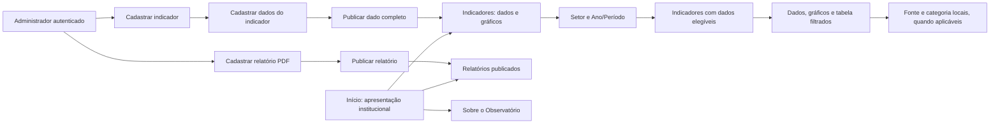

# Fluxos de uso e regras funcionais

**Revisão 3 — 05/11/2026.** Definições aprovadas para as correções da entrega de Testes. A documentação descreve o comportamento a implementar; sua existência não comprova integração no banco, na API ou nas telas.

Este documento define a navegação, a consulta, o CRUD com arquivamento, a publicação e as respostas esperadas. A [estrutura](01-estrutura-e-dicionario.md) define os campos e os relacionamentos; os [dados](02-dados-e-integracao.md) definem o conteúdo disponível. A escolha final de componentes visuais cabe ao frontend, respeitando os comportamentos abaixo.

## 1. Navegação pública

| Página | Finalidade | Conteúdo e ações |
| --- | --- | --- |
| Início (`/`) | Apresentar o Observatório | Resumo institucional, setores e acessos a Indicadores, Relatórios e Sobre. Não repete um dashboard independente. |
| Indicadores (`/indicadores`) | Filtrar e consultar dados e gráficos | Setor e Ano/Período primeiro; lista resultante de indicadores, definição, unidade, fonte, notas e recortes locais. |
| Relatórios (`/relatorios`) | Consultar documentos | Listagem pública de relatórios ativos e publicados, com abertura/download do PDF ou acesso ao link legado. |
| Sobre (`/sobre`) | Explicar a plataforma | Origem, finalidade, setores, leitura dos dados, instituições participantes e fontes. Orientações já existentes podem ficar em seção secundária. |
| Contribua (`/contribua`) | Acessar canais externos prontos | Preservar o formulário recebido e as orientações válidas, sem criar coleta dentro do sistema. |
| Administração (`/admin`) | Gerir conteúdo | Indicadores; Dados do indicador; Relatórios; acesso aos arquivados. |

O responsável pelo frontend público decide cards ou lista pesquisável, a disposição dos gráficos e os detalhes visuais. O responsável pela administração decide a composição dos formulários. Os fluxos, campos necessários e critérios deste documento devem ser atendidos em qualquer solução visual.

O caminho antigo de Dashboard deve conduzir a Indicadores sem oferecer outra consulta concorrente. Atualizar menus, links e acessos internos. A rota inicial `/` permanece institucional. Contribua preserva os canais externos já existentes; não cria coleta nativa.

## 2. Consulta: Setor e Ano/Período antes dos indicadores

**Somente Setor e Ano/Período são filtros gerais da página.** Fonte, classificação e categoria ficam dentro do detalhe do indicador e afetam apenas os seus dados. Essa separação foi confirmada por Gustavo.

### Decisão e vocabulário

Os filtros principais da página são **Setor** e **Ano/Período**. A aplicação mostra somente indicadores com ao menos um dado público elegível que atenda à seleção. A abertura de detalhes é posterior aos filtros gerais, conforme a composição visual da página.

Setor do Observatório usa os seis agrupamentos recebidos: **Dados gerais, Turismo, Economia criativa, Eventos, Pesquisa e inovação e Vale da Eletrônica**. O antigo Tema é reaproveitado como Setor; não criar os dois como classificações paralelas com os mesmos valores.

Um indicador pertence a um ou mais setores. Cada dado permanece ligado ao indicador e herda esse enquadramento para a consulta. O ano não é um atributo fixo do indicador: vem da referência de seus dados.

**Setor do Observatório não é setor econômico nem CNAE.** No detalhe do estoque de empresas, Comércio/Indústria/Serviços/Agropecuária continuam como recortes da classificação **Setor econômico (Sebrae)**. Moradores e Visitantes continuam como Público da pesquisa. Essa separação evita atribuir um significado novo ao valor recebido.

### Estrutura e campos

| Elemento | Campos relevantes | Responsabilidade |
| --- | --- | --- |
| Setor | `codigo`, `nome` | Catálogo dos agrupamentos do Observatório. |
| Indicador | `setores` (lista não vazia), unidade, definição e classificações permitidas | Define em quais setores a medida pode aparecer. |
| Dado do indicador | `indicador_codigo`, `referencia`, valor, fonte e categoria | Fornece o valor e o período disponível para a medida. |
| Categoria e classificação | `categoria_codigo` e sua `classificacao` | Recorte local do dado, sem substituir o Setor global. |

No pacote v2, o catálogo `setores` e o campo `indicador.setores` substituem `temas`. Os códigos recebidos são preservados como identificadores opacos, inclusive quando seu prefixo interno antigo contém `tema`. Não expor esse prefixo no produto nem recriar IDs apenas para renomeá-lo.

Setor não faz parte da identidade semântica do dado. Alterar o enquadramento de um indicador não copia seus valores nem cria novos dados. A identidade continua indicador + município + categoria/ausência + referência completa + fonte.

### Fluxo público obrigatório

1. Abrir Indicadores, que reúne dados, gráficos e tabela.
2. Mostrar Setor e Ano/Período antes da lista. Padrões: Todos os setores e Todos os períodos.
3. Escolher um setor e uma referência completa, quando desejado, e aplicar os filtros. Os filtros aplicados são refletidos na URL.
4. Retornar somente indicadores com dados elegíveis para a combinação. O indicador aparece uma vez, mesmo pertencendo a vários setores.
5. Em cada indicador, usar somente os dados que passaram no filtro global. O nome, a definição e a unidade acompanham a leitura.
6. Abrir um indicador ou seus recortes, se a composição visual usar detalhe. Fonte, classificação e categoria são filtros locais e não reclassificam o indicador em outro setor.

A composição visual pode usar cards ou lista pesquisável e decidir como abrir os detalhes. A página não exige escolher um indicador antes de aplicar Setor e Ano/Período. Não há outra consulta separada em Dashboard.

### Regra de inclusão e exemplos

Um dado entra na seleção se for municipal, publicado, não arquivado, não bloqueado e ligado a indicador ativo; o indicador deve pertencer ao setor selecionado e a referência do dado deve coincidir com a opção selecionada. Todos elimina apenas a restrição daquele filtro.

**Um indicador aparece se existir ao menos um desses dados.** Não basta pertencer ao setor e ter algum dado de outro período. O backend e a tela usam a mesma regra; não esconder apenas os cards deixando a API retornar conteúdo indevido.

| Filtros globais | Resultado de referência no pacote preparado |
| --- | --- |
| Economia criativa + 2025 anual | Os quatro indicadores de percepção da cidade: Acolhedora, Criativa, Inovadora e Inspiradora. |
| Turismo + 2024 anual | Os 14 indicadores turísticos com dados anuais de 2024, incluindo hospedagem e UHs. Acolhedora não aparece. |
| Economia criativa + 2024 anual | Nenhum indicador nessa combinação; mostrar ausência, sem retornar todos como alternativa. |
| Turismo + 2022 e 2023 levantamento | Empreendimentos ativos locais; não duplicar esse levantamento em dois anos anuais. |
| Todos os setores + Todos os períodos | Até 61 indicadores e 303 dados da origem atual, sem duplicação pelas associações setoriais. |

As contagens descrevem uma simulação do pacote preparado. A quantidade pública real depende de publicação, arquivo e bloqueio persistidos. Dados novos não são publicados automaticamente para atingir essas contagens.

### Ano/Período é uma referência completa

| Opção | Correspondência | Exemplo após abrir o indicador |
| --- | --- | --- |
| 2024 — anual | Tipo anual, início/fim 2024, sem mês | Depósitos de PI = 5. |
| 2000–2024 — acumulado | Tipo acumulada, início 2000 e fim 2024 | Depósitos de PI = 72. |
| 2020–2024 — acumulado | Tipo acumulada, início 2020 e fim 2024 | Depósitos de PI = 24. |
| 2022 e 2023 — levantamento | Tipo levantamento, início 2022 e fim 2023 | Total de empreendimentos ativos locais = 116. |

2024 anual não inclui acumulados encerrados em 2024. Não testar se um ano está dentro de qualquer intervalo. O levantamento de 2022 e 2023 não vira dois dados anuais.

Todos os períodos conserva cada referência identificada e não autoriza somar ou misturar tipos de referência. Mensal e retrato continuam suportados pelo modelo quando existirem dados recebidos completos; não criar opções vazias para eles no pacote atual.

### Opções, mudança de filtros e URL

As opções de Setor vêm dos setores com ao menos um indicador ativo e dado público elegível em algum período. A opção não desaparece apenas porque o ano atualmente selecionado é incompatível.

As opções de Ano/Período vêm dos dados elegíveis dos indicadores do setor escolhido. Se a troca de Setor tornar o período inválido, limpar o período para Todos e informar a mudança. Aplicar atualiza a seleção, os resultados e a URL. Limpar filtros volta aos dois valores Todos.

O exemplo Economia criativa + 2024 anual verifica a ausência de correspondência no pacote e a resposta vazia da consulta para essa combinação. Não exige criar uma opção vazia no controle: ao trocar o setor na interface, aplica-se a limpeza do período incompatível descrita acima. A API nunca substitui silenciosamente uma combinação sem dados por todos os dados.

Ao recarregar uma URL válida, restaurar a seleção. Valor desconhecido ou incompatível deve ser removido com indicação clara, sem mudar silenciosamente para outro setor/período. Parâmetros antigos não permitem consultar outra cidade.

Se o indicador aberto deixar de pertencer aos resultados, fechar ou limpar seu detalhe. Se continuar, limpar apenas recortes locais incompatíveis. Carregamento, vazio, falha e atualização de publicação precisam atualizar a lista e as opções sem usar dados fictícios como fallback.

### Recortes locais e significado dos números

| Indicador | Recorte local recebido |
| --- | --- |
| Estoque de empresas | Setor econômico (Sebrae), Porte ou Segmento, uma classificação por vez. |
| Empreendimentos ativos locais | Categoria do cadastro SMCELT ou Grupo do cadastro SMCELT. |
| Meios de hospedagem cadastrados | Categoria de hospedagem ou Zona. |
| Cidade vista como: Acolhedora | Público da pesquisa: Amostra total, Moradores ou Visitantes. |
| UHs informadas | Não recebeu divisão por tipo de hospedagem. |

O filtro global seleciona indicadores; não muda a população medida por seus dados. Um indicador multissetorial mantém a mesma definição em todos os setores. Por exemplo, o total 116 de empreendimentos ativos locais não se transforma em total de criativos ao abrir Economia criativa. O subtotal criativo recebido de 18 continua identificado no recorte Grupo do cadastro SMCELT.

Fonte e recortes locais restringem somente os dados daquele indicador que já passaram pelos filtros globais. Não afetam os demais indicadores da lista. Fonte deve poder mudar sem ficar presa à categoria anterior; limpar as opções locais incompatíveis.

Não oferecer Comércio + MEI como cruzamento do estoque, pois os dados por Setor econômico e por Porte são distribuições independentes. Hotel = 3 não fornece uma divisão das 251 UHs. Não somar amostra total e grupos de entrevistados, totais e recortes ou fontes/edições distintas.

## 3. Gráficos, tabela e significado dos resultados

- **Sem recorte** seleciona somente dados sem categoria. **Todas as categorias** considera a classificação escolhida. Uma visão **Todos os dados** pode exibir total e recortes identificados em tabela, sem somá-los.
- Fonte e referência fazem parte da leitura. Os estoques de 5.818 e 5.879 empresas continuam separados por fonte; não viram um único total.
- Uma série temporal reúne referências anuais ou mensais compatíveis. Acumulado, levantamento e retrato não entram como um ponto anual simples. Fontes diferentes não são ligadas como se fossem uma mesma série contínua.
- Um comparativo por categoria usa a mesma medida, unidade, referência e fonte. Classificações diferentes não são empilhadas como partes do mesmo total.
- Percentuais de Amostra total, Moradores e Visitantes têm bases próprias. Não somar ou usar gráfico de partes de 100% para os três grupos. A amostra total recebida pode ser apresentada como referência.
- Todo gráfico possui alternativa em tabela. Ausência de dado é diferente de zero. Limites como “mais de” e ressalvas de cobertura acompanham o valor.

### Exemplos no detalhe do indicador

| Seleção | Resultado esperado |
| --- | --- |
| Cidade vista como: Acolhedora; anual 2025; Público da pesquisa = Moradores | 44,5% dos moradores entrevistados na pesquisa recebida, com a fonte do relatório HackTown. |
| Mesmo indicador; Público da pesquisa = Visitantes | 60,6% dos visitantes entrevistados; não é percentual de toda a população da cidade. |
| Meios de hospedagem cadastrados; anual 2024; categoria Hotel | 3 empreendimentos com a fonte SMCELT. Recorte local: não apresenta 251 UHs como valor de Hotel nem altera os demais indicadores da lista global. |
| Mesmo indicador; categoria Resort | 0 empreendimentos, com fonte e referência. |
| Unidades habitacionais (UHs) informadas; anual 2024 | 251 UHs e suas ressalvas de cobertura. Não oferece Hotel como recorte inexistente dessa medida. |
| Depósitos de PI; anual 2024 | 5 patentes. Os acumulados de 72 e 24 não são tratados como valores anuais de 2024. |

Ao manter Turismo + 2024 anual e filtrar Hotel dentro de Meios de hospedagem, os demais indicadores da lista global continuam com seus resultados próprios. O dado 251 de UHs não se torna uma medida de Hotel.

## 4. Administração de indicadores e Dados do indicador

### Cadastrar e editar a definição

O administrador abre Indicadores e escolhe Novo indicador. Preenche nome, o que a medida significa, unidade, um ou mais Setores do Observatório, tipos de referência permitidos, classificações aceitas e possibilidade de dado sem categoria. Nota metodológica é opcional quando não há ressalva comum a todos os dados.

O código interno é gerado e preservado pelo sistema; o usuário não precisa preencher hash ou chave técnica. A definição pode existir sem dados e não aparece como opção pública vazia. Ela passa a aparecer quando tem ao menos um dado publicado e elegível para divulgação, sem outra ação para publicar a definição.

Editar nome ou explicação atualiza os dados públicos associados após a confirmação, sem criar versão paralela. Uma alteração que invalidaria dados existentes, inclusive arquivados, é recusada com explicação dos vínculos afetados. Mudar o significado da medida ou converter unidades não é uma simples edição descritiva.

Os cadastros auxiliares devem permitir acrescentar fonte, classificação e categoria sem editar arquivos ou código. Unidades e setores também são catálogos. A interface pode usar um formulário auxiliar ou cadastro contextual, sem exigir uma tela complexa por catálogo. Itens em uso não podem ser apagados ou ter seu significado alterado silenciosamente.

### Cadastrar e editar um dado

1. O administrador escolhe um indicador ativo e abre Adicionar dado. A unidade e os setores vêm da definição; o município é Santa Rita do Sapucaí.
2. Informa o tipo de referência permitido e os campos correspondentes: ano, mês, intervalo ou data de extração. A categoria é escolhida somente em classificações permitidas; ausência de categoria precisa ser aceita pelo indicador.
3. Informa valor, qualificador, fonte e notas necessárias. O campo Notas contém ressalvas; ele não se chama Observações para designar outro cadastro.
4. Salvar cria um rascunho. A publicação é uma ação explícita, com resumo do dado e validação de completude e divulgação. O sistema não publica automaticamente toda a carga preparada.
5. Ao editar um dado publicado, a confirmação informa que a alteração atualiza a consulta pública imediatamente. Um rascunho editado continua rascunho.
6. Fonte, categoria e referência podem ser corrigidas no mesmo dado, preservando o identificador. Se a combinação de destino já existe, o sistema recusa a gravação e identifica o conflito.

Valores são recebidos com precisão decimal. A entrada pode aceitar a vírgula decimal usual em português e convertê-la para o formato de intercâmbio, sem passar por ponto flutuante nem arredondar o valor armazenado. Zero é permitido; limites e exigência de inteiro vêm da unidade.

### Arquivar, restaurar e despublicar

Dados e relatórios têm status rascunho/publicado separado do arquivamento. Arquivar preserva o status e retira o item da consulta ativa e pública. Restaurar recupera a situação anterior: publicado reaparece se elegível; rascunho continua privado. Bloqueio de divulgação é preservado.

Arquivar o indicador inteiro oculta seus dados sem mudar os estados individuais. Restaurá-lo não restaura um dado que havia sido arquivado separadamente. O sistema informa o alcance da ação antes da confirmação.

Itens arquivados podem ser consultados e restaurados, mas precisam ser restaurados antes de editar, publicar ou despublicar. Despublicar um dado ou relatório ativo o devolve a rascunho, sem apagar seu conteúdo.

CRUD significa cadastrar, consultar, editar e arquivar/restaurar. A retirada é reversível; não oferecer exclusão física como fluxo comum. A definição não tem publicação independente: aparece quando seus dados publicados forem elegíveis.

Setor é obrigatório no cadastro da definição e não é preenchido novamente em cada dado. A referência completa é obrigatória no dado. A unidade é herdada da definição. Santa Rita é fixa nas consultas e nos formulários.

## 5. Publicar, corrigir, despublicar, arquivar e restaurar

Nos dados e relatórios, **status e arquivamento são campos separados**. Assim, arquivar um publicado mantém `status=publicado` e muda apenas `arquivado=true`. Restaurar limpa esse campo e o item volta à situação anterior, sem guardar uma versão ou um histórico de transições.

| Ação | Antes | Depois | Efeito público |
| --- | --- | --- | --- |
| Cadastrar | Não existe | Rascunho, ativo | Não aparece. |
| Publicar | Rascunho válido, ativo | Publicado, ativo | Aparece se cumprir as regras de visibilidade. |
| Confirmar edição | Publicado, ativo | Publicado com os dados corrigidos | Atualiza imediatamente. |
| Confirmar edição | Rascunho, ativo | Rascunho corrigido | Continua privado. |
| Despublicar | Publicado, ativo | Rascunho, ativo | Sai da consulta pública. |
| Arquivar | Rascunho ou publicado, ativo | Mesmo status, arquivado | Sai da consulta ativa e pública. |
| Restaurar | Arquivado | Mesmo status, ativo | Publicado reaparece se elegível; rascunho continua privado. |

**Não permitir editar, publicar ou despublicar enquanto arquivado.** Restaurar primeiro. Isso preserva o sentido de “voltar à situação anterior”. Dados bloqueados continuam bloqueados ao restaurar; desbloqueio exige a justificativa substantiva da origem ter sido resolvida, não apenas um clique de restauração.

### Arquivar o indicador inteiro

Decisão confirmada: arquivar a definição **oculta efetivamente seus dados**, sem modificar o status ou o arquivamento individual deles. Restaurar o indicador torna elegíveis os dados que já estavam publicados e ativos. Um dado arquivado separadamente continua arquivado; um rascunho continua rascunho. Não fazer cascata de exclusão nem reescrever todos os filhos.

### O que é visível publicamente

Um dado só aparece se estiver **publicado + não arquivado + não bloqueado + ligado a indicador não arquivado + com território Santa Rita do Sapucaí**. A mesma regra deve valer na API pública, listagens, filtros, detalhes e acesso direto por identificador. Um indicador sem dados elegíveis não aparece como opção pública vazia.

Relatório só aparece e disponibiliza seu conteúdo no acesso público se estiver publicado e não arquivado. A administração autenticada pode consultar rascunhos e arquivos. O pacote ativo é exclusivamente de Santa Rita; a restrição de escopo definida no documento Dados recebidos, tratamento e integração substitui a previsão de manter dados não municipais ativos na administração.

**Sem registro de quem alterou e sem histórico de versões.** Login e autorização administrativa permanecem. Fontes, notas e localização na planilha continuam porque explicam o dado, não porque auditam o usuário.

## 6. Relatórios: administração por PDF e consulta pública

O administrador abre Relatórios, escolhe Novo relatório e informa título, fonte e PDF. Número, tipo, data original do documento e referência são preenchidos somente quando conhecidos. Mês de referência exige ano. O upload novo não oferece URL como alternativa.

Salvar cria um rascunho. Publicar disponibiliza o relatório e seu PDF na consulta pública. Uma edição confirmada de relatório publicado entra em vigor imediatamente; editar um rascunho não o publica.

Ao substituir o PDF, o sistema valida o novo arquivo antes de concluir a troca. Arquivo inválido, falha no upload ou limite excedido mantêm o conteúdo vigente e informam o motivo. O limite de tamanho é configurado e exibido na interface. A validação verifica conteúdo PDF, não apenas extensão ou nome.

Relatórios legados reais com link externo continuam acessíveis. Se forem substituídos, o novo conteúdo é um PDF. Cada relatório possui um conteúdo vigente, sem guardar uma segunda versão publicada. Exemplos fictícios permanecem fora do acervo real.

Arquivar/despublicar retira a listagem e o acesso público direto ao arquivo ou ao redirecionamento pelos endpoints da plataforma. Isso não altera permissões no provedor de um link externo legado. A administração autorizada continua consultando o item. Não é gerado PDF automaticamente ao publicar um dado do indicador.

### Campos do cadastro

Os nomes abaixo são campos conceituais; o contrato HTTP deve registrar sua correspondência com a implementação.

| Campo | Obrigatório | Regra |
| --- | --- | --- |
| `id` | Sim | Identificador estável. |
| `titulo` | Sim | Nome público do documento. |
| `fonte` | Sim | Órgão/documento responsável, conforme informação recebida. |
| `arquivoPDF` | Em novos cadastros | Um PDF válido, disponível para leitura/download. Preservar o nome original para apresentação; detalhes de armazenamento são da implementação. |
| `numero` e `tipo` | Não | Número oficial e tipo (relatório técnico ou peça de divulgação), quando conhecidos. |
| `dataPublicacaoDocumento` | Não | Data original do documento, se informada. Não presumir a data em que ele foi enviado ao sistema. |
| `anoReferencia` e `mesReferencia` | Não | Referência do conteúdo quando conhecida; mês exige ano e pertence ao intervalo 1–12. |
| `status` | Sim | Rascunho ou publicado. Novo cadastro começa em rascunho. |
| `arquivado` | Sim | `false` por padrão; restauração preserva o status. |
| `linkExternoLegado` | Apenas compatibilidade | Mantém acesso aos relatórios externos já existentes; novos cadastros não oferecem campo de URL. |
| `demonstracao` | Sim | Identifica documentos fictícios já existentes. |

## 7. Início, Sobre e linguagem do produto

O nome de apresentação segue o protótipo recebido: **Observatório de Santa Rita do Sapucaí**, explicando sua origem no Observatório do Turismo. Início apresenta a plataforma; Sobre explica finalidade, origem, setores, fontes e leitura dos dados.

A lista pública de fontes considera somente dados municipais publicados e elegíveis. Não anunciar números, cidades, fontes ou funcionalidades ausentes da consulta. Cadastur/FNRH são orientações secundárias, com acessos oficiais já existentes.

O vocabulário é Indicadores, Dados do indicador, Relatórios, Notas, Rascunho, Publicado e Arquivado. Retirar textos internos como “Dados da M6 por indicador, território, recorte e referência”. Nomes de milestone, tarefas, migrações, hashes e tabelas internas não são textos do produto.

### Textos institucionais e mensagens de apoio

Conteúdo adaptado do [protótipo enviado pelo Observatório](https://claude.ai/artifact/DpoEgrkHRGaTyC9hHJ9onX#sobre), preservando o escopo municipal e os dados elegíveis. Os textos abaixo são base de conteúdo; sua disposição pode ser ajustada pelo frontend.

### Início — título

Observatório de Santa Rita do Sapucaí

### Início — apresentação curta

Consulte dados e pesquisas sobre Santa Rita do Sapucaí. Escolha um Setor do Observatório e um Ano/Período para consultar os indicadores disponíveis, com suas referências e fontes.

### Início — acessos

- Consultar indicadores
- Acessar relatórios
- Conheça o Observatório

### Sobre — apresentação

O Observatório reúne informações sobre Santa Rita do Sapucaí para apoiar a consulta e o conhecimento do município. Moradores, empreendedores, estudantes, pesquisadores e o poder público podem explorar indicadores e acessar relatórios das pesquisas disponíveis.

### Sobre — origem

A iniciativa teve origem no trabalho do Observatório do Turismo e ampliou sua organização para outros setores de informação do município. A plataforma aproxima informações de diferentes fontes, preservando o contexto necessário para compreender cada resultado.

### Sobre — setores do Observatório

- **Dados gerais:** população, território, empresas, educação e indicadores econômicos.
- **Turismo:** meios de hospedagem, unidades habitacionais informadas e empreendimentos cadastrados.
- **Economia criativa:** cadastros de atividades criativas e percepção da cidade nas pesquisas recebidas.
- **Eventos:** resultados das pesquisas do Observatório sobre eventos realizados no município.
- **Pesquisa e inovação:** depósitos e concessões de patentes, com referências anuais e acumuladas.
- **Vale da Eletrônica:** dados sobre a indústria e o segmento de eletroeletrônicos.

### Sobre — como ler os dados

Os filtros Setor e Ano/Período mostram os indicadores que possuem dados disponíveis para sua seleção. Cada indicador explica o que está sendo medido e sua unidade. Seus dados apresentam valores para uma referência, uma fonte e, quando houver, uma categoria específica.

Consulte a fonte, o período e as notas antes de comparar resultados. Uma pesquisa pode representar apenas seus entrevistados ou os estabelecimentos que responderam ao levantamento. Um valor zero é diferente da ausência de informação.

### Sobre — fontes

Os dados são fornecidos em valores consolidados, a partir de bases institucionais, cadastros e pesquisas. Cada resultado identifica sua fonte e apresenta um link quando ele está disponível.

### Sobre — instituições participantes

A iniciativa é da Prefeitura de Santa Rita do Sapucaí, por meio da Secretaria Municipal de Cultura, Esporte, Lazer e Turismo (SMCELT), com desenvolvimento acadêmico de estudantes do Inatel no projeto HEIComp 2026.2. O conteúdo sobre o Vale da Eletrônica conta com a contribuição da Secretaria de Ciência, Tecnologia e Desenvolvimento Econômico.

### Sobre — participação

O conhecimento sobre a cidade pode crescer com a contribuição da comunidade. Conheça os canais disponíveis para fornecer informações do seu empreendimento ao Observatório.

Ação: **Conhecer os canais de contribuição**.

### Textos de apoio à administração

#### Indicadores

Defina o que será medido, a unidade, os Setores do Observatório e os tipos de dados aceitos por cada indicador.

#### Dados do indicador

Cadastre e publique os dados dos indicadores de Santa Rita do Sapucaí. Informe a referência, a fonte e as notas necessárias para a consulta.

#### Relatórios

Envie relatórios em PDF e organize os documentos disponíveis para consulta pública.

#### Confirmação de edição publicada

Este conteúdo já está publicado. Ao confirmar, a alteração ficará disponível na consulta pública.

#### Confirmação de arquivamento do indicador

Ao arquivar este indicador, seus dados deixarão de aparecer na consulta pública. Os dados serão preservados e manterão suas situações individuais para uma futura restauração.

#### Confirmação de restauração

O item voltará à situação anterior ao arquivamento. Se estava publicado, ficará disponível novamente quando atender às regras de divulgação.

#### Referência incompleta

Informe a referência do dado antes de salvar.

#### Dado duplicado

Já existe um dado para este indicador, categoria, referência e fonte. Consulte o dado existente para fazer a correção.

#### Consulta sem resultado

Não há dados publicados para esta seleção. Revise os filtros.

#### Falha ao substituir PDF

Não foi possível substituir o PDF. O arquivo anterior foi mantido.

## 8. Validação, autorização e estados da interface

As ações administrativas exigem administrador autenticado. O backend aplica elegibilidade também em filtros, listagens, detalhes e downloads; esconder um botão na interface não substitui essa regra.

Consultas e formulários precisam distinguir carregamento, vazio, erro e sucesso confirmado pelo servidor. Uma falha deve conservar o preenchimento relevante. Atualizar os resultados afetados após uma edição, publicação, arquivo ou restauração.

Navegação por teclado, rótulos claros, foco visível e apresentação em tela estreita fazem parte do fluxo. Gráficos têm alternativa em tabela; cor não é o único meio de comunicar um estado. Metadados necessários à interpretação acompanham o valor.

## 9. Critérios funcionais para orientar as próximas tarefas

Os IDs abaixo são referências de requisitos, não tarefas já distribuídas nem testes já executados. A próxima divisão de tarefas usará estes critérios. A suíte de testes será planejada separadamente.

| ID | Resultado observável |
| --- | --- |
| NAV-01 | Início apresenta o Observatório e oferece acessos funcionais a Indicadores, Relatórios e Sobre. |
| NAV-02 | Gráficos, tabela e consulta estão reunidos em Indicadores; o menu não oferece Dashboard nem Inventário como funcionalidades separadas prontas. |
| PUB-01 | Após Setor e Ano/Período, listar somente indicadores com dado municipal publicado, ativo e sem bloqueio compatível com a seleção, sob definição ativa. |
| PUB-02 | Setor e Ano/Período ficam antes da lista; opções vêm da API, a troca de Setor limpa período incompatível e recortes locais não mudam os demais indicadores. Não há seletor de cidade. |
| PUB-03 | Setor/Ano-Período restringem a lista e seus dados. Em Meios de hospedagem, Hotel retorna 3 e Resort retorna 0; esse filtro local não altera os outros indicadores nem apresenta 251 UHs como valor de Hotel. |
| PUB-04 | Tipos de referência permanecem distintos; anual/2024 de depósitos de PI mostra 5. Fontes/edições não são somadas ou sobrescritas. |
| PUB-05 | Valores e gráficos apresentam unidade, referência, fonte, qualificador e notas necessárias; decimal original é preservado e ausência não vira zero. |
| PUB-06 | Gráficos respeitam bases e períodos; totais, recortes de classificações diferentes e públicos de uma pesquisa não são somados indevidamente. A tabela acompanha a visualização. |
| PUB-07 | A consulta pode ser compartilhada/restaurada pela URL; parâmetros antigos não permitem outra cidade nem mantêm filtros incompatíveis. |
| FILT-01 | Setor consulta `indicador.setores`; Ano/Período consulta a referência completa dos dados. Ambos funcionam sem exigir um indicador selecionado antes. |
| FILT-02 | Em depósitos de PI, selecionar 2024 anual retorna 5; acumulados 2000–2024 = 72 e 2020–2024 = 24 são opções diferentes e não entram pela igualdade do ano final. |
| FILT-03 | No pacote preparado, Economia criativa + 2025 anual encontra quatro indicadores de percepção; Turismo + 2024 anual encontra 14 e não inclui Acolhedora; Economia criativa + 2024 anual fica vazia. Publicação persistida continua obrigatória. |
| FILT-04 | Indicadores multissetoriais e seus dados aparecem uma vez em Todos ou no setor escolhido. A associação setorial não copia dados nem transforma um total em medida exclusiva daquele setor. |
| ADM-01 | É possível criar, consultar, editar e arquivar/restaurar a definição do indicador sem criar componentes específicos ou editar arquivos de dados. |
| ADM-02 | Uma definição tem uma unidade, um ou mais setores, referências e classificações permitidas. Alterações que invalidariam dados existentes são recusadas; rótulos descritivos podem ser corrigidos. |
| ADM-03 | Fonte, classificação e categoria podem ser acrescentadas pelo cadastro; unidades e setores são obtidos de catálogos. Referências em uso são protegidas. |
| ADM-04 | Dados do indicador permite cadastro, consulta e correção completa dos campos definidos no documento Estrutura e dicionário, com unidade herdada, município fixo e validação do decimal. |
| ADM-05 | Correções preservam o ID do dado. Duplicidade da identidade é recusada sem sobrescrever outro dado, perder campos do formulário ou criar cópia silenciosa. |
| ADM-06 | Cadastro novo é rascunho. Publicar/despublicar funciona para dados e relatórios. A definição aparece pelos dados publicados, sem outra publicação da definição. |
| ADM-07 | Confirmar edição de publicado atualiza o conteúdo público imediatamente; rascunho editado continua privado. Não há versão editada paralela. |
| ADM-08 | Arquivar/restaurar dado ou relatório preserva seu status anterior e eventual bloqueio. Arquivado exige restauração antes de edição/publicação. |
| ADM-09 | Arquivar indicador oculta todos os filhos sem alterar seus estados individuais. Restaurar respeita rascunhos, arquivos individuais e bloqueios. |
| REL-01 | É possível cadastrar, consultar e editar relatório com PDF, título e fonte; metadados opcionais não são inventados. Novos cadastros não aceitam link externo. |
| REL-02 | PDF é validado e seu limite é informado; falha na substituição preserva o arquivo vigente. Troca confirmada mantém o estado de publicação do relatório. |
| REL-03 | A consulta pública apresenta relatórios ativos e publicados, preserva links legados reais e bloqueia acesso público direto a conteúdo arquivado ou despublicado. |
| INS-01 | Sobre explica finalidade, origem, setores e leitura dos dados; orientações setoriais são secundárias. Não promete comparações ou dados retirados. |
| TXT-01 | Menus, títulos, ações e mensagens usam Dados do indicador e Notas, sem duplicidade Lançamentos/Observações ou texto interno de milestone. |
| MIG-01 | A integração preserva os 303 dados, seus IDs, decimais, fontes, referências e estados existentes; dados novos são rascunhos. O carregador M6 não recebe o contrato novo por substituição de arquivos. |
| MIG-02 | Os 925 dados fora do escopo não são importados e são arquivados se existentes. Demonstrações antigas não viram dados reais; nenhum descarte físico é implícito. |
| SEG-01 | Escritas e consultas administrativas exigem administrador autenticado. Elegibilidade pública também é aplicada no backend, inclusive acesso direto a detalhes e arquivos. |
| UX-01 | Consulta, administração e relatórios possuem carregamento, vazio e erro claros. Sucesso só é informado após confirmação do servidor, com atualização dos resultados afetados. |
| UX-02 | Navegação, filtros e formulários funcionam em tela estreita e por teclado, com rótulos, foco visível e sem depender apenas de cores ou gráficos. |

## 10. Limites do escopo

Esta correção cobre consulta unificada, administração, PDFs, conteúdo institucional e integração municipal. Ficam fora inventário turístico completo, coleta nativa, integração automática com Forms, Cadastur/FNRH ou fontes externas, comparações entre municípios, dados pendentes, auditoria de autor e histórico de versões.

Dados do indicador não geram relatório PDF automaticamente. A fonte continua responsável pelos valores consolidados; o sistema não calcula novas métricas para preencher lacunas.
