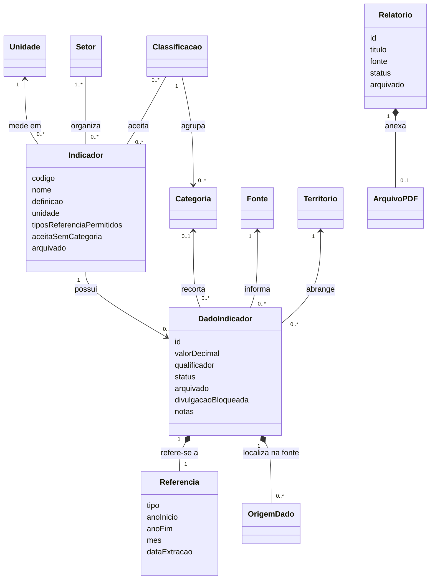

# G7 — Modelo de indicadores, dados e relatórios

> **Documento anterior — substituído em 05/11/2026.** Referência atual: [Estrutura e dicionário](01-estrutura-e-dicionario.md); [Fluxos de uso](03-fluxos-de-uso.md). O restante está preservado como histórico e não deve orientar uma nova implementação isoladamente.

**Revisão 2 consolidada em 05/11/2026: modelo ajustado à seleção global por Setor e Ano/Período, conforme confirmação de Gustavo.** Este documento define o comportamento desejado. Não representa uma migração aplicada nem funcionalidades já implementadas. O modelo validado orienta a preparação dos dados (G8), os fluxos (G9) e as tarefas de implementação.

## 1. Os três conceitos principais

| Conceito | O que é | Exemplo |
| --- | --- | --- |
| **Indicador** | Define uma medida: nome, significado, unidade, setores, referências e classificações aceitas. Não contém um valor ou ano fixo. | Meios de hospedagem cadastrados; unidade: empreendimentos. |
| **Dados do indicador** | Valores recebidos para um indicador. Cada item contém abrangência, referência, fonte e categoria quando houver. | 3 hotéis, Santa Rita do Sapucaí, 2024, cadastro de hospedagem da SMCELT. |
| **Relatório** | Um documento independente disponibilizado para leitura ou download. Novos cadastros recebem um PDF. | Relatório técnico do Observatório enviado pela Prefeitura. |

**“Lançamento” e “observação” deixam de ser nomes de dois cadastros distintos na interface.** O nome da seção será **Dados do indicador**. Cada item dessa seção é um dado do indicador. O nome técnico `observacoes_m6` pode ser mantido internamente durante a adaptação. Um dado publicado aparece na consulta de indicadores; não gera um relatório PDF automaticamente.

Um indicador aparece na consulta pública quando está ativo e possui pelo menos um dado publicado e elegível para divulgação. **Decisão confirmada:** não criar uma segunda publicação independente para a definição do indicador. A ação de publicar atua nos dados; o cadastro da definição tem apenas ativo/arquivado. Isso evita duas confirmações para disponibilizar o mesmo dado.

## 2. Estrutura e relações

O diagrama editável está em `g7-modelo-de-dominio.mdj`. As classes são conceitos de domínio; não exigem uma tabela SQL por classe. **Decisão confirmada: cada indicador possui uma unidade. Contagem, percentual e razão por mil habitantes são medidas separadas.**

No diagrama, `0..*` significa nenhum ou vários; `1` significa exatamente um. O PDF é obrigatório em relatório novo. A multiplicidade opcional preserva os relatórios legados cujo conteúdo é um link externo.

### Setor, classificação e categoria não são sinônimos

- **Setor do Observatório:** agrupamento de indicadores para a consulta global. Reaproveita os seis grupos recebidos: Dados gerais, Turismo, Economia criativa, Eventos, Pesquisa e inovação e Vale da Eletrônica. Cada indicador possui um ou mais setores, sem duplicar seus dados. O antigo Tema deixa de ser uma classificação paralela.
- **Classificação:** o critério usado para separar os dados, como Categoria de hospedagem, Porte ou Setor econômico (Sebrae).
- **Categoria:** uma opção de uma classificação, como Hotel, Pousada ou Resort. Cada categoria pertence a uma classificação.
- **CNAE:** código opcional, somente quando informado pela fonte. Setor econômico (Sebrae) ou categoria de hospedagem não vira CNAE por aproximação.

Um dado aceita, nesta etapa, no máximo uma categoria, preservando a capacidade do modelo atual. Não será criado um mecanismo de cruzamento arbitrário entre várias dimensões. Quando o mesmo indicador tiver classificações diferentes, a consulta escolhe uma classificação por vez.

### Setor classifica a definição; período pertence ao dado

O visitante escolhe Setor e Ano/Período antes de escolher um indicador. Um indicador só aparece quando pertence ao setor e possui ao menos um dado público elegível para a referência escolhida. Um indicador multissetorial aparece uma vez, sem cópia dos valores.

O Setor do Observatório não é o recorte econômico Comércio/Indústria nem o Público Moradores/Visitantes. Esses recortes continuam nas categorias dos dados. O filtro global não transforma um total municipal em valor exclusivo de um segmento.

Não colocar um ano fixo na definição nem repetir os setores em cada dado. O setor não integra a identidade semântica do dado e sua correção não gera novos IDs ou valores.

## 3. Dicionário do indicador

| Campo | Obrigatório | Regra |
| --- | --- | --- |
| `codigo` | Sim | Identificador estável. Nome não é a chave; renomear não duplica os dados. Preservar os códigos atuais quando a medida continuar equivalente. |
| `nome` | Sim | Nome público específico: “Meios de hospedagem cadastrados”, e não somente “Quantidade”. |
| `definicao` | Sim | Explica o que se conta ou mede e seus limites. Não prometer cobertura integral da cidade quando a fonte é um cadastro ou uma pesquisa. |
| `unidadeCodigo` | Sim | **Decisão confirmada:** uma unidade por definição. Pessoas, percentual e pessoas por mil habitantes são medidas distintas. |
| `setores` | Sim | Lista não vazia de Setores do Observatório. O filtro global consulta essa associação antes de listar indicadores. Um setor novo não exige componente específico no frontend. |
| `tiposReferenciaPermitidos` | Sim | Conjunto não vazio: anual, mensal, acumulada, levantamento ou retrato, conforme a medida. Não é uma promessa de que todos já possuem dados. |
| `classificacoesPermitidas` | Sim, podendo ser vazio | Critérios de recorte aceitos. As opções concretas vêm das categorias e dos dados disponíveis. |
| `aceitaSemCategoria` | Sim | Indica se existe dado sem recorte, como um total informado pela fonte. `false` exige categoria. Não preencher categoria ausente com “Total” sem conferir a origem. |
| `notaMetodologica` | Não | Orientação comum a todos os dados. Ressalvas específicas de uma pesquisa ou período ficam no dado. |
| `arquivado` | Sim | Começa como `false`. Arquivado: fica fora da seleção ativa e da consulta pública. |

**Uma definição não contém valor, ano fixo, fonte única nem fórmula de cálculo obrigatória.** O Observatório envia valores consolidados. As fontes e os períodos pertencem aos dados. A mesma medida pode receber fontes diferentes, mantidas separadas na consulta.

Não será criado um editor de fórmulas nem cálculo automático de indicadores. Acrescentar um indicador, categoria ou fonte será uma operação de cadastro, sem criar colunas ou componentes específicos para cada um.

## 4. Dicionário dos dados do indicador

| Campo | Obrigatório | Regra |
| --- | --- | --- |
| `id` | Sim | Identificador interno estável durante a edição. A adaptação do identificador atual por hash será definida na migração. |
| `indicadorCodigo` | Sim | Definição existente. Para cadastrar ou editar ativamente, o indicador deve estar ativo. |
| `territorioCodigo` | Sim | Abrangência real da fonte. O pacote ativo da G8 foi limitado a Santa Rita do Sapucaí. Dados antigos de outras abrangências ficam fora da carga e são destinados a arquivamento na migração. |
| `categoriaCodigo` | Conforme o indicador | Vazia somente se `aceitaSemCategoria=true`. Quando preenchida, sua classificação precisa ser permitida pelo indicador. |
| `referencia` | Sim | Objeto descrito na seção 5. Período desconhecido não é um tipo válido. |
| `valorDecimal` | Sim | Decimal exato, não negativo, intercambiado como texto. `"0"` é válido; vazio não vira zero. Respeitar números inteiros e limites da unidade. |
| `qualificador` | Sim | `igual` ou `maior_que`, para preservar “mais de”. |
| `fonteCodigo` | Sim | Fonte identificável. Uma URL não é obrigatória quando a origem é um documento recebido. |
| `notas` | Não, salvo ressalvas necessárias | Cobertura, denominador, respostas múltiplas, amostra e restrições de interpretação. Não apagar uma ressalva necessária ao publicar. |
| `origens` | Conforme a origem | Importado: preservar arquivo/aba/célula disponíveis. Cadastro manual: não inventar célula ou planilha. Não contém quem editou nem versões anteriores. |
| `status` | Sim | `rascunho` ou `publicado`; cadastro novo começa em rascunho. |
| `arquivado` | Sim | `false` por padrão. Não altera o status guardado. |
| `divulgacaoBloqueada` | Sim | Impedimento de divulgação já existente. Não confundir com rascunho ou arquivo. |
| `motivoBloqueio` | Se bloqueado | Motivo concreto. Restaurar ou editar não remove o bloqueio. |
| `demonstracao` | Sim | Preserva a identificação de eventual dado fictício. Dados reais preparados não recebem essa marca. |

Unidade e setores são obtidos da definição do indicador. Caso continuem duplicados no contrato de transição, devem ser coerentes com ela. O CNAE é obtido da categoria quando houver correspondência explícita; não é outro campo livre para contradizer a categoria.

Metadados como tamanho de amostra podem continuar nas notas quando a origem não oferece um campo uniforme. Não inventar cobertura, denominador ou número de respondentes para preencher um cadastro.

### Identidade e correção

A combinação de **indicador + território + categoria (ou ausência dela) + referência completa + fonte** não pode se repetir. A unidade é determinada pelo indicador. No contrato atual ela também integra a identidade; a migração precisará preservar essa equivalência.

- Alterar somente o valor corrige o mesmo dado.
- Corrigir fonte, categoria ou referência também pode manter o mesmo dado, após validar a nova combinação.
- Se a combinação já existir, recusar a gravação e indicar o conflito; não sobrescrever outro dado nem fundir automaticamente.
- O frontend usa o identificador do dado, não a combinação editável como endereço.
- Mudanças em medida/unidade que representem outro significado exigem outra definição de indicador e remapeamento validado. Não converter o valor automaticamente.
- Se o dado publicado for corrigido, o valor corrigido passa a valer imediatamente após a confirmação. Não há versão publicada separada da versão editada.

## 5. Referência e unidade

| Tipo de referência | Campos | Exemplo e comportamento |
| --- | --- | --- |
| Anual | Um único ano | 2024. Pode compor série anual com referências e medidas compatíveis. |
| Mensal | Um único ano e mês de 1 a 12 | Janeiro/2024, somente quando a fonte mede aquele mês. |
| Acumulada | Ano inicial e final, início ≤ fim | 2000–2024. Não é um ponto anual de 2024. |
| Levantamento | Ano inicial e final, início ≤ fim | Pesquisa realizada em 2022 e 2023. Não distribuir o resultado entre os dois anos. |
| Retrato | Ano único e data de extração compatível | Extração de uma base em 04/10/2026. Não tratar como produção anual. |

O mês fica vazio nos demais tipos. A data de extração pertence ao retrato; os rótulos de apresentação são derivados dos campos estruturados. “Janeiro” como resposta de um questionário pode ser uma categoria de uma pesquisa anual, e não um período mensal.

**Unidade:** código, nome/símbolo, exigência de inteiro, máximo quando conhecido e casas de exibição. O mínimo numérico segue a regra atual de zero. Percentual de 0 a 100 e índice de 0 a 1 são unidades distintas. O arredondamento serve à exibição, preservando o decimal recebido.

**Fonte:** código, nome e links disponíveis; edição identificada quando conhecida. Fontes/edições diferentes não são somadas nem substituídas por parecerem medir algo semelhante. Não inventar edição ausente.

**Origem do dado:** localização do valor recebido, como `_Indicadores_OT_SRS_.xlsx`, Turismo!D11. É proveniência documental; não é histórico de quem alterou o cadastro.

## 6. Relatórios PDF

| Campo | Obrigatório | Regra |
| --- | --- | --- |
| `id` | Sim | Identificador estável. |
| `titulo` | Sim | Nome público do documento. |
| `fonte` | Sim | Órgão/documento responsável, conforme informação recebida. |
| `arquivoPDF` | Em novos cadastros | Um PDF válido, disponível para leitura/download. Preservar o nome original para apresentação; detalhes de armazenamento são da implementação. |
| `numero` e `tipo` | Não | Número oficial e tipo (relatório técnico ou peça de divulgação), quando conhecidos. |
| `dataPublicacaoDocumento` | Não | Data original do documento, se informada. Não presumir a data em que ele foi enviado ao sistema. |
| `anoReferencia` e `mesReferencia` | Não | Referência do conteúdo quando conhecida; mês exige ano e pertence ao intervalo 1–12. |
| `status` | Sim | Rascunho ou publicado. Novo cadastro começa em rascunho. |
| `arquivado` | Sim | `false` por padrão; restauração preserva o status. |
| `linkExternoLegado` | Apenas compatibilidade | Mantém acesso aos relatórios externos já existentes; novos cadastros não oferecem campo de URL. |
| `demonstracao` | Sim | Identifica documentos fictícios já existentes. |

Cada relatório tem **um único conteúdo vigente**: PDF ou link externo legado. Ao substituir um PDF, validar o novo arquivo antes de concluir a troca. Erro no envio não pode apagar o arquivo vigente. Para substituir um link legado, o novo conteúdo deve ser PDF; o link deixa de ser o conteúdo vigente somente após a troca bem-sucedida.

Um relatório publicado corrigido continua publicado, inclusive quando o PDF é substituído com sucesso. A edição confirmada atualiza o público imediatamente. Relatório arquivado não permite download pelo endereço público direto. Não há geração automática de relatórios a partir dos dados.

## 7. Ciclo de vida simplificado

Nos dados e relatórios, **status e arquivamento são campos separados**. Assim, arquivar um publicado mantém `status=publicado` e muda apenas `arquivado=true`. Restaurar limpa esse campo e o item volta à situação anterior, sem guardar uma versão ou um histórico de transições.

| Ação | Antes | Depois | Efeito público |
| --- | --- | --- | --- |
| Cadastrar | Não existe | Rascunho, ativo | Não aparece. |
| Publicar | Rascunho válido, ativo | Publicado, ativo | Aparece se cumprir as regras de visibilidade. |
| Confirmar edição | Publicado, ativo | Publicado com os dados corrigidos | Atualiza imediatamente. |
| Confirmar edição | Rascunho, ativo | Rascunho corrigido | Continua privado. |
| Despublicar | Publicado, ativo | Rascunho, ativo | Sai da consulta pública. |
| Arquivar | Rascunho ou publicado, ativo | Mesmo status, arquivado | Sai da consulta ativa e pública. |
| Restaurar | Arquivado | Mesmo status, ativo | Publicado reaparece se elegível; rascunho continua privado. |

**Não permitir editar, publicar ou despublicar enquanto arquivado.** Restaurar primeiro. Isso preserva o sentido de “voltar à situação anterior”. Dados bloqueados continuam bloqueados ao restaurar; desbloqueio exige a justificativa substantiva da origem ter sido resolvida, não apenas um clique de restauração.

### Arquivar o indicador inteiro

Decisão confirmada: arquivar a definição **oculta efetivamente seus dados**, sem modificar o status ou o arquivamento individual deles. Restaurar o indicador torna elegíveis os dados que já estavam publicados e ativos. Um dado arquivado separadamente continua arquivado; um rascunho continua rascunho. Não fazer cascata de exclusão nem reescrever todos os filhos.

### O que é visível publicamente

Um dado só aparece se estiver **publicado + não arquivado + não bloqueado + ligado a indicador não arquivado + com território Santa Rita do Sapucaí**. A mesma regra deve valer na API pública, listagens, filtros, detalhes e acesso direto por identificador. Um indicador sem dados elegíveis não aparece como opção pública vazia.

Relatório só aparece e disponibiliza seu conteúdo no acesso público se estiver publicado e não arquivado. A administração autenticada pode consultar rascunhos e arquivos. O pacote ativo é exclusivamente de Santa Rita; a restrição de escopo definida na G8 substitui a previsão de manter dados não municipais ativos na administração.

**Sem registro de quem alterou e sem histórico de versões.** Login e autorização administrativa permanecem. Fontes, notas e localização na planilha continuam porque explicam o dado, não porque auditam o usuário.

## 8. Consulta global e recortes locais

A regra normativa está no [contrato dos filtros](g9-contrato-dos-filtros.md). A ordem é **Setor + Ano/Período → indicadores com dados elegíveis → abertura e recortes locais de um indicador**.

- Setor vem de `indicador.setores`; Ano/Período vem de `dado.referencia` e compara a referência completa.
- Todos os setores e Todos os períodos retiram apenas as respectivas restrições. Não somam valores.
- Uma definição sem dado elegível para o filtro aplicado não aparece. Zero publicado continua sendo dado elegível.
- Fonte, classificação e categoria são recortes locais dos dados do indicador aberto, sempre dentro da seleção global.
- 2024 anual não inclui acumulados encerrados em 2024; levantamento 2022 e 2023 não vira dois anos anuais.
- Comércio + MEI não é um cruzamento disponível só porque existem recortes separados por Setor econômico e Porte.
- Não duplicar indicadores ou dados pelas suas associações a vários setores. Não inferir CNAEs.

Nos dados recebidos, Setor Economia criativa + 2025 anual permite os quatro indicadores de percepção da cidade. Setor Turismo + 2024 anual permite os indicadores de hospedagem e suas pesquisas, sem incluir Acolhedora. Contagens públicas finais dependem dos estados persistidos.

## 9. Exemplos reais para validar o modelo

### A. Meios de hospedagem cadastrados

Definição proposta: quantidade de meios de hospedagem na base recebida, sem afirmar censo de todos os estabelecimentos da cidade. Setor Turismo, unidade empreendimentos, referência anual, aceita total sem categoria e classificação Categoria de hospedagem.

| Dado | Valor | Referência | Categoria | Fonte | Localização recebida |
| --- | ---: | --- | --- | --- | --- |
| Total informado | 10 | Anual 2024 | Sem categoria | Formulário Google (coleta espontânea) + complemento via Econodata | Turismo!D2 |
| Hotéis | 3 | Anual 2024 | Hotel | Cadastro de meios de hospedagem 2024 (formulário Google da SMCELT, respostas de jun e jul de 2024) | Turismo!D3 |
| Resorts | 0 | Anual 2024 | Resort | Mesmo cadastro da SMCELT do recorte Hotel | Turismo!D5 |

Selecionar Hotel deve exibir **3**, com fonte e referência desse recorte. O total **10** não deve ser calculado como soma dos recortes nem reapresentado com a fonte do recorte. Se a fonte escolhida for a do total, não oferecer Hotel como filtro disponível. Zero resorts não significa falta de dados.

### B. Unidades habitacionais (UHs) informadas

Definição proposta: quantidade de UHs informadas na base recebida, unidade UHs, referência anual, sem categorias de hospedagem confirmadas nesse indicador.

- Valor recebido: **251**, Santa Rita do Sapucaí, anual 2024, Turismo!D11.
- Fonte: Formulário Google (coleta espontânea) + complemento via Econodata.
- Nota obrigatória de interpretação: oito respostas numéricas; inclui 50 UHs da CCI Imóveis, que gerencia imóveis de temporada e não é um hotel. Camping Pedra do Osso respondeu em texto e Pousada Estação do Vale não respondeu.
- Filtro Hotel não é oferecido aqui: a planilha não informou a divisão dessas 251 UHs por categoria. Não distribuir o total artificialmente.

### C. Depósitos de patentes de invenção (PI)

Definição proposta: contagem de depósitos de PI conforme cidade do primeiro depositante residente na série INPI recebida. Unidade patentes, aceita referência anual e acumulada, sem categoria nestes exemplos.

| Tipo | Referência | Valor recebido |
| --- | --- | ---: |
| Anual | 2024 | 5 |
| Acumulada | 2000–2024 | 72 |
| Acumulada | 2020–2024 | 24 |

Fonte: INPI — Anuário Estatístico de Propriedade Industrial (patentes), 2000–2024. As três referências são independentes. Selecionar Anual/2024 retorna **5**, não 72 nem 24. O acumulado recebido não precisa ser recalculado pelo sistema.

## 10. Ajustes identificados para a preparação dos dados

O catálogo atual tem **76 códigos de indicador**, e duas definições agrupam unidades diferentes:

| Cadastro atual | Mistura encontrada | Tratamento proposto para G8 |
| --- | --- | --- |
| Mestres e doutores atuando na cidade (Lattes) | Pessoas, %, pessoas por mil habitantes | Separar medidas absolutas, participações e razão por mil habitantes; conferir os denominadores e recortes na origem antes de nomear cada definição. |
| Indústria de eletroeletrônicos (segmento Sebrae Minas) | % e % das empresas do segmento | Conferir a base de comparação de cada dado e separar as medidas quando os denominadores forem diferentes. Não apenas trocar o símbolo da unidade. |

Também existem categorias que juntam dimensões no nome, como “Por nível — Doutorado”, “Mulheres” e “Por grande área — Engenharias”. A G8 deverá conferir e separar classificações semanticamente distintas, mantendo o dado com sua categoria correta. Esta G7 não transforma esses dados nem presume que todas as categorias sejam partes exclusivas de um total.

As **1.228 observações elegíveis** e as **119 linhas excluídas** registradas no pacote atual continuam como ponto de partida. Não reincluir os 443 leitos pendentes, ocupação com divulgação restrita, empregos sem período ou Lattes de SRS com filtros pendentes. O modelo não torna um dado excluído elegível. A contagem final após o mapeamento será conferida na G8.

## 11. Aplicação ao sistema existente

| Situação atual verificada | Destino proposto |
| --- | --- |
| Indicador do catálogo M6 tem apenas código e nome. | Enriquecer a definição com medida, unidade e compatibilidades; preparar o mapeamento antes da migração. |
| Há fluxo legado de Lançamentos e fluxo M6 de Observações. | Um fluxo de Dados do indicador. Preservar o legado e conferir sua migração; não apagar nem copiar sem validar unidade, fonte e referência. |
| Correção atual permite valor, qualificador e notas; identidade vem de hash. | Permitir correção validada dos metadados, sem duplicatas; adaptar a chave técnica e referências existentes em migração incremental. |
| Banco exige usuário/data para publicar e possui histórico administrativo. | Adequar as restrições e o contrato ao modelo simplificado. A retirada do uso de auditoria não autoriza apagar tabelas ou dados nesta G7. |
| Setores e unidade aparecem no dado importado. | Consolidar na definição; manter adaptador de compatibilidade até migrar dados, API e frontend de forma coordenada. |
| Filtro de categoria atual mantém dados aos quais não se aplica. | Consulta centrada em um indicador, com filtro estrito e opções dependentes do conjunto visível. |
| Relatórios têm consulta pública e links/documentos legados. | Acrescentar cadastro/edição de PDF, publicação, despublicação, arquivo e restauração administrativos. |

Uma mudança na definição que tornaria dados existentes inválidos deve ser recusada com indicação dos dados afetados, incluindo arquivados. Primeiro se resolve o mapeamento; não alterar unidades ou categorias em massa silenciosamente. Catálogos auxiliares em uso não podem ser removidos; nomes e descrições podem ser corrigidos sem alterar códigos ou significado.

Confirmar uma correção descritiva na definição do indicador atualiza imediatamente seu nome e sua explicação na consulta pública dos dados já publicados. Não há uma segunda versão da definição aguardando publicação.

## 12. Escopo e validação da G7

Entregas deste documento: vocabulário único, classes e relações, dicionário de campos, identidade, referência/unidade, publicação, arquivo/restauração e comportamento básico dos filtros. O diagrama e os exemplos não substituem a futura implementação.

Ficam para as próximas tarefas: mapeamento integral e arquivo preparado dos dados (G8); telas e fluxos detalhados (G9); migrações, endpoints, upload e componentes; planejamento dos testes da etapa de Testes. Nenhuma issue será liberada aos colegas antes da validação combinada.

**Decisões confirmadas:**

1. Nomenclatura: usar **Dados do indicador** na seção administrativa, substituindo a duplicidade de nomes Lançamentos/Observações.
2. Publicação: a definição aparece automaticamente quando possui dados publicados elegíveis, sem outro botão de publicação da definição.
3. Arquivamento: arquivar o indicador oculta seus dados e preserva os estados individuais para a restauração.
4. Unidade: cada indicador possui uma unidade; contagem, percentual e razão por mil habitantes são definições separadas. Anos e categorias que usam a mesma medida continuam nos dados desse indicador.

As decisões de unidade, publicação, correção e arquivo permanecem. Esta revisão acrescenta o filtro global por seis Setores do Observatório, com a associação na definição e o período nos dados. O pacote foi preparado na G8; banco e aplicação ainda dependem da implementação.

### Como entender a regra de unidade

Unidade é o significado do número. As medidas podem tratar do mesmo assunto e responder a perguntas diferentes:

| Indicador proposto | Pergunta respondida | Unidade | Exemplo fictício |
| --- | --- | --- | ---: |
| Mestres e doutores atuando na cidade | Quantas pessoas são? | Pessoas | 100 |
| Participação de mulheres entre mestres e doutores | Qual parcela desse grupo é de mulheres? | % do grupo | 40% |
| Mestres e doutores por mil habitantes | Quantas dessas pessoas existem para cada mil moradores? | Pessoas por mil habitantes | 10 |

Os exemplos são apenas explicativos e não serão carregados no projeto. Eles são compatíveis com uma situação hipotética de 100 mestres/doutores, dos quais 40 são mulheres, numa população de 10.000 moradores. O sistema continuará recebendo os valores prontos da fonte, sem calcular essas medidas automaticamente.

A regra aprovada permite manter as três definições no mesmo setor e apresentá-las juntas quando útil, com unidades e significados próprios. Assim, o gráfico de quantidade não mistura 100 pessoas com 40% e 10 pessoas por mil habitantes.

Ano e categoria continuam nos dados: Hotel e Pousada usam a mesma unidade (empreendimentos) e podem permanecer no mesmo indicador. Receber outro ano também não exige criar outro indicador. Não serão criados percentuais ou razões ausentes na origem para completar esse conjunto de exemplos.

## Referências verificadas

- `frontend/src/models/observacao.ts`: catálogo, observações, referência, unidade, correção e histórico atuais.
- `backend/app/schemas/relatorio.py`: campos públicos e compatibilidade com relatório externo.
- `docs/m6/requisitos-e-contrato.md` e `docs/m6/modelo-observacoes.md`: identidade, origem, precisão e persistência atuais.
- `backend/dados/m6/catalogos.json`, `observacoes.jsonl` e `manifesto.json`: exemplos e unidades conferidos nesta G7; pacote derivado de `_Indicadores_OT_SRS_.xlsx`, SHA-256 `e956c9350dbd4ca699b8803215413c23270daa5e4bfa5f7c4f594b969e9a3d8a`.

As decisões recentes de simplificar publicação, restauração e ausência de auditoria substituem as regras anteriores de auditoria **no modelo proposto**. Os documentos da M6 continuam descrevendo a implementação existente até a migração.
