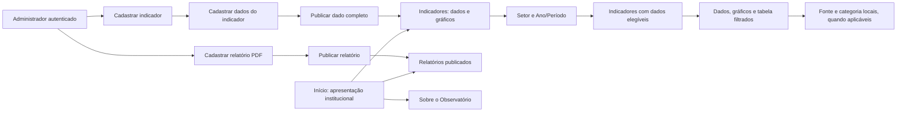

# G9 — Fluxos e critérios funcionais

> **Documento anterior — substituído em 05/11/2026.** Referência atual: [Fluxos de uso](03-fluxos-de-uso.md). O restante está preservado como histórico e não deve orientar uma nova implementação isoladamente.

**Revisão 2, preparada para revisão final das tarefas em 05/11/2026.** Gustavo confirmou Início institucional e a consulta com **Setor e Ano/Período antes da lista de indicadores**. Os Setores do Observatório são os seis agrupamentos recebidos. Modelo, pacote e fluxos estão consolidados nesta revisão; isso não comprova implementação no programa.

Os critérios abaixo definem resultados observáveis para as tarefas da equipe. O planejamento e a implementação da suíte de testes serão tratados separadamente, conforme combinado.

## 1. Escopo consolidado

- Somente Santa Rita do Sapucaí no cadastro ativo e nas consultas. O pacote da G8 contém 61 indicadores e 303 dados municipais; esses números descrevem a origem atual, não limites fixos do sistema.
- Início apresenta o Observatório e oferece acesso a Indicadores e Relatórios.
- Indicadores reúne filtros globais, lista de indicadores compatíveis, dados, gráficos e tabela. A aba Dashboard deixa de existir.
- Sobre explica a plataforma. Relatórios disponibiliza documentos publicados. Contribua preserva os canais externos já existentes e prontos.
- Administração permite cadastrar, consultar, editar e arquivar indicadores, dados do indicador e relatórios; permite restaurar os itens arquivados. Dados e relatórios podem ser publicados ou despublicados.
- Uma unidade por indicador; dados consolidados recebidos, sem cálculo de novas medidas.
- Novos relatórios recebem PDF. Links externos legados continuam acessíveis quando pertencem a relatórios reais publicados e ativos.
- Sem versões paralelas, aprovação editorial ou identificação de quem alterou. Autenticação e autorização administrativa permanecem.

Ficam fora desta correção: inventário turístico completo, coleta nativa, integração automática com Forms, Cadastur/FNRH ou fontes externas, comparações entre cidades e inclusão de dados pendentes. Inventário não deve ser oferecido como funcionalidade pronta no menu.

## 2. Navegação e responsabilidade das páginas

| Página | Finalidade | Conteúdo e ações |
| --- | --- | --- |
| Início (`/`) | Apresentar o Observatório | Resumo institucional, setores e acessos a Indicadores, Relatórios e Sobre. Não repete um dashboard independente. |
| Indicadores (`/indicadores`) | Filtrar e consultar dados e gráficos | Setor e Ano/Período primeiro; lista resultante de indicadores, definição, unidade, fonte, notas e recortes locais. |
| Relatórios (`/relatorios`) | Consultar documentos | Listagem pública de relatórios ativos e publicados, com abertura/download do PDF ou acesso ao link legado. |
| Sobre (`/sobre`) | Explicar a plataforma | Origem, finalidade, setores, leitura dos dados, instituições participantes e fontes. Orientações já existentes podem ficar em seção secundária. |
| Contribua (`/contribua`) | Acessar canais externos prontos | Preservar o formulário recebido e as orientações válidas, sem criar coleta dentro do sistema. |
| Administração (`/admin`) | Gerir conteúdo | Indicadores; Dados do indicador; Relatórios; acesso aos arquivados. |

João decide a apresentação dos indicadores resultantes por cards ou lista pesquisável, a disposição dos gráficos e os detalhes visuais. Davi decide a composição dos formulários administrativos. Os fluxos, campos necessários e critérios deste documento devem ser atendidos em qualquer solução visual.

## 3. Consulta de indicadores

1. Abrir a página e escolher **Setor** e **Ano/Período** antes de escolher um indicador. Os padrões são Todos os setores e Todos os períodos.
2. Setor usa os seis agrupamentos do Observatório. Um indicador pode pertencer a um ou mais setores; esse vínculo pertence à definição.
3. Ano/Período compara a referência completa dos dados. O indicador aparece somente se existir ao menos um dado municipal publicado, ativo, sem bloqueio e compatível com os dois filtros, sob definição ativa.
4. A lista apresenta cada indicador uma vez. Todos não duplica indicadores ou dados pelas associações multissetoriais.
5. Os resultados de cada indicador contêm somente dados que passaram pelo filtro global. O visitante pode abrir detalhes e recortes locais, sem precisar escolher o indicador para liberar os filtros globais.
6. Fonte, classificação e categoria restringem somente o indicador aberto e permanecem dentro da seleção global. Público da pesquisa, Categoria de hospedagem e Setor econômico (Sebrae) não são o Setor do Observatório.
7. Setores disponíveis vêm dos dados públicos elegíveis em algum período; períodos disponíveis vêm do setor escolhido. Trocar Setor limpa um período incompatível para Todos. Aplicar atualiza a consulta e a URL; Limpar volta aos dois padrões.
8. Recarregar/compartilhar a URL restaura a seleção válida. Seleções inválidas ou detalhes que saíram da lista são limpos com indicação clara. Não retornar todos silenciosamente quando a combinação aplicada está vazia.

O [contrato dos filtros](g9-contrato-dos-filtros.md) é a referência normativa. Ele especifica campos, opções, exemplos, limites e responsabilidade de cada tarefa. A consulta global com os seis grupos está confirmada.

### Totais, classificações e gráficos

- **Sem recorte** seleciona somente dados sem categoria. **Todas as categorias** considera a classificação escolhida. Uma visão **Todos os dados** pode exibir total e recortes identificados em tabela, sem somá-los.
- Fonte e referência fazem parte da leitura. Os estoques de 5.818 e 5.879 empresas continuam separados por fonte; não viram um único total.
- Uma série temporal reúne referências anuais ou mensais compatíveis. Acumulado, levantamento e retrato não entram como um ponto anual simples. Fontes diferentes não são ligadas como se fossem uma mesma série contínua.
- Um comparativo por categoria usa a mesma medida, unidade, referência e fonte. Classificações diferentes não são empilhadas como partes do mesmo total.
- Percentuais de Amostra total, Moradores e Visitantes têm bases próprias. Não somar ou usar gráfico de partes de 100% para os três grupos. A amostra total recebida pode ser apresentada como referência.
- Todo gráfico possui alternativa em tabela. Ausência de dado é diferente de zero. Limites como “mais de” e ressalvas de cobertura acompanham o valor.

### Exemplos de comportamento esperado

| Seleção | Resultado esperado |
| --- | --- |
| Cidade vista como: Acolhedora; anual 2025; Público da pesquisa = Moradores | 44,5% dos moradores entrevistados na pesquisa recebida, com a fonte do relatório HackTown. |
| Mesmo indicador; Público da pesquisa = Visitantes | 60,6% dos visitantes entrevistados; não é percentual de toda a população da cidade. |
| Meios de hospedagem cadastrados; anual 2024; categoria Hotel | 3 empreendimentos com a fonte SMCELT. Recorte local: não apresenta 251 UHs como valor de Hotel nem altera os demais indicadores da lista global. |
| Mesmo indicador; categoria Resort | 0 empreendimentos, com fonte e referência. |
| Unidades habitacionais (UHs) informadas; anual 2024 | 251 UHs e suas ressalvas de cobertura. Não oferece Hotel como recorte inexistente dessa medida. |
| Depósitos de PI; anual 2024 | 5 patentes. Os acumulados de 72 e 24 não são tratados como valores anuais de 2024. |

## 4. Administração de indicadores e de seus dados

### Cadastrar e editar a definição

O administrador abre Indicadores e escolhe Novo indicador. Preenche nome, o que a medida significa, unidade, um ou mais Setores do Observatório, tipos de referência permitidos, classificações aceitas e possibilidade de dado sem categoria. Nota metodológica é opcional quando não há ressalva comum a todos os dados.

O código interno é gerado e preservado pelo sistema; o usuário não precisa preencher hash ou chave técnica. A definição pode existir sem dados e não aparece como opção pública vazia. Ela passa a aparecer quando tem ao menos um dado publicável, sem outra ação para publicar a definição.

Editar nome ou explicação atualiza os dados públicos associados após a confirmação, sem criar versão paralela. Uma alteração que invalidaria dados existentes, inclusive arquivados, é recusada com explicação dos vínculos afetados. Mudar o significado da medida ou converter unidades não é uma simples edição descritiva.

Os cadastros auxiliares devem permitir acrescentar fonte, classificação e categoria sem editar arquivos ou código. Unidade e tema também são catálogos. A interface pode usar um formulário auxiliar ou cadastro contextual, sem exigir uma tela complexa por catálogo. Itens em uso não podem ser apagados ou ter seu significado alterado silenciosamente.

### Cadastrar e editar um dado

1. O administrador escolhe um indicador ativo e abre Adicionar dado. A unidade e os setores vêm da definição; o município é Santa Rita do Sapucaí.
2. Informa o tipo de referência permitido e os campos correspondentes: ano, mês, intervalo ou data de extração. A categoria é escolhida somente em classificações permitidas; ausência de categoria precisa ser aceita pelo indicador.
3. Informa valor, qualificador, fonte e notas necessárias. O campo Notas contém ressalvas; ele não se chama Observações para designar outro cadastro.
4. Salvar cria um rascunho. A publicação é uma ação explícita, com resumo do dado e validação de completude e divulgação. O sistema não publica automaticamente toda a carga preparada.
5. Ao editar um dado publicado, a confirmação informa que a alteração atualiza a consulta pública imediatamente. Um rascunho editado continua rascunho.
6. Fonte, categoria e referência podem ser corrigidas no mesmo dado, preservando o identificador. Se a combinação de destino já existe, o sistema recusa a gravação e identifica o conflito.

Valores são recebidos com precisão decimal. A entrada pode aceitar a vírgula decimal usual em português e convertê-la para o formato de intercâmbio, sem passar por ponto flutuante nem arredondar o valor armazenado. Zero é permitido; limites e exigência de inteiro vêm da unidade.

### Arquivar, restaurar e despublicar

Dados e relatórios têm status rascunho/publicado separado do arquivamento. Arquivar preserva o status e retira o item da consulta ativa e pública. Restaurar recupera a situação anterior: publicado reaparece se elegível; rascunho continua privado. Bloqueio de divulgação é preservado.

Arquivar o indicador inteiro oculta seus dados sem mudar os estados individuais. Restaurá-lo não restaura um dado que havia sido arquivado separadamente. O sistema informa o alcance da ação antes da confirmação.

Itens arquivados podem ser consultados e restaurados, mas precisam ser restaurados antes de editar, publicar ou despublicar. Despublicar um dado ou relatório ativo o devolve a rascunho, sem apagar seu conteúdo.

## 5. Administração e consulta de relatórios

O administrador abre Relatórios, escolhe Novo relatório e informa título, fonte e PDF. Número, tipo, data original do documento e referência são preenchidos somente quando conhecidos. Mês de referência exige ano. O upload novo não oferece URL como alternativa.

Salvar cria um rascunho. Publicar disponibiliza o relatório e seu PDF na consulta pública. Uma edição confirmada de relatório publicado entra em vigor imediatamente; editar um rascunho não o publica.

Ao substituir o PDF, o sistema valida o novo arquivo antes de concluir a troca. Arquivo inválido, falha no upload ou limite excedido mantêm o conteúdo vigente e informam o motivo. O limite de tamanho é configurado e exibido na interface. A validação verifica conteúdo PDF, não apenas extensão ou nome.

Relatórios legados reais com link externo continuam acessíveis. Se forem substituídos, o novo conteúdo é um PDF. Cada relatório possui um conteúdo vigente, sem guardar uma segunda versão publicada. Exemplos fictícios permanecem fora do acervo real.

Arquivar/despublicar retira a listagem e o acesso público direto ao arquivo ou ao redirecionamento pelos endpoints da plataforma. Isso não altera permissões no provedor de um link externo legado. A administração autorizada continua consultando o item. Não é gerado PDF automaticamente ao publicar um dado do indicador.

## 6. Início, Sobre e textos

O texto pronto para uso está em [Conteúdo institucional](g9-conteudo-institucional.md). O nome de apresentação segue o protótipo atualizado: **Observatório de Santa Rita do Sapucaí**, explicando sua origem no Observatório do Turismo.

A página inicial usa a apresentação curta e os acessos principais. Sobre usa o conteúdo completo e as orientações de leitura. A lista de fontes considera somente dados publicados e elegíveis de Santa Rita. Fontes de dados retirados, rascunhos ou itens arquivados não aparecem como se fornecessem números disponíveis.

Cadastur e FNRH podem permanecer como orientações secundárias com acesso oficial; não substituem a explicação sobre o Observatório. Retirar a descrição atual de comparações com outras cidades, pois essa consulta saiu do escopo. Não prometer Lattes municipal, ocupação ou leitos enquanto seus dados continuam excluídos.

Exemplo de texto administrativo substituto para a descrição com M6: **“Cadastre e publique os dados dos indicadores de Santa Rita do Sapucaí. Informe a referência, a fonte e as notas necessárias para a consulta.”**

Os rótulos são Indicadores, Dados do indicador, Relatórios, Notas, Rascunho, Publicado e Arquivado. Não exibir M6/M7, nomes de tarefas, detalhes de migração, hashes, tabela interna ou mensagens de implementação no fluxo público ou administrativo.

## 7. Critérios de aceite

| ID | Resultado observável |
| --- | --- |
| NAV-01 | Início apresenta o Observatório e oferece acessos funcionais a Indicadores, Relatórios e Sobre. |
| NAV-02 | Gráficos, tabela e consulta estão reunidos em Indicadores; o menu não oferece Dashboard nem Inventário como funcionalidades separadas prontas. |
| PUB-01 | Após Setor e Ano/Período, listar somente indicadores com dado municipal publicado, ativo e sem bloqueio compatível com a seleção, sob definição ativa. |
| PUB-02 | Setor e Ano/Período ficam antes da lista; opções vêm da API, a troca de Setor limpa período incompatível e recortes locais não mudam os demais indicadores. Não há seletor de cidade. |
| PUB-03 | Setor/Ano-Período restringem a lista e seus dados. Em Meios de hospedagem, Hotel retorna 3 e Resort retorna 0; esse filtro local não altera os outros indicadores nem apresenta 251 UHs como valor de Hotel. |
| PUB-04 | Tipos de referência permanecem distintos; anual/2024 de depósitos de PI mostra 5. Fontes/edições não são somadas ou sobrescritas. |
| PUB-05 | Valores e gráficos apresentam unidade, referência, fonte, qualificador e notas necessárias; decimal original é preservado e ausência não vira zero. |
| PUB-06 | Gráficos respeitam bases e períodos; totais, recortes de classificações diferentes e públicos de uma pesquisa não são somados indevidamente. A tabela acompanha a visualização. |
| PUB-07 | A consulta pode ser compartilhada/restaurada pela URL; parâmetros antigos não permitem outra cidade nem mantêm filtros incompatíveis. |
| FILT-01 | Setor consulta `indicador.setores`; Ano/Período consulta a referência completa dos dados. Ambos funcionam sem exigir um indicador selecionado antes. |
| FILT-02 | Em depósitos de PI, selecionar 2024 anual retorna 5; acumulados 2000–2024 = 72 e 2020–2024 = 24 são opções diferentes e não entram pela igualdade do ano final. |
| FILT-03 | No pacote preparado, Economia criativa + 2025 anual encontra quatro indicadores de percepção; Turismo + 2024 anual encontra 14 e não inclui Acolhedora; Economia criativa + 2024 anual fica vazia. Publicação persistida continua obrigatória. |
| FILT-04 | Indicadores multissetoriais e seus dados aparecem uma vez em Todos ou no setor escolhido. A associação setorial não copia dados nem transforma um total em medida exclusiva daquele setor. |
| ADM-01 | É possível criar, consultar, editar e arquivar/restaurar a definição do indicador sem criar componentes específicos ou editar arquivos de dados. |
| ADM-02 | Uma definição tem uma unidade, um ou mais setores, referências e classificações permitidas. Alterações que invalidariam dados existentes são recusadas; rótulos descritivos podem ser corrigidos. |
| ADM-03 | Fonte, classificação e categoria podem ser acrescentadas pelo cadastro; unidades e setores são obtidos de catálogos. Referências em uso são protegidas. |
| ADM-04 | Dados do indicador permite cadastro, consulta e correção completa dos campos previstos na G7, com unidade herdada, município fixo e validação do decimal. |
| ADM-05 | Correções preservam o ID do dado. Duplicidade da identidade é recusada sem sobrescrever outro dado, perder campos do formulário ou criar cópia silenciosa. |
| ADM-06 | Cadastro novo é rascunho. Publicar/despublicar funciona para dados e relatórios. A definição aparece pelos dados publicados, sem outra publicação da definição. |
| ADM-07 | Confirmar edição de publicado atualiza o conteúdo público imediatamente; rascunho editado continua privado. Não há versão editada paralela. |
| ADM-08 | Arquivar/restaurar dado ou relatório preserva seu status anterior e eventual bloqueio. Arquivado exige restauração antes de edição/publicação. |
| ADM-09 | Arquivar indicador oculta todos os filhos sem alterar seus estados individuais. Restaurar respeita rascunhos, arquivos individuais e bloqueios. |
| REL-01 | É possível cadastrar, consultar e editar relatório com PDF, título e fonte; metadados opcionais não são inventados. Novos cadastros não aceitam link externo. |
| REL-02 | PDF é validado e seu limite é informado; falha na substituição preserva o arquivo vigente. Troca confirmada mantém o estado de publicação do relatório. |
| REL-03 | A consulta pública apresenta relatórios ativos e publicados, preserva links legados reais e bloqueia acesso público direto a conteúdo arquivado ou despublicado. |
| INS-01 | Sobre explica finalidade, origem, setores e leitura dos dados; orientações setoriais são secundárias. Não promete comparações ou dados retirados. |
| TXT-01 | Menus, títulos, ações e mensagens usam Dados do indicador e Notas, sem duplicidade Lançamentos/Observações ou texto interno de milestone. |
| MIG-01 | A integração preserva os 303 dados, seus IDs, decimais, fontes, referências e estados existentes; dados novos são rascunhos. O carregador M6 não recebe o contrato novo por substituição de arquivos. |
| MIG-02 | Os 925 dados fora do escopo não são importados e são arquivados se existentes. Demonstrações antigas não viram dados reais; nenhum descarte físico é implícito. |
| SEG-01 | Escritas e consultas administrativas exigem administrador autenticado. Elegibilidade pública também é aplicada no backend, inclusive acesso direto a detalhes e arquivos. |
| UX-01 | Consulta, administração e relatórios possuem carregamento, vazio e erro claros. Sucesso só é informado após confirmação do servidor, com atualização dos resultados afetados. |
| UX-02 | Navegação, filtros e formulários funcionam em tela estreita e por teclado, com rótulos, foco visível e sem depender apenas de cores ou gráficos. |

## 8. Integração e divisão de trabalho

As [nove tarefas da equipe](g9-tarefas-equipe.md) referenciam os critérios acima. Permanecem como rascunhos para revisão antes de publicação no GitHub.

V7 define a persistência e o contrato de Setores do Observatório e definições/catálogos. V9 integra os dados e a migração. V8 prepara os relatórios PDF. João e Davi podem trabalhar na composição e nos conteúdos independentes enquanto esses contratos são implementados, usando a G8 como referência; o aceite integrado depende da API real.

Escolher métodos HTTP, nomes de rotas novas e organização física das tabelas cabe à implementação do backend, documentada em contrato compartilhado antes de conectar os formulários. Os nomes técnicos antigos não justificam manter dois cadastros do mesmo conceito na interface.

## Referências da especificação

- Modelo aprovado: `docs/m7/g7-modelo-de-dominio.md`.
- Preparação e migração: `docs/m7/g8-tratamento-dos-dados.md`, `backend/dados/m7/catalogos.json`, `dados_indicadores.jsonl` e `manifesto.json`.
- Protótipo institucional: [Sobre a plataforma](https://claude.ai/artifact/DpoEgrkHRGaTyC9hHJ9onX#sobre), consultado em 05/11/2026. O conteúdo foi adaptado ao escopo municipal e aos dados elegíveis, sem copiar promessas de dados excluídos.
- Estado consultado do repositório: base local `8c64ff7`, incluindo as alterações locais já existentes. O exame de arquivos serviu para identificar os fluxos atuais; não foi uma nova auditoria de funcionamento do programa.
