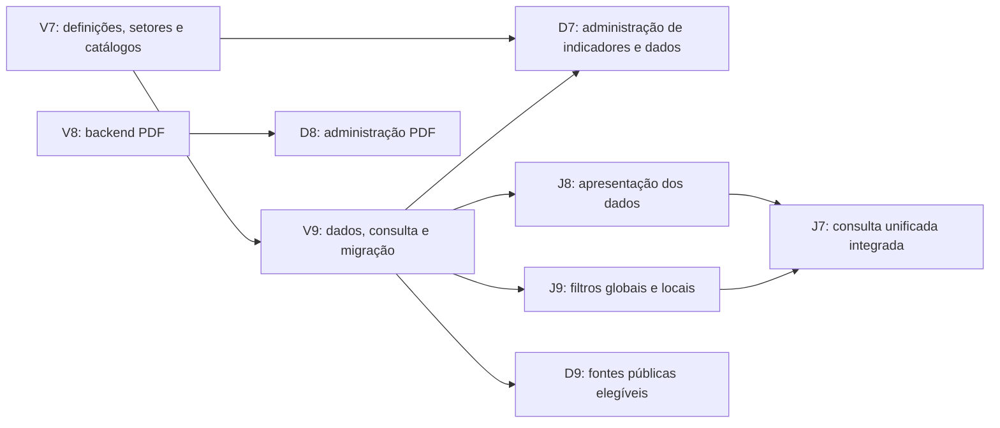

# G9 — Próximas tarefas da equipe, revisão 2

> **Documento anterior — substituído em 05/11/2026.** Referência atual: [Documentação atual](README.md). A distribuição abaixo é um rascunho anterior; as próximas tarefas ainda serão definidas. O restante está preservado como histórico e não deve orientar uma nova implementação isoladamente.

**Para revisão de Gustavo antes de publicar no GitHub.** São três tarefas para Vitor, três para João e três para Davi. Setor e Ano/Período estão confirmados como filtros globais, antes da lista de indicadores. Nenhuma issue foi criada ou alterada por esta revisão.

Base comum: [modelo G7](g7-modelo-de-dominio.md), [dados G8](g8-tratamento-dos-dados.md), [contrato dos filtros](g9-contrato-dos-filtros.md), [fluxos e critérios G9](g9-fluxos-e-criterios.md) e [conteúdo institucional](g9-conteudo-institucional.md). Os IDs citados são critérios de aceite, não números de issues.

O [guia de tarefas da equipe](guia-tarefas-equipe.md) reúne o contexto em um único arquivo para os integrantes e suas IAs. Gustavo entrega G7–G9: requisitos, modelo, pacote preparado e especificação. A implementação das correções está nas tarefas abaixo. O plano da suíte de testes será definido separadamente.

## Visão das dependências

| Responsável | Tarefa | Começo e dependência |
| --- | --- | --- |
| Vitor | V7 — Definições e setores | Primeiro contrato: definição, setores e catálogos usados por V9 e D7. |
| Vitor | V8 — Relatórios PDF no backend | Pode avançar em paralelo à V7 com a autenticação existente. |
| Vitor | V9 — Dados, consulta e migração | Depende de V7; usa o pacote G8 v2. Desbloqueia a consulta integrada. |
| João | J7 — Início e consulta unificada | Pode preparar navegação; conclusão depende de J8/J9 e API. |
| João | J8 — Apresentação dos dados | Pode preparar componentes com G8; aceite integrado depende de V9. |
| João | J9 — Filtros globais e recortes locais | Pode preparar o fluxo especificado; aceite depende de V7/V9. |
| Davi | D7 — Administração de indicadores e dados | Pode preparar formulários; integração depende de V7/V9. |
| Davi | D8 — Administração de relatórios PDF | Integração depende de V8. |
| Davi | D9 — Sobre, fontes e orientações | Texto pode avançar em paralelo; fontes elegíveis dependem de V9. |

Ordem: V7 e contrato compartilhado; V9 e integração de J8/J9/D7; conclusão de J7. V8/D8 e o conteúdo institucional podem avançar em paralelo. Componentes preparados com exemplos não equivalem ao aceite com a API real.

## V7 — Estruturar definições, Setores do Observatório e catálogos

**Responsável:** Vitor.

Preparar persistência e API para uma definição completa de indicador. Reaproveitar o antigo catálogo Tema como Setor do Observatório, com os seis grupos recebidos. Não manter Tema e Setor como dimensões duplicadas.

**Entregas:** migração incremental; cadastro, consulta, edição e arquivo/restauração de definições; associação obrigatória de um ou mais setores por indicador; operações dos catálogos; documentação dos payloads consumidos por João e Davi.

**Critérios de aceite:**

- **ADM-01, ADM-02:** definição com nome, significado, uma unidade, setores, referências e classificações permitidas. Recusar alterações que invalidem dados existentes.
- **ADM-03:** fontes, classificações e categorias podem ser cadastradas sem editar código. Unidades e setores vêm de catálogos; proteger vínculos em uso.
- **FILT-01, FILT-04:** `indicador.setores` é uma lista não vazia; suportar múltiplos setores sem copiar a definição ou seus dados. Setor não integra a identidade do dado.
- **SEG-01:** operações administrativas exigem autorização. A definição não recebe publicação independente.

**Contrato obrigatório:** `catalogos.setores` e `indicador.setores` substituem os campos `temas` do pacote anterior. Preservar códigos e as 67 associações atuais, incluindo os seis indicadores multissetoriais. Um setor futuro é configuração de catálogo, sem componente próprio no frontend. Classificação Setor econômico (Sebrae) e CNAE continuam conceitos distintos.

**Dependência:** G7/G8/G9 revisadas. **Desbloqueia:** V9 e integração de D7.

## V8 — Implementar cadastro e publicação de relatórios PDF no backend

**Responsável:** Vitor.

Disponibilizar as operações para a Prefeitura enviar e administrar relatórios. Reutilizar a consulta pública existente e preservar documentos legados reais em links externos.

**Entregas:** cadastro, consulta, edição, publicação, despublicação, arquivo/restauração; armazenamento e entrega do PDF; contrato de upload, limite e mensagens de validação.

**Critérios de aceite:**

- **REL-01:** novos relatórios usam PDF, título e fonte; não inventar metadados opcionais.
- **REL-02:** validar o PDF e informar limite. Falha na troca conserva o conteúdo vigente; troca confirmada mantém o status.
- **REL-03, SEG-01:** aplicar elegibilidade também no download e acesso direto. Preservar links legados reais e não apresentar exemplos fictícios como documentos reais.
- **ADM-06, ADM-07, ADM-08:** novos em rascunho; edição confirmada de publicado tem efeito imediato; restauração conserva a situação anterior.

**Dependência:** G7/G9 e autenticação existente. **Desbloqueia:** D8.

## V9 — Integrar dados, consulta global e migração

**Responsável:** Vitor.

Incorporar o pacote municipal `c317.m7.g8.v2`, preservando IDs, valores e estados existentes. Oferecer a consulta que lista indicadores por Setor e Ano/Período sem exigir uma escolha prévia de indicador.

**Entregas:** carga incremental e operações administrativas dos dados; consulta de indicadores com os respectivos dados filtrados; opções globais e recortes locais; correspondência de identidades; tratamento dos dados retirados e do legado fictício.

**Critérios de aceite:**

- **MIG-01, MIG-02:** preservar os 303 dados municipais e seus estados persistidos; novos começam em rascunho. Não importar os 925 não municipais; arquivar se existentes. Demonstrações antigas não viram dados reais.
- **ADM-04, ADM-05:** correção completa preserva ID, decimal e metadados; duplicidade é recusada sem sobrescrita silenciosa.
- **ADM-06, ADM-07, ADM-08, ADM-09:** publicação, edição, arquivo e restauração seguem a G7, inclusive bloqueios e arquivamento do indicador-pai.
- **PUB-01, PUB-02, PUB-04, PUB-05, SEG-01:** elegibilidade municipal aplicada no backend a listas, opções e detalhes; preservar fonte, referência, unidade, qualificador e notas.
- **FILT-01, FILT-02, FILT-03, FILT-04:** setor consulta a definição; período compara a referência completa dos dados. Retornar cada indicador e dado uma vez, apenas quando houver dado elegível para a combinação.

**Consulta e opções:** setores disponíveis vêm dos dados elegíveis em algum período; períodos disponíveis vêm do setor selecionado. Fornecer informação para limpar um período incompatível. Todos remove apenas a respectiva restrição. Uma combinação válida sem resultado retorna vazio. Comparar ano, tipo, intervalo e demais componentes da referência, sem tratar acumulado encerrado em 2024 como anual 2024.

**Recortes locais:** fonte/classificação/categoria operam dentro dos dados do indicador já filtrados globalmente. Não fabricar Comércio + MEI a partir de distribuições independentes, CNAEs ausentes ou UHs por Hotel. Associação a Economia criativa não transforma o total 116 em subtotal criativo 18. Contrato completo em `g9-contrato-dos-filtros.md`.

**Dependência:** V7 e pacote G8 v2. **Desbloqueia:** aceite de J8/J9/D7 e lista de fontes de D9.

## J7 — Criar Início institucional e reunir a consulta em Indicadores

**Responsável:** João.

Criar a apresentação institucional inicial e reunir gráficos e dados na página Indicadores. Nessa página, os filtros globais ficam antes da lista de indicadores compatíveis.

**Entregas:** Início; navegação compartilhada; integração dos filtros J9 e dos componentes J8 em Indicadores; acessos a Relatórios, Sobre e Contribua.

**Critérios de aceite:**

- **NAV-01:** Início apresenta o Observatório e oferece acessos funcionais às áreas públicas.
- **NAV-02:** remover Dashboard como consulta separada e não oferecer Inventário como funcionalidade pronta.
- **PUB-02, FILT-01:** Setor e Ano/Período precedem a lista; não exigir escolher um indicador antes de filtrar.
- **TXT-01:** vocabulário aprovado e ausência de texto interno de milestone no produto.
- **UX-01, UX-02:** carregamento, vazio, erro, tela estreita e navegação por teclado.

**Dependência:** conteúdo G9 disponível. Estrutura pode começar em paralelo; conclusão depende de J8/J9 e API. **Liberdade visual:** João decide cards ou lista pesquisável e como abrir os detalhes, mantendo a ordem funcional definida.

## J8 — Apresentar os indicadores filtrados com gráficos, tabela e contexto

**Responsável:** João.

Exibir os indicadores e seus dados resultantes da seleção global. Cada medida mantém definição e unidade próprias; visualizações respeitam categorias, bases, fontes e referências recebidas.

**Entregas:** lista resultante com resumos; gráficos e tabela correspondente; definição, fonte, referência e notas; tratamento de valores avulsos, categorias, séries e períodos não anuais.

**Critérios de aceite:**

- **PUB-01, FILT-03, FILT-04:** não exibir indicadores sem dado compatível nem duplicar indicadores multissetoriais. A lista acompanha Setor e Ano/Período.
- **PUB-05:** unidade, qualificador, cobertura, notas e decimal corretos. Zero é diferente de ausência.
- **PUB-06:** não somar total e recortes, públicos sobrepostos, classificações ou fontes distintas. Gráfico e tabela representam a mesma seleção do indicador.
- **FILT-02:** referência completa nos rótulos; levantamento 2022 e 2023 e acumulados não viram pontos anuais.
- **UX-01, UX-02:** apresentação legível, teclado, tela estreita e estados de carregamento, vazio e erro.

**Exemplo obrigatório:** Turismo + 2024 anual pode listar Meios de hospedagem e UHs. Ao abrir Meios de hospedagem e filtrar Hotel, mostrar 3 com a fonte SMCELT; não apresentar 251 UHs como valor de Hotel. O filtro local não altera o indicador UHs na lista global. Em Economia criativa, o total municipal 116 permanece identificado como total; 18 é o subtotal criativo recebido.

**Dependência:** contrato V7/V9 e exemplos G8. **Integração:** J7 compõe a página; J9 mantém os estados dos filtros.

## J9 — Implementar Setor e Ano/Período globais e recortes locais

**Responsável:** João.

Implementar a seleção que determina quais indicadores aparecem. Usar os seis Setores do Observatório vindos da API e um controle único de Ano/Período. Fonte/classificação/categoria ficam no contexto de cada indicador aberto.

**Entregas:** filtros globais antes da lista; padrões Todos os setores/Todos os períodos; Aplicar/Limpar; opções dependentes; URL restaurável; limpeza de seleções incompatíveis; recortes locais sem afetar outros indicadores.

**Critérios de aceite:**

- **PUB-01, PUB-02, FILT-01:** consultar opções e resultados da API sem indicador previamente selecionado. Não há seletor de cidade nem catálogo de setores fixado no componente.
- **FILT-02, FILT-03:** preservar tipo e intervalo completos; Economia criativa + 2025 anual encontra quatro indicadores de percepção, Turismo + 2024 anual encontra 14, Economia criativa + 2024 anual retorna vazio, considerando os estados públicos elegíveis.
- **FILT-04:** indicadores e dados únicos com múltiplos setores. Não criar cruzamento econômico Comércio + MEI ausente da fonte.
- **PUB-03:** Hotel = 3 e Resort = 0 somente em Meios de hospedagem; Público Moradores = 44,5% em Acolhedora. Esses filtros locais não removem nem alteram os outros indicadores da lista global.
- **PUB-04:** anual/2024 de depósitos de PI = 5; acumulados e fontes distintos não são misturados.
- **PUB-07:** Aplicar atualiza consulta e URL; Limpar volta aos dois padrões; recarregar restaura valores válidos e remove parâmetros desconhecidos/incompatíveis com informação clara.
- **UX-01, UX-02:** rótulos específicos, operação por teclado, tela estreita e estados claros.

**Mudança de setor:** setores permanecem disponíveis a partir de algum período elegível; períodos dependem do setor selecionado. Se necessário, limpar período incompatível para Todos e informar. Se o indicador aberto sair da lista, fechar seu detalhe; caso continue, limpar apenas os recortes incompatíveis. Permitir mudar fonte sem ficar preso à categoria anterior. Implementar o contrato completo de filtros, sem substituir a consulta por seleção de indicador primeiro.

**Dependência:** V7/V9 para aceite integrado. **Integração:** J7/J8 recebem a seleção e os resultados correspondentes.

## D7 — Adaptar a administração de indicadores e de seus dados

**Responsável:** Davi.

Reunir Lançamentos/Observações em Dados do indicador e acrescentar a administração da definição. Reutilizar os componentes existentes com os campos e o ciclo de vida aprovados.

**Entregas:** listagem e formulário de definições; listagem e formulário de dados; cadastros auxiliares; publicação, despublicação, edição, arquivo e restauração com resumo antes da confirmação.

**Critérios de aceite:**

- **ADM-01, ADM-02, ADM-03:** definição com uma unidade e um ou mais setores do catálogo. Exibir validações da API e permitir os cadastros auxiliares previstos.
- **ADM-04, ADM-05:** dado completo com referência real, unidade herdada, município fixo e conflito de duplicidade sem perda de preenchimento.
- **ADM-06, ADM-07:** publicação explícita; edição confirmada de publicado tem efeito imediato, sem versão paralela. Rascunho continua privado.
- **ADM-08, ADM-09:** arquivo/restauração conserva estados; distinguir indicador arquivado e dados arquivados individualmente.
- **FILT-01, FILT-03, FILT-04:** setores ficam na definição; não pedir nem copiar Setor em cada dado. Referência e categoria ficam no dado, com códigos da API e classificação permitida. Não transformar levantamento em anos anuais ou inventar cruzamentos.
- **TXT-01, UX-01, UX-02:** Dados do indicador e Notas nos rótulos; retirar texto interno M6; mensagens, foco, estados e tela estreita.

**Dependência:** V7/V9. Davi decide a composição visual dos formulários, respeitando os campos e regras. Preparação pode começar com o contrato; conclusão exige persistência e ações reais.

## D8 — Criar administração de relatórios por envio de PDF

**Responsável:** Davi.

Permitir que a Prefeitura envie e mantenha um relatório PDF pela interface e use o ciclo de vida da V8.

**Entregas:** listagem, formulário, upload e substituição de PDF; publicação, despublicação, arquivo e restauração; metadados opcionais e mensagens de falha.

**Critérios de aceite:**

- **REL-01:** título, fonte e PDF; opcionais somente quando conhecidos. Novos cadastros não oferecem URL.
- **REL-02:** limite visível; falha não apaga PDF vigente; troca confirmada mantém o estado de publicação.
- **REL-03:** consultar o resultado público; arquivados/despublicados não mantêm acesso público direto pela API. Preservar links legados reais.
- **ADM-06, ADM-07, ADM-08:** novos em rascunho, correção imediata de publicado e restauração na situação anterior.
- **TXT-01, UX-01, UX-02:** textos claros, confirmação do servidor, tela estreita e teclado.

**Dependência:** V8. **Integração:** consulta pública de relatórios e documentos legados reais.

## D9 — Revisar Sobre, fontes e orientações institucionais

**Responsável:** Davi.

Explicar o Observatório, sua origem e como consultar os dados. Usar os textos da G9 e a nomenclatura Setores do Observatório, com orientações já existentes como seção secundária.

**Entregas:** finalidade, origem, seis setores, leitura dos dados, fontes e participantes; acesso a Contribua e orientações pertinentes.

**Critérios de aceite:**

- **INS-01:** apresentação institucional, sem limitar Sobre a Cadastur/FNRH ou prometer comparação regional e dados excluídos. Explicar que Setor/Ano-Período selecionam indicadores e os recortes locais detalham uma medida.
- **PUB-01:** lista de fontes contém somente fontes de dados municipais públicos elegíveis; não anunciar fontes exclusivamente retiradas.
- **TXT-01:** nomes e linguagem institucionais; sem tarefas ou milestones no texto do produto.
- **UX-01, UX-02:** links utilizáveis, tela estreita, teclado e estados da lista de fontes.

**Dependência:** texto G9 disponível. Conteúdo pode avançar em paralelo; fontes dinâmicas dependem de V9. João mantém a navegação compartilhada em J7.

## Condição comum para concluir as tarefas

Preservar contrato, dados reais, precisão e estados persistidos. A integração deve funcionar com a API real. Mocks podem apoiar a preparação, mas não concluem os critérios. Publicação/arquivo precisam permanecer corretos após nova consulta e reinício.

Cada tarefa tem um responsável pela integração. Não criar inventário, integração federal, coleta nativa, auditoria de autor ou histórico de versões. O plano da suíte de testes será discutido depois; executar as verificações apropriadas às mudanças e as exigidas pelo repositório.
