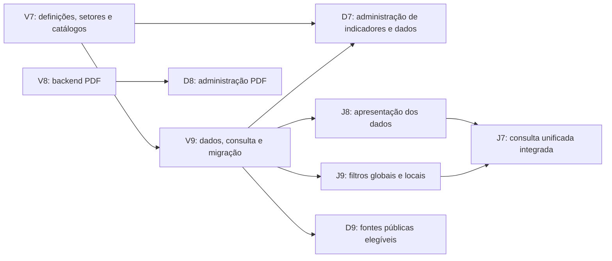

# C317 — Guia de implementação e tarefas da equipe

> **Documento anterior — substituído em 05/11/2026.** Referência atual: [Contexto para IAs](CONTEXTO-PARA-IAS.md); [Documentação atual](README.md). A distribuição abaixo é um rascunho anterior; as próximas tarefas ainda serão definidas. O restante está preservado como histórico e não deve orientar uma nova implementação isoladamente.

**Etapa:** correções para a entrega de Testes. **Referência:** 05/11/2026.

**Situação:** revisão 2 consolidada para revisão final de Gustavo, antes de criar as nove issues no GitHub. **Setor e Ano/Período estão confirmados como filtros globais antes da lista de indicadores.** Este guia reúne G7–G9 e o pacote G8 v2; não afirma que as correções já foram implementadas no programa. O planejamento da suíte de testes será tratado separadamente.

Repositório: [DaviRosimES/C317](https://github.com/DaviRosimES/C317).

Este arquivo pode ser compartilhado inteiro com os integrantes e com suas IAs. Ele reúne contexto, regras de negócio, exemplos, divisão das responsabilidades, dependências, critérios de aceite e textos institucionais. A execução de cada membro deve ficar nas tarefas que lhe forem atribuídas.

## 1. Divisão resumida

| Integrante | Tarefa | Resultado principal |
| --- | --- | --- |
| Vitor | V7 | Estrutura e API das definições, Setores do Observatório e catálogos. |
| Vitor | V8 | Backend de cadastro, upload, publicação e manutenção de relatórios PDF. |
| Vitor | V9 | Dados, migração, consulta global por setor/período e visibilidade pública. |
| João | J7 | Início institucional, navegação e consulta unificada em Indicadores. |
| João | J8 | Apresentação dos dados em gráficos e tabela, com contexto correto. |
| João | J9 | Setor/Ano-Período globais, recortes locais e consulta compartilhável. |
| Davi | D7 | Administração das definições e dos Dados do indicador. |
| Davi | D8 | Administração de relatórios por envio de PDF. |
| Davi | D9 | Página Sobre, fontes e orientações institucionais. |

Gustavo prepara os requisitos e a organização: G7 — modelo do domínio; G8 — dados preparados; G9 — fluxos, critérios e esta divisão. A publicação das tarefas depende da aprovação da proposta.

## 2. O que o projeto deve oferecer

- **Início:** apresentação do Observatório e acessos a Indicadores, Relatórios e Sobre. Essa escolha foi confirmada por Gustavo.
- **Indicadores:** uma única área com Setor e Ano/Período antes da lista de indicadores compatíveis, gráficos, tabela e recortes locais. A aba Dashboard deixa de existir.
- **Relatórios:** documentos ativos e publicados, com PDF ou acesso externo legado real.
- **Sobre:** finalidade, origem, setores, leitura dos dados, fontes e instituições participantes.
- **Contribua:** canais externos já existentes e prontos, preservados sem criar coleta nativa.
- **Administração:** cadastro, consulta, edição, arquivo e restauração de indicadores, dados e relatórios. Dados e relatórios também permitem publicar e despublicar.

Inventário turístico completo, comparação entre cidades, dados pendentes e integrações automáticas com Forms, sistemas federais ou fontes externas ficam fora desta correção. Não oferecer Inventário no menu como funcionalidade pronta.

João decide cards ou lista pesquisável para apresentar os indicadores resultantes e abrir seus detalhes, além da composição dos gráficos. Davi decide a composição dos formulários administrativos. A liberdade visual mantém a ordem funcional e os critérios deste guia.

## 3. Modelo de domínio, sem ambiguidade

| Conceito | Significado | Exemplo |
| --- | --- | --- |
| Indicador | Define o que se mede, sua unidade e os tipos de referência e classificação aceitos. | Meios de hospedagem cadastrados, em empreendimentos. |
| Dados do indicador | Cada item contém um valor recebido para a medida, com referência, fonte e categoria quando houver. | 3 hotéis, anual 2024, cadastro SMCELT. |
| Setor do Observatório | Agrupamento global associado à definição do indicador; reaproveita o antigo Tema. | Turismo ou Economia criativa. |
| Classificação | Critério para separar os dados de um indicador. | Categoria de hospedagem ou Público da pesquisa. |
| Categoria | Opção de uma classificação. | Hotel; Moradores; Visitantes. |
| Relatório | Documento independente oferecido para consulta. | Relatório do Observatório enviado em PDF. |

Os nomes Lançamentos e Observações não serão dois cadastros na interface. O nome aprovado é **Dados do indicador**. Ressalvas textuais usam o campo **Notas**. Nomes técnicos antigos podem existir durante a transição, sem expor essa duplicidade ao usuário.

### Campos da definição de indicador

- Código interno estável, nome e definição do que a medida significa.
- Uma unidade por indicador, com regras de inteiro, escala e casas de exibição quando aplicáveis.
- Um ou mais Setores do Observatório: lista `setores`, obrigatória e não vazia.
- Tipos de referência permitidos e classificações aceitas.
- Indicação de que aceita ou não dado sem categoria.
- Nota metodológica comum, quando necessária, e arquivamento da definição.

O código é interno, sem obrigar o usuário a preencher hash. Valor, ano fixo e fonte única não pertencem à definição. Contagem, percentual e razão por mil habitantes são definições diferentes quando representam medidas distintas. Ano e categoria da mesma medida ficam nos dados, sem criar um indicador para cada ano ou categoria.

Os seis setores são Dados gerais, Turismo, Economia criativa, Eventos, Pesquisa e inovação e Vale da Eletrônica. Um indicador pode pertencer a vários deles, sem duplicar sua definição ou valores. Não manter Tema e Setor como dois cadastros paralelos. Setor do Observatório é diferente da classificação local Setor econômico (Sebrae) e de CNAE.

### Campos de cada dado

- ID estável e vínculo com o indicador.
- Município fixo em Santa Rita do Sapucaí.
- Categoria permitida ou ausência de recorte, quando aceita pela definição.
- Referência estruturada, valor decimal exato, qualificador, fonte e notas.
- Origem documental disponível, como arquivo, aba e célula. Isso não é histórico de quem editou.
- Estado de publicação, arquivamento e eventual bloqueio de divulgação, geridos pela aplicação.

A unidade e os setores vêm da definição. Não copiar Setor em cada dado nem colocá-lo na identidade semântica. A identidade reúne indicador, município, categoria ou ausência dela, referência completa e fonte. Corrigir os metadados preserva o ID; se a identidade de destino já existir, recusar a gravação sem sobrescrever o outro dado.

### Referências permitidas

| Tipo | Representação | Cuidados |
| --- | --- | --- |
| Anual | Um ano. | Pode compor série anual compatível. |
| Mensal | Ano e mês. | Usar somente se a fonte realmente informar um valor mensal. |
| Acumulada | Ano inicial e final. | 2000–2024 não é um ponto anual de 2024. |
| Levantamento | Intervalo da coleta. | 2022 e 2023 não devem ser divididos em valores anuais inventados. |
| Retrato | Ano e data de extração. | Não representa produção anual da base. |

O modelo suporta esses tipos, mas cada indicador permite apenas os tipos configurados. Os filtros públicos oferecem somente referências efetivamente disponíveis nos dados elegíveis. Mês citado por um entrevistado pode ser categoria de uma pesquisa anual, e não referência mensal.

## 4. Publicação, correção e arquivamento

1. Novo dado ou relatório começa em **Rascunho**. Publicar é uma ação explícita.
2. A definição de indicador aparece publicamente quando tem ao menos um dado elegível publicado. Não há um segundo botão para publicar sua definição.
3. Confirmar edição de um conteúdo publicado atualiza imediatamente a consulta pública. Não existe uma versão publicada e outra editada aguardando aprovação.
4. Editar rascunho mantém rascunho. Despublicar devolve o item ativo a rascunho.
5. Arquivamento é separado do status de publicação. Arquivar oculta o item e preserva seu estado; restaurar recupera a situação anterior.
6. Um publicado restaurado reaparece se continuar elegível. Um rascunho restaurado continua privado. Bloqueio de divulgação permanece.
7. Arquivar um indicador oculta todos os seus dados sem alterar os estados individuais. Restaurar o indicador não restaura um filho arquivado separadamente.
8. Itens arquivados precisam ser restaurados antes de editar, publicar ou despublicar.
9. Não criar exclusão física como substituta de arquivamento. Não criar histórico de versões ou registro de quem alterou. Login e autorização administrativa continuam necessários.

O backend aplica as mesmas regras de elegibilidade pública das telas: publicado, ativo, sem bloqueio, indicador ativo e município correto. Isso também vale para detalhes e downloads. Acesso público a links externos legados não altera as permissões do provedor externo; a plataforma controla seus próprios endpoints e redirecionamentos.

## 5. Dados reais disponíveis e exemplos obrigatórios

O pacote **c317.m7.g8.v2**, em `backend/dados/m7/`, contém **61 indicadores, 303 dados de Santa Rita, seis setores, 67 associações indicador–setor, 18 classificações e 80 categorias**. Seis indicadores pertencem a mais de um setor. Os números descrevem a versão preparada; não são limites fixos nem uma afirmação de que todos já estão publicados no banco.

A revisão troca os campos `temas` por `setores` no catálogo e na definição e explicita o fluxo global. Os IDs e códigos permanecem estáveis, inclusive os códigos opacos com prefixo histórico `tema_`. O JSONL dos 303 dados é idêntico ao preparado anterior: nenhuma alteração de valor, referência ou fonte para implementar esse agrupamento.

Os 925 dados de outras abrangências foram retirados da carga. `retirados_por_abrangencia.csv` contém apenas seus identificadores e a ação de arquivamento caso já existam no banco, sem carregar seus valores. O arquivo original e o pacote M6 são fontes preservadas, não cadastros ativos a reincluir por conveniência.

As 119 exclusões anteriores continuam respeitadas: leitos pendentes, ocupação com divulgação restrita, empregos sem referência, Lattes municipal com filtros pendentes e demais linhas listadas. Nenhum código CNAE foi recebido; não inventar correspondências com setores Sebrae. O indicador de quantidade de atividades CNAE não fornece seus códigos individuais.

Gustavo confirmou que o painel antigo contém apenas demonstração. O fixture contém oito tipos e 25 valores fictícios, mas isso não é um inventário independente do banco em execução. Conferir o estado real antes de executar a migração; exemplos não viram dados reais.

| Consulta | Resultado recebido | Restrição importante |
| --- | --- | --- |
| Cidade vista como: Acolhedora; anual 2025; Amostra total | 51,1% dos entrevistados | Total recebido da pesquisa, sem recalcular por média dos grupos. |
| Mesmo indicador e referência; Moradores | 44,5% | Percentual dos moradores entrevistados naquela pesquisa. |
| Mesmo indicador e referência; Visitantes | 60,6% | Percentual dos visitantes entrevistados naquela pesquisa. |
| Meios de hospedagem cadastrados; anual 2024; sem recorte | 10 empreendimentos | Fonte: Formulário Google com complemento Econodata. |
| Mesmo indicador; Categoria de hospedagem = Hotel | 3 empreendimentos | Fonte: cadastro de hospedagem SMCELT; não substituir a fonte pelo total. |
| Mesmo indicador; Categoria de hospedagem = Resort | 0 empreendimentos | Zero é dado válido. |
| UHs informadas; anual 2024 | 251 UHs | Oito respostas numéricas; inclui 50 UHs da CCI Imóveis. Sem divisão confirmada por categoria de hospedagem. |
| Depósitos de PI; anual 2024 | 5 patentes | Não confundir com os acumulados 72 (2000–2024) e 24 (2020–2024). |
| Estoque de empresas; anual 2026 | 5.818 ou 5.879, conforme a fonte | Fontes diferentes: não somar, sobrepor ou escolher uma silenciosamente. |
| Empreendimentos ativos locais; levantamento 2022 e 2023 | Total 116 e subtotal criativo 18 | O subtotal está em outra classificação; não somar novamente às suas categorias. |

Os três dados de Acolhedora têm a fonte Relatório OT nº 004/2025 — Impacto Turístico HackTown 2025. A classificação é Público da pesquisa. Os percentuais representam entrevistados da pesquisa, não toda a população municipal; os grupos não devem ser tratados como partes para somar em um gráfico de 100%.

## 6. Consulta e filtros

Ordem obrigatória: **Setor + Ano/Período → lista de indicadores com dados elegíveis → detalhe e recortes locais**. Ano/Período é um controle único; cada opção preserva a referência completa.

- Setor consulta `indicador.setores`; Ano/Período consulta a referência completa em `dado.referencia`. Não exigir escolher indicador antes de filtrar. Os dois padrões são Todos.
- O indicador aparece se possuir ao menos um dado elegível para a combinação. Mostrar somente esses dados e deduplicar indicadores e valores mesmo em associações multissetoriais.
- Opções de Setor vêm dos dados públicos elegíveis em algum período. Opções de período vêm do setor selecionado. Trocar Setor limpa período incompatível para Todos com indicação clara. Aplicar atualiza resultados e URL; Limpar volta aos dois padrões.
- Economia criativa + 2025 anual encontra quatro indicadores de percepção; Turismo + 2024 anual encontra 14; Economia criativa + 2024 anual retorna vazio. São exemplos do pacote, sujeitos aos estados de publicação.
- Fonte, classificação e categoria restringem apenas os dados do indicador aberto, dentro da seleção global. Permitir mudar fonte e limpar recortes incompatíveis, sem afetar os outros indicadores da lista.
- A classificação nomeia o filtro local: Público da pesquisa, Porte, Setor econômico (Sebrae) ou Categoria de hospedagem. Não misturar tudo em Categoria de origem.
- Hotel = 3 se aplica a Meios de hospedagem. Não fornece o número de UHs de hotéis; UHs mantém seu próprio resultado global e não recebe um recorte inexistente.
- Selecionar Economia criativa não muda a população da medida: 116 empreendimentos é o total municipal; o subtotal criativo 18 permanece identificado no seu recorte. Não fabricar interseções Comércio + MEI a partir de distribuições independentes.
- Se o detalhe aberto sair da lista, fechá-lo; caso continue, limpar somente seus recortes incompatíveis. A URL restaura a consulta válida; parâmetros antigos não permitem outra cidade.
- Sem recorte seleciona somente dados sem categoria. Todas as categorias usa a classificação escolhida. Uma visão de todos os dados deve identificar totais e recortes separadamente, sem somá-los.
- Gráficos e séries respeitam unidade, referência e fonte. Acumulados, levantamentos e retratos não viram valores anuais.
- Exibir fonte, referência, unidade, notas e qualificadores necessários. Uma tabela acompanha os gráficos. Zero não é ausência.
- Decimais são strings no intercâmbio. Não usar ponto flutuante para armazenar, transmitir ou arredondar o original; eventual conversão para desenho de gráfico não substitui o valor exato.

### Contrato consolidado dos filtros globais e locais


**Revisão 2, consolidada em 05/11/2026.** Gustavo confirmou a navegação por filtros antes da escolha do indicador e o uso dos seis grupos recebidos como Setores do Observatório. Esta regra substitui a proposta anterior de selecionar o indicador primeiro. A divisão de tarefas ainda aguarda revisão antes de publicar as issues.

### 1. Decisão e vocabulário

Os filtros principais da página são **Setor** e **Ano/Período**. A aplicação mostra somente indicadores com ao menos um dado público elegível que atenda à seleção. A escolha de um indicador para abrir detalhes é posterior e opcional conforme a composição de João.

Setor do Observatório usa os seis agrupamentos recebidos: **Dados gerais, Turismo, Economia criativa, Eventos, Pesquisa e inovação e Vale da Eletrônica**. O antigo Tema é reaproveitado como Setor; não criar os dois como classificações paralelas com os mesmos valores.

Um indicador pertence a um ou mais setores. Cada dado permanece ligado ao indicador e herda esse enquadramento para a consulta. O ano não é um atributo fixo do indicador: vem da referência de seus dados.

**Setor do Observatório não é setor econômico nem CNAE.** No detalhe do estoque de empresas, Comércio/Indústria/Serviços/Agropecuária continuam como recortes da classificação **Setor econômico (Sebrae)**. Moradores e Visitantes continuam como Público da pesquisa. Essa separação evita atribuir um significado novo ao valor recebido.

### 2. Estrutura e campos

| Elemento | Campos relevantes | Responsabilidade |
| --- | --- | --- |
| Setor | `codigo`, `nome` | Catálogo dos agrupamentos do Observatório. |
| Indicador | `setores` (lista não vazia), unidade, definição e classificações permitidas | Define em quais setores a medida pode aparecer. |
| Dado do indicador | `indicador_codigo`, `referencia`, valor, fonte e categoria | Fornece o valor e o período disponível para a medida. |
| Categoria e classificação | `categoria_codigo` e sua `classificacao` | Recorte local do dado, sem substituir o Setor global. |

No pacote v2, o catálogo `setores` e o campo `indicador.setores` substituem `temas`. Os códigos recebidos são preservados como identificadores opacos, inclusive quando seu prefixo interno antigo contém `tema`. Não expor esse prefixo no produto nem recriar IDs apenas para renomeá-lo.

Setor não faz parte da identidade semântica do dado. Alterar o enquadramento de um indicador não copia seus valores nem cria novos dados. A identidade continua indicador + município + categoria/ausência + referência completa + fonte.

### 3. Fluxo público obrigatório

1. Abrir Indicadores, que reúne dados, gráficos e tabela.
2. Mostrar Setor e Ano/Período antes da lista. Padrões: Todos os setores e Todos os períodos.
3. Escolher um setor e uma referência completa, quando desejado, e aplicar os filtros. Os filtros aplicados são refletidos na URL.
4. Retornar somente indicadores com dados elegíveis para a combinação. O indicador aparece uma vez, mesmo pertencendo a vários setores.
5. Em cada indicador, usar somente os dados que passaram no filtro global. O nome, a definição e a unidade acompanham a leitura.
6. Abrir um indicador ou seus recortes, se a composição visual usar detalhe. Fonte, classificação e categoria são filtros locais e não reclassificam o indicador em outro setor.

João decide cards, lista pesquisável, disposição e abertura dos detalhes. A página não exige escolher um indicador antes de aplicar Setor e Ano/Período. Não há outra consulta separada em Dashboard.

### 4. Regra de inclusão e exemplos

Um dado entra na seleção se for municipal, publicado, não arquivado, não bloqueado e ligado a indicador ativo; o indicador deve pertencer ao setor selecionado e a referência do dado deve coincidir com a opção selecionada. Todos elimina apenas a restrição daquele filtro.

**Um indicador aparece se existir ao menos um desses dados.** Não basta pertencer ao setor e ter algum dado de outro período. O backend e a tela usam a mesma regra; não esconder apenas os cards deixando a API retornar conteúdo indevido.

| Filtros globais | Resultado de referência no pacote preparado |
| --- | --- |
| Economia criativa + 2025 anual | Os quatro indicadores de percepção da cidade: Acolhedora, Criativa, Inovadora e Inspiradora. |
| Turismo + 2024 anual | Os 14 indicadores turísticos com dados anuais de 2024, incluindo hospedagem e UHs. Acolhedora não aparece. |
| Economia criativa + 2024 anual | Nenhum indicador nessa combinação; mostrar ausência, sem retornar todos como alternativa. |
| Turismo + 2022 e 2023 levantamento | Empreendimentos ativos locais; não duplicar esse levantamento em dois anos anuais. |
| Todos os setores + Todos os períodos | Até 61 indicadores e 303 dados da origem atual, sem duplicação pelas associações setoriais. |

As contagens descrevem uma simulação do pacote preparado. A quantidade pública real depende de publicação, arquivo e bloqueio persistidos. Dados novos não são publicados automaticamente para atingir essas contagens.

### 5. Ano/Período é uma referência completa

| Opção | Correspondência | Exemplo após abrir o indicador |
| --- | --- | --- |
| 2024 — anual | Tipo anual, início/fim 2024, sem mês | Depósitos de PI = 5. |
| 2000–2024 — acumulado | Tipo acumulada, início 2000 e fim 2024 | Depósitos de PI = 72. |
| 2020–2024 — acumulado | Tipo acumulada, início 2020 e fim 2024 | Depósitos de PI = 24. |
| 2022 e 2023 — levantamento | Tipo levantamento, início 2022 e fim 2023 | Total de empreendimentos ativos locais = 116. |

2024 anual não inclui acumulados encerrados em 2024. Não testar se um ano está dentro de qualquer intervalo. O levantamento de 2022 e 2023 não vira dois dados anuais.

Todos os períodos conserva cada referência identificada e não autoriza somar ou misturar tipos de referência. Mensal e retrato continuam suportados pelo modelo quando existirem dados recebidos completos; não criar opções vazias para eles no pacote atual.

### 6. Opções, mudança de filtros e URL

As opções de Setor vêm dos setores com ao menos um indicador ativo e dado público elegível em algum período. A opção não desaparece apenas porque o ano atualmente selecionado é incompatível.

As opções de Ano/Período vêm dos dados elegíveis dos indicadores do setor escolhido. Se a troca de Setor tornar o período inválido, limpar o período para Todos e informar a mudança. Aplicar atualiza a seleção, os resultados e a URL. Limpar filtros volta aos dois valores Todos.

O exemplo Economia criativa + 2024 anual verifica a ausência de correspondência no pacote e a resposta vazia da consulta para essa combinação. Não exige criar uma opção vazia no controle: ao trocar o setor na interface, aplica-se a limpeza do período incompatível descrita acima. A API nunca substitui silenciosamente uma combinação sem dados por todos os dados.

Ao recarregar uma URL válida, restaurar a seleção. Valor desconhecido ou incompatível deve ser removido com indicação clara, sem mudar silenciosamente para outro setor/período. Parâmetros antigos não permitem consultar outra cidade.

Se o indicador aberto deixar de pertencer aos resultados, fechar ou limpar seu detalhe. Se continuar, limpar apenas recortes locais incompatíveis. Carregamento, vazio, falha e atualização de publicação precisam atualizar a lista e as opções sem usar dados fictícios como fallback.

### 7. Recortes locais e significado dos números

| Indicador | Recorte local recebido |
| --- | --- |
| Estoque de empresas | Setor econômico (Sebrae), Porte ou Segmento, uma classificação por vez. |
| Empreendimentos ativos locais | Categoria do cadastro SMCELT ou Grupo do cadastro SMCELT. |
| Meios de hospedagem cadastrados | Categoria de hospedagem ou Zona. |
| Cidade vista como: Acolhedora | Público da pesquisa: Amostra total, Moradores ou Visitantes. |
| UHs informadas | Não recebeu divisão por tipo de hospedagem. |

O filtro global seleciona indicadores; não muda a população medida por seus dados. Um indicador multissetorial mantém a mesma definição em todos os setores. Por exemplo, o total 116 de empreendimentos ativos locais não se transforma em total de criativos ao abrir Economia criativa. O subtotal criativo recebido de 18 continua identificado no recorte Grupo do cadastro SMCELT.

Fonte e recortes locais restringem somente os dados daquele indicador que já passaram pelos filtros globais. Não afetam os demais indicadores da lista. Fonte deve poder mudar sem ficar presa à categoria anterior; limpar as opções locais incompatíveis.

Não oferecer Comércio + MEI como cruzamento do estoque, pois os dados por Setor econômico e por Porte são distribuições independentes. Hotel = 3 não fornece uma divisão das 251 UHs. Não somar amostra total e grupos de entrevistados, totais e recortes ou fontes/edições distintas.

### 8. Responsabilidade por tarefa

| Tarefa | Resultado exigido |
| --- | --- |
| V7 | Catálogo Setor e associação obrigatória de um ou mais setores na definição; migrar a antiga organização por temas sem duplicá-la. |
| V9 | Consulta global de indicadores e opções disponíveis por setor/período; mesma elegibilidade e referência completa; sem duplicatas ou reinício de estados. |
| J7 | Filtros antes da lista na consulta unificada; início institucional oferece acesso a essa consulta. |
| J8 | Mostrar os indicadores e dados retornados, com metadados e recortes locais semanticamente corretos. |
| J9 | Estado global Setor/Ano-Período, opções dependentes, aplicação, limpeza, URL e atualização dos resultados. |
| D7 | Cadastro da definição exige setores; cadastro do dado usa referência e categoria reais, sem copiar o setor para cada valor. |
| D9 | Textos e lista de fontes refletem os Setores do Observatório e os dados municipais públicos elegíveis. |

Os nomes e payloads HTTP serão documentados por Vitor para os consumidores. Este contrato define o comportamento e os campos do pacote, não presume que os endpoints novos já estejam implementados.


## 7. Relatórios

- Novo cadastro: título, fonte e PDF válido. Número, tipo, data original e referência são opcionais quando não informados.
- Não oferecer URL para novos cadastros. Preservar relatórios legados reais com link externo.
- Informar o limite de upload e validar conteúdo, não apenas extensão. Substituição com falha conserva o PDF vigente.
- Cada relatório tem um conteúdo vigente. Troca bem-sucedida mantém sua situação de publicação e segue a confirmação de edição publicada.
- Publicar um dado do indicador não gera um relatório PDF automaticamente.
- Arquivar/despublicar retira listagem e acesso público direto pelos endpoints da plataforma.

## 8. Arquivos que cada integrante e sua IA devem consultar

Os caminhos abaixo são relativos à raiz do repositório, para funcionarem em qualquer computador.

| Arquivo ou diretório | Uso |
| --- | --- |
| `AGENTS.md`, quando existir, e `CLAUDE.md` | Instruções e arquitetura do repositório. |
| `docs/m7/README.md` | Entrada da revisão 2 e mapa das entregas consolidadas. |
| `docs/m7/g7-modelo-de-dominio.md` | Modelo aprovado e dicionário de campos. |
| `docs/m7/g8-tratamento-dos-dados.md` | Preparação e orientações de migração do pacote municipal. |
| `docs/m7/g9-fluxos-e-criterios.md` | Fluxos detalhados e critérios funcionais. |
| `docs/m7/g9-conteudo-institucional.md` | Texto pronto de Início, Sobre e mensagens de apoio. |
| `docs/m7/g9-tarefas-equipe.md` | Rascunhos originais das nove tarefas. |
| `backend/dados/m7/catalogos.json` | Definições com setores, unidades, fontes, classificações e categorias. |
| `backend/dados/m7/setores_indicadores.csv` | Os 67 vínculos indicador–setor, sem duplicar os dados. |
| `backend/dados/m7/dados_indicadores.jsonl` | Conteúdo dos 303 dados, com origem documental. |
| `backend/dados/m7/mapeamento_m6_m7.csv` | Correspondência dos dados mantidos e identidade semântica de destino. |
| `backend/dados/m7/retirados_por_abrangencia.csv` | Identificadores dos 925 dados fora do escopo. |
| `backend/dados/m7/exclusoes.csv` | Linhas que continuam excluídas por pendência ou restrição. |
| `backend/dados/m7/legado_demonstracao.csv` | Tratamento previsto para os tipos fictícios antigos. |
| `backend/dados/m7/manifesto.json` | Contrato, hashes, contagens e preservação dos estados. |

**Disponibilidade da base:** documentação e pacote novo precisam estar no checkout compartilhado do grupo. Se algum desses arquivos não estiver na branch recebida, solicitar a referência da entrega a Gustavo antes da integração. Não recriar o pacote com base apenas nos exemplos deste guia, substituir por dados fictícios ou executar o carregador da M6 com os arquivos novos.

Os campos do pacote são um contrato de intercâmbio, não uma definição definitiva dos endpoints HTTP. Em `catalogos.json`, as definições usam `setores`, `unidade_codigo`, `tipos_referencia_permitidos`, `classificacoes_permitidas` e `aceita_sem_categoria`; o catálogo global é `setores`. No JSONL, cada dado usa `id`, `indicador_codigo`, `categoria_codigo`, `territorio_codigo`, `referencia`, `valor`, `qualificador`, `fonte_codigo`, `notas`, `origens` e `demonstracao`.

O pacote não redefine estados de publicação, arquivo e bloqueio existentes. Esses estados pertencem à aplicação. Vitor deve documentar o contrato de API compartilhado antes de os formulários e consultas dependerem de endpoints novos.

## 9. Integração e limites de atuação

- Backend: respeitar as camadas de rotas, serviços e repositórios. Migrações são incrementais, sem apagar dados ou tabelas como atalho.
- Frontend: seguir as camadas `routes → features → queries → services → api/http`, os DTOs/mappers e componentes existentes. Não copiar o JSON da G8 como substituto definitivo da API.
- Vitor documenta os contratos usados por João e Davi. Uma mudança incompatível precisa ser comunicada antes de alterar os consumidores.
- João mantém a navegação compartilhada e a composição de Início/Indicadores. Davi mantém os formulários administrativos e o conteúdo de Sobre. Evitar editar simultaneamente o mesmo menu sem combinar.
- Publicação e arquivamento precisam ser persistidos e voltar corretos após nova consulta; sucesso visual sem resposta do servidor não conclui a tarefa.
- Mocks locais podem apoiar a preparação da interface, mas não são prova de integração nem devem ocultar falhas da API no produto.
- Verificar `git status` antes de trabalhar. Preservar alterações de outros integrantes e não incluir arquivos alheios à tarefa no commit.
- Relatar o que foi implementado, o que foi verificado e o que ainda depende de outra entrega. Não declarar Done apenas porque o PR foi aberto.
- Executar as verificações apropriadas à mudança e as exigidas pelo repositório. O plano da suíte de testes da etapa será discutido separadamente; não acrescentar um novo escopo inteiro de testes a estas nove tarefas.
- Quando for necessário usar nomes ou emails em testes, preferir Cristiano Ronaldo e `cristiano.ronaldo@example.test`.

## 10. Ordem de trabalho

1. Gustavo disponibiliza a base documental e o pacote G8 no repositório compartilhado, após revisão.
2. Vitor começa pela V7 e compartilha o contrato. V8 pode avançar em paralelo.
3. João pode iniciar a estrutura da J7; Davi pode iniciar o conteúdo da D9. Componentes e formulários podem ser preparados com o contrato.
4. Após V7, integrar V9. Ela permite o aceite real de J8/J9/D7 e das fontes da D9.
5. Após V8, integrar D8. A consulta de relatórios preserva os documentos legados reais.
6. Concluir a consulta unificada da J7 com J8/J9 e API real; revisar os critérios integrados antes de encerrar as tarefas.



## 11. Tarefas detalhadas

### V7 — Estruturar definições, Setores do Observatório e catálogos

**Responsável:** Vitor.

Preparar persistência e API para uma definição completa de indicador. Reaproveitar o antigo catálogo Tema como Setor do Observatório, com os seis grupos recebidos. Não manter Tema e Setor como dimensões duplicadas.

**Entregas:** migração incremental; cadastro, consulta, edição e arquivo/restauração de definições; associação obrigatória de um ou mais setores por indicador; operações dos catálogos; documentação dos payloads consumidos por João e Davi.

**Critérios de aceite:**

- **ADM-01, ADM-02:** definição com nome, significado, uma unidade, setores, referências e classificações permitidas. Recusar alterações que invalidem dados existentes.
- **ADM-03:** fontes, classificações e categorias podem ser cadastradas sem editar código. Unidades e setores vêm de catálogos; proteger vínculos em uso.
- **FILT-01, FILT-04:** `indicador.setores` é uma lista não vazia; suportar múltiplos setores sem copiar a definição ou seus dados. Setor não integra a identidade do dado.
- **SEG-01:** operações administrativas exigem autorização. A definição não recebe publicação independente.

**Contrato obrigatório:** `catalogos.setores` e `indicador.setores` substituem os campos `temas` do pacote anterior. Preservar códigos e as 67 associações atuais, incluindo os seis indicadores multissetoriais. Um setor futuro é configuração de catálogo, sem componente próprio no frontend. Classificação Setor econômico (Sebrae) e CNAE continuam conceitos distintos.

**Dependência:** G7/G8/G9 revisadas. **Desbloqueia:** V9 e integração de D7.

### V8 — Implementar cadastro e publicação de relatórios PDF no backend

**Responsável:** Vitor.

Disponibilizar as operações para a Prefeitura enviar e administrar relatórios. Reutilizar a consulta pública existente e preservar documentos legados reais em links externos.

**Entregas:** cadastro, consulta, edição, publicação, despublicação, arquivo/restauração; armazenamento e entrega do PDF; contrato de upload, limite e mensagens de validação.

**Critérios de aceite:**

- **REL-01:** novos relatórios usam PDF, título e fonte; não inventar metadados opcionais.
- **REL-02:** validar o PDF e informar limite. Falha na troca conserva o conteúdo vigente; troca confirmada mantém o status.
- **REL-03, SEG-01:** aplicar elegibilidade também no download e acesso direto. Preservar links legados reais e não apresentar exemplos fictícios como documentos reais.
- **ADM-06, ADM-07, ADM-08:** novos em rascunho; edição confirmada de publicado tem efeito imediato; restauração conserva a situação anterior.

**Dependência:** G7/G9 e autenticação existente. **Desbloqueia:** D8.

### V9 — Integrar dados, consulta global e migração

**Responsável:** Vitor.

Incorporar o pacote municipal `c317.m7.g8.v2`, preservando IDs, valores e estados existentes. Oferecer a consulta que lista indicadores por Setor e Ano/Período sem exigir uma escolha prévia de indicador.

**Entregas:** carga incremental e operações administrativas dos dados; consulta de indicadores com os respectivos dados filtrados; opções globais e recortes locais; correspondência de identidades; tratamento dos dados retirados e do legado fictício.

**Critérios de aceite:**

- **MIG-01, MIG-02:** preservar os 303 dados municipais e seus estados persistidos; novos começam em rascunho. Não importar os 925 não municipais; arquivar se existentes. Demonstrações antigas não viram dados reais.
- **ADM-04, ADM-05:** correção completa preserva ID, decimal e metadados; duplicidade é recusada sem sobrescrita silenciosa.
- **ADM-06, ADM-07, ADM-08, ADM-09:** publicação, edição, arquivo e restauração seguem a G7, inclusive bloqueios e arquivamento do indicador-pai.
- **PUB-01, PUB-02, PUB-04, PUB-05, SEG-01:** elegibilidade municipal aplicada no backend a listas, opções e detalhes; preservar fonte, referência, unidade, qualificador e notas.
- **FILT-01, FILT-02, FILT-03, FILT-04:** setor consulta a definição; período compara a referência completa dos dados. Retornar cada indicador e dado uma vez, apenas quando houver dado elegível para a combinação.

**Consulta e opções:** setores disponíveis vêm dos dados elegíveis em algum período; períodos disponíveis vêm do setor selecionado. Fornecer informação para limpar um período incompatível. Todos remove apenas a respectiva restrição. Uma combinação válida sem resultado retorna vazio. Comparar ano, tipo, intervalo e demais componentes da referência, sem tratar acumulado encerrado em 2024 como anual 2024.

**Recortes locais:** fonte/classificação/categoria operam dentro dos dados do indicador já filtrados globalmente. Não fabricar Comércio + MEI a partir de distribuições independentes, CNAEs ausentes ou UHs por Hotel. Associação a Economia criativa não transforma o total 116 em subtotal criativo 18. Contrato completo em `g9-contrato-dos-filtros.md`.

**Dependência:** V7 e pacote G8 v2. **Desbloqueia:** aceite de J8/J9/D7 e lista de fontes de D9.

### J7 — Criar Início institucional e reunir a consulta em Indicadores

**Responsável:** João.

Criar a apresentação institucional inicial e reunir gráficos e dados na página Indicadores. Nessa página, os filtros globais ficam antes da lista de indicadores compatíveis.

**Entregas:** Início; navegação compartilhada; integração dos filtros J9 e dos componentes J8 em Indicadores; acessos a Relatórios, Sobre e Contribua.

**Critérios de aceite:**

- **NAV-01:** Início apresenta o Observatório e oferece acessos funcionais às áreas públicas.
- **NAV-02:** remover Dashboard como consulta separada e não oferecer Inventário como funcionalidade pronta.
- **PUB-02, FILT-01:** Setor e Ano/Período precedem a lista; não exigir escolher um indicador antes de filtrar.
- **TXT-01:** vocabulário aprovado e ausência de texto interno de milestone no produto.
- **UX-01, UX-02:** carregamento, vazio, erro, tela estreita e navegação por teclado.

**Dependência:** conteúdo G9 disponível. Estrutura pode começar em paralelo; conclusão depende de J8/J9 e API. **Liberdade visual:** João decide cards ou lista pesquisável e como abrir os detalhes, mantendo a ordem funcional definida.

### J8 — Apresentar os indicadores filtrados com gráficos, tabela e contexto

**Responsável:** João.

Exibir os indicadores e seus dados resultantes da seleção global. Cada medida mantém definição e unidade próprias; visualizações respeitam categorias, bases, fontes e referências recebidas.

**Entregas:** lista resultante com resumos; gráficos e tabela correspondente; definição, fonte, referência e notas; tratamento de valores avulsos, categorias, séries e períodos não anuais.

**Critérios de aceite:**

- **PUB-01, FILT-03, FILT-04:** não exibir indicadores sem dado compatível nem duplicar indicadores multissetoriais. A lista acompanha Setor e Ano/Período.
- **PUB-05:** unidade, qualificador, cobertura, notas e decimal corretos. Zero é diferente de ausência.
- **PUB-06:** não somar total e recortes, públicos sobrepostos, classificações ou fontes distintas. Gráfico e tabela representam a mesma seleção do indicador.
- **FILT-02:** referência completa nos rótulos; levantamento 2022 e 2023 e acumulados não viram pontos anuais.
- **UX-01, UX-02:** apresentação legível, teclado, tela estreita e estados de carregamento, vazio e erro.

**Exemplo obrigatório:** Turismo + 2024 anual pode listar Meios de hospedagem e UHs. Ao abrir Meios de hospedagem e filtrar Hotel, mostrar 3 com a fonte SMCELT; não apresentar 251 UHs como valor de Hotel. O filtro local não altera o indicador UHs na lista global. Em Economia criativa, o total municipal 116 permanece identificado como total; 18 é o subtotal criativo recebido.

**Dependência:** contrato V7/V9 e exemplos G8. **Integração:** J7 compõe a página; J9 mantém os estados dos filtros.

### J9 — Implementar Setor e Ano/Período globais e recortes locais

**Responsável:** João.

Implementar a seleção que determina quais indicadores aparecem. Usar os seis Setores do Observatório vindos da API e um controle único de Ano/Período. Fonte/classificação/categoria ficam no contexto de cada indicador aberto.

**Entregas:** filtros globais antes da lista; padrões Todos os setores/Todos os períodos; Aplicar/Limpar; opções dependentes; URL restaurável; limpeza de seleções incompatíveis; recortes locais sem afetar outros indicadores.

**Critérios de aceite:**

- **PUB-01, PUB-02, FILT-01:** consultar opções e resultados da API sem indicador previamente selecionado. Não há seletor de cidade nem catálogo de setores fixado no componente.
- **FILT-02, FILT-03:** preservar tipo e intervalo completos; Economia criativa + 2025 anual encontra quatro indicadores de percepção, Turismo + 2024 anual encontra 14, Economia criativa + 2024 anual retorna vazio, considerando os estados públicos elegíveis.
- **FILT-04:** indicadores e dados únicos com múltiplos setores. Não criar cruzamento econômico Comércio + MEI ausente da fonte.
- **PUB-03:** Hotel = 3 e Resort = 0 somente em Meios de hospedagem; Público Moradores = 44,5% em Acolhedora. Esses filtros locais não removem nem alteram os outros indicadores da lista global.
- **PUB-04:** anual/2024 de depósitos de PI = 5; acumulados e fontes distintos não são misturados.
- **PUB-07:** Aplicar atualiza consulta e URL; Limpar volta aos dois padrões; recarregar restaura valores válidos e remove parâmetros desconhecidos/incompatíveis com informação clara.
- **UX-01, UX-02:** rótulos específicos, operação por teclado, tela estreita e estados claros.

**Mudança de setor:** setores permanecem disponíveis a partir de algum período elegível; períodos dependem do setor selecionado. Se necessário, limpar período incompatível para Todos e informar. Se o indicador aberto sair da lista, fechar seu detalhe; caso continue, limpar apenas os recortes incompatíveis. Permitir mudar fonte sem ficar preso à categoria anterior. Implementar o contrato completo de filtros, sem substituir a consulta por seleção de indicador primeiro.

**Dependência:** V7/V9 para aceite integrado. **Integração:** J7/J8 recebem a seleção e os resultados correspondentes.

### D7 — Adaptar a administração de indicadores e de seus dados

**Responsável:** Davi.

Reunir Lançamentos/Observações em Dados do indicador e acrescentar a administração da definição. Reutilizar os componentes existentes com os campos e o ciclo de vida aprovados.

**Entregas:** listagem e formulário de definições; listagem e formulário de dados; cadastros auxiliares; publicação, despublicação, edição, arquivo e restauração com resumo antes da confirmação.

**Critérios de aceite:**

- **ADM-01, ADM-02, ADM-03:** definição com uma unidade e um ou mais setores do catálogo. Exibir validações da API e permitir os cadastros auxiliares previstos.
- **ADM-04, ADM-05:** dado completo com referência real, unidade herdada, município fixo e conflito de duplicidade sem perda de preenchimento.
- **ADM-06, ADM-07:** publicação explícita; edição confirmada de publicado tem efeito imediato, sem versão paralela. Rascunho continua privado.
- **ADM-08, ADM-09:** arquivo/restauração conserva estados; distinguir indicador arquivado e dados arquivados individualmente.
- **FILT-01, FILT-03, FILT-04:** setores ficam na definição; não pedir nem copiar Setor em cada dado. Referência e categoria ficam no dado, com códigos da API e classificação permitida. Não transformar levantamento em anos anuais ou inventar cruzamentos.
- **TXT-01, UX-01, UX-02:** Dados do indicador e Notas nos rótulos; retirar texto interno M6; mensagens, foco, estados e tela estreita.

**Dependência:** V7/V9. Davi decide a composição visual dos formulários, respeitando os campos e regras. Preparação pode começar com o contrato; conclusão exige persistência e ações reais.

### D8 — Criar administração de relatórios por envio de PDF

**Responsável:** Davi.

Permitir que a Prefeitura envie e mantenha um relatório PDF pela interface e use o ciclo de vida da V8.

**Entregas:** listagem, formulário, upload e substituição de PDF; publicação, despublicação, arquivo e restauração; metadados opcionais e mensagens de falha.

**Critérios de aceite:**

- **REL-01:** título, fonte e PDF; opcionais somente quando conhecidos. Novos cadastros não oferecem URL.
- **REL-02:** limite visível; falha não apaga PDF vigente; troca confirmada mantém o estado de publicação.
- **REL-03:** consultar o resultado público; arquivados/despublicados não mantêm acesso público direto pela API. Preservar links legados reais.
- **ADM-06, ADM-07, ADM-08:** novos em rascunho, correção imediata de publicado e restauração na situação anterior.
- **TXT-01, UX-01, UX-02:** textos claros, confirmação do servidor, tela estreita e teclado.

**Dependência:** V8. **Integração:** consulta pública de relatórios e documentos legados reais.

### D9 — Revisar Sobre, fontes e orientações institucionais

**Responsável:** Davi.

Explicar o Observatório, sua origem e como consultar os dados. Usar os textos da G9 e a nomenclatura Setores do Observatório, com orientações já existentes como seção secundária.

**Entregas:** finalidade, origem, seis setores, leitura dos dados, fontes e participantes; acesso a Contribua e orientações pertinentes.

**Critérios de aceite:**

- **INS-01:** apresentação institucional, sem limitar Sobre a Cadastur/FNRH ou prometer comparação regional e dados excluídos. Explicar que Setor/Ano-Período selecionam indicadores e os recortes locais detalham uma medida.
- **PUB-01:** lista de fontes contém somente fontes de dados municipais públicos elegíveis; não anunciar fontes exclusivamente retiradas.
- **TXT-01:** nomes e linguagem institucionais; sem tarefas ou milestones no texto do produto.
- **UX-01, UX-02:** links utilizáveis, tela estreita, teclado e estados da lista de fontes.

**Dependência:** texto G9 disponível. Conteúdo pode avançar em paralelo; fontes dinâmicas dependem de V9. João mantém a navegação compartilhada em J7.


## 12. Critérios de aceite e textos de interface

### Critérios comuns

| ID | Resultado observável |
| --- | --- |
| NAV-01 | Início apresenta o Observatório e oferece acessos funcionais a Indicadores, Relatórios e Sobre. |
| NAV-02 | Gráficos, tabela e consulta estão reunidos em Indicadores; o menu não oferece Dashboard nem Inventário como funcionalidades separadas prontas. |
| PUB-01 | Após Setor e Ano/Período, listar somente indicadores com dado municipal publicado, ativo e sem bloqueio compatível com a seleção, sob definição ativa. |
| PUB-02 | Setor e Ano/Período ficam antes da lista; opções vêm da API, a troca de Setor limpa período incompatível e recortes locais não mudam os demais indicadores. Não há seletor de cidade. |
| PUB-03 | Setor/Ano-Período restringem a lista e seus dados. Em Meios de hospedagem, Hotel retorna 3 e Resort retorna 0; esse filtro local não altera os outros indicadores nem apresenta 251 UHs como valor de Hotel. |
| PUB-04 | Tipos de referência permanecem distintos; anual/2024 de depósitos de PI mostra 5. Fontes/edições não são somadas ou sobrescritas. |
| PUB-05 | Valores e gráficos apresentam unidade, referência, fonte, qualificador e notas necessárias; decimal original é preservado e ausência não vira zero. |
| PUB-06 | Gráficos respeitam bases e períodos; totais, recortes de classificações diferentes e públicos de uma pesquisa não são somados indevidamente. A tabela acompanha a visualização. |
| PUB-07 | A consulta pode ser compartilhada/restaurada pela URL; parâmetros antigos não permitem outra cidade nem mantêm filtros incompatíveis. |
| FILT-01 | Setor consulta `indicador.setores`; Ano/Período consulta a referência completa dos dados. Ambos funcionam sem exigir um indicador selecionado antes. |
| FILT-02 | Em depósitos de PI, selecionar 2024 anual retorna 5; acumulados 2000–2024 = 72 e 2020–2024 = 24 são opções diferentes e não entram pela igualdade do ano final. |
| FILT-03 | No pacote preparado, Economia criativa + 2025 anual encontra quatro indicadores de percepção; Turismo + 2024 anual encontra 14 e não inclui Acolhedora; Economia criativa + 2024 anual fica vazia. Publicação persistida continua obrigatória. |
| FILT-04 | Indicadores multissetoriais e seus dados aparecem uma vez em Todos ou no setor escolhido. A associação setorial não copia dados nem transforma um total em medida exclusiva daquele setor. |
| ADM-01 | É possível criar, consultar, editar e arquivar/restaurar a definição do indicador sem criar componentes específicos ou editar arquivos de dados. |
| ADM-02 | Uma definição tem uma unidade, um ou mais setores, referências e classificações permitidas. Alterações que invalidariam dados existentes são recusadas; rótulos descritivos podem ser corrigidos. |
| ADM-03 | Fonte, classificação e categoria podem ser acrescentadas pelo cadastro; unidades e setores são obtidos de catálogos. Referências em uso são protegidas. |
| ADM-04 | Dados do indicador permite cadastro, consulta e correção completa dos campos previstos na G7, com unidade herdada, município fixo e validação do decimal. |
| ADM-05 | Correções preservam o ID do dado. Duplicidade da identidade é recusada sem sobrescrever outro dado, perder campos do formulário ou criar cópia silenciosa. |
| ADM-06 | Cadastro novo é rascunho. Publicar/despublicar funciona para dados e relatórios. A definição aparece pelos dados publicados, sem outra publicação da definição. |
| ADM-07 | Confirmar edição de publicado atualiza o conteúdo público imediatamente; rascunho editado continua privado. Não há versão editada paralela. |
| ADM-08 | Arquivar/restaurar dado ou relatório preserva seu status anterior e eventual bloqueio. Arquivado exige restauração antes de edição/publicação. |
| ADM-09 | Arquivar indicador oculta todos os filhos sem alterar seus estados individuais. Restaurar respeita rascunhos, arquivos individuais e bloqueios. |
| REL-01 | É possível cadastrar, consultar e editar relatório com PDF, título e fonte; metadados opcionais não são inventados. Novos cadastros não aceitam link externo. |
| REL-02 | PDF é validado e seu limite é informado; falha na substituição preserva o arquivo vigente. Troca confirmada mantém o estado de publicação do relatório. |
| REL-03 | A consulta pública apresenta relatórios ativos e publicados, preserva links legados reais e bloqueia acesso público direto a conteúdo arquivado ou despublicado. |
| INS-01 | Sobre explica finalidade, origem, setores e leitura dos dados; orientações setoriais são secundárias. Não promete comparações ou dados retirados. |
| TXT-01 | Menus, títulos, ações e mensagens usam Dados do indicador e Notas, sem duplicidade Lançamentos/Observações ou texto interno de milestone. |
| MIG-01 | A integração preserva os 303 dados, seus IDs, decimais, fontes, referências e estados existentes; dados novos são rascunhos. O carregador M6 não recebe o contrato novo por substituição de arquivos. |
| MIG-02 | Os 925 dados fora do escopo não são importados e são arquivados se existentes. Demonstrações antigas não viram dados reais; nenhum descarte físico é implícito. |
| SEG-01 | Escritas e consultas administrativas exigem administrador autenticado. Elegibilidade pública também é aplicada no backend, inclusive acesso direto a detalhes e arquivos. |
| UX-01 | Consulta, administração e relatórios possuem carregamento, vazio e erro claros. Sucesso só é informado após confirmação do servidor, com atualização dos resultados afetados. |
| UX-02 | Navegação, filtros e formulários funcionam em tela estreita e por teclado, com rótulos, foco visível e sem depender apenas de cores ou gráficos. |

### Textos prontos para Início, Sobre e administração

### Início — título

Observatório de Santa Rita do Sapucaí

### Início — apresentação curta

Consulte dados e pesquisas sobre Santa Rita do Sapucaí. Escolha um Setor do Observatório e um Ano/Período para consultar os indicadores disponíveis, com suas referências e fontes.

### Início — acessos

- Consultar indicadores
- Acessar relatórios
- Conheça o Observatório

### Sobre — apresentação

O Observatório reúne informações sobre Santa Rita do Sapucaí para apoiar a consulta e o conhecimento do município. Moradores, empreendedores, estudantes, pesquisadores e o poder público podem explorar indicadores e acessar relatórios das pesquisas disponíveis.

### Sobre — origem

A iniciativa teve origem no trabalho do Observatório do Turismo e ampliou sua organização para outros setores de informação do município. A plataforma aproxima informações de diferentes fontes, preservando o contexto necessário para compreender cada resultado.

### Sobre — setores do Observatório

- **Dados gerais:** população, território, empresas, educação e indicadores econômicos.
- **Turismo:** meios de hospedagem, unidades habitacionais informadas e empreendimentos cadastrados.
- **Economia criativa:** cadastros de atividades criativas e percepção da cidade nas pesquisas recebidas.
- **Eventos:** resultados das pesquisas do Observatório sobre eventos realizados no município.
- **Pesquisa e inovação:** depósitos e concessões de patentes, com referências anuais e acumuladas.
- **Vale da Eletrônica:** dados sobre a indústria e o segmento de eletroeletrônicos.

### Sobre — como ler os dados

Os filtros Setor e Ano/Período mostram os indicadores que possuem dados disponíveis para sua seleção. Cada indicador explica o que está sendo medido e sua unidade. Seus dados apresentam valores para uma referência, uma fonte e, quando houver, uma categoria específica.

Consulte a fonte, o período e as notas antes de comparar resultados. Uma pesquisa pode representar apenas seus entrevistados ou os estabelecimentos que responderam ao levantamento. Um valor zero é diferente da ausência de informação.

### Sobre — fontes

Os dados são fornecidos em valores consolidados, a partir de bases institucionais, cadastros e pesquisas. Cada resultado identifica sua fonte e apresenta um link quando ele está disponível.

### Sobre — instituições participantes

A iniciativa é da Prefeitura de Santa Rita do Sapucaí, por meio da Secretaria Municipal de Cultura, Esporte, Lazer e Turismo (SMCELT), com desenvolvimento acadêmico de estudantes do Inatel no projeto HEIComp 2026.2. O conteúdo sobre o Vale da Eletrônica conta com a contribuição da Secretaria de Ciência, Tecnologia e Desenvolvimento Econômico.

### Sobre — participação

O conhecimento sobre a cidade pode crescer com a contribuição da comunidade. Conheça os canais disponíveis para fornecer informações do seu empreendimento ao Observatório.

Ação: **Conhecer os canais de contribuição**.

### Textos de apoio à administração

#### Indicadores

Defina o que será medido, a unidade, os Setores do Observatório e os tipos de dados aceitos por cada indicador.

#### Dados do indicador

Cadastre e publique os dados dos indicadores de Santa Rita do Sapucaí. Informe a referência, a fonte e as notas necessárias para a consulta.

#### Relatórios

Envie relatórios em PDF e organize os documentos disponíveis para consulta pública.

#### Confirmação de edição publicada

Este conteúdo já está publicado. Ao confirmar, a alteração ficará disponível na consulta pública.

#### Confirmação de arquivamento do indicador

Ao arquivar este indicador, seus dados deixarão de aparecer na consulta pública. Os dados serão preservados e manterão suas situações individuais para uma futura restauração.

#### Confirmação de restauração

O item voltará à situação anterior ao arquivamento. Se estava publicado, ficará disponível novamente quando atender às regras de divulgação.

#### Referência incompleta

Informe a referência do dado antes de salvar.

#### Dado duplicado

Já existe um dado para este indicador, categoria, referência e fonte. Consulte o dado existente para fazer a correção.

#### Consulta sem resultado

Não há dados publicados para esta seleção. Revise os filtros.

#### Falha ao substituir PDF

Não foi possível substituir o PDF. O arquivo anterior foi mantido.


## 13. Como passar este guia para a sua IA

Anexe este Markdown e informe quais tarefas são suas. O projeto e os arquivos citados devem estar disponíveis no ambiente da IA. Use o texto abaixo como pedido inicial de análise; implementação, commits e publicação precisam de solicitação explícita do integrante.

```text
Sou [NOME] e sou responsável pelas tarefas [IDs] deste guia do C317.

Leia este guia e as instruções do repositório. Confira o estado atual dos arquivos,
da branch e dos contratos antes de propor mudanças. Trabalhe apenas nas minhas tarefas.

Primeiro me explique o que já existe, o que falta, quais arquivos você pretende alterar
e quais dependências ainda não foram entregues. Não altere código até eu pedir a implementação.

Ao implementar, siga os critérios de aceite, preserve os dados reais e as alterações
de outros integrantes. Se o pacote G8 ou um contrato necessário estiver ausente,
aponte isso sem inventar dados, endpoints ou integrações para afirmar que está pronto.

Ao terminar, separe o que foi implementado, o que foi verificado e o que continua
dependente de integração. Não faça commit, push ou merge sem minha solicitação.
```

Preenchimento: Vitor → V7/V8/V9; João → J7/J8/J9; Davi → D7/D8/D9.

## 14. Entrega de cada tarefa

O PR deve explicar o problema resolvido, o comportamento resultante, os critérios atendidos e as verificações executadas. Informar dependências de integração que ainda impedem o aceite. Não transformar pendência em comportamento fictício para preencher a tela.

Depois da implementação integrada, os critérios podem orientar a validação funcional e o planejamento da suíte de testes. A existência deste guia e de seus rascunhos não equivale à publicação das issues nem à conclusão do código.
