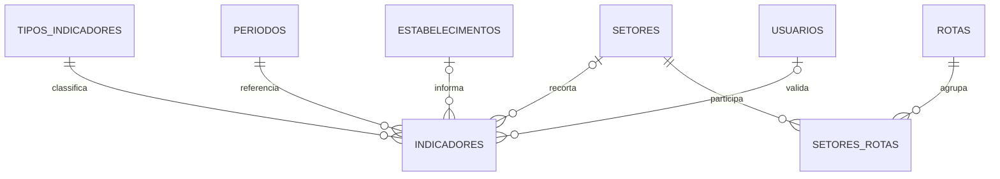

# Indicadores, CNAEs e rotas — modelo de dados

Implementação da atividade [G2 (#14)](https://github.com/DaviRosimES/C317/issues/14), alinhada aos [requisitos da entrega](requisitos-entrega.md). A revisão `6e2c3170b001` sucede `fb26bd09dac1`; a migração inicial permanece intacta.

## Estrutura



| Tabela/campo | Uso |
| --- | --- |
| `tipos_indicadores` | Catálogo com código, nome, descrição, unidade, escopo, fonte de referência e indicação de definição provisória |
| `setores.codigo_cnae` | Código de subclasse, único quando preenchido; os setores antigos podem continuar com código nulo |
| `setores.provisorio`, `fonte_cnae` | Registra seleção provisória e fonte da classificação |
| `periodos.ano`, `mes` | Mês de 1 a 12; `mes = NULL` representa um ano completo, sem inventar mês |
| `indicadores.tipo` | Chave estrangeira para o código em `tipos_indicadores` |
| `indicadores.setor_id` | CNAE associado a um agregado setorial; nulo para total municipal |
| `indicadores.estabelecimento_id` | Opcional; preserva o uso original de lançamentos de estabelecimentos |
| `indicadores.origem` | Fonte obrigatória do lançamento; texto sem conteúdo é rejeitado |
| `indicadores.demonstracao` | Identifica valores fictícios; false por padrão |
| `indicadores.status`, `validado_por` | Campos existentes; o fluxo de autorização/publicação cabe à API |
| `rotas`, `setores_rotas` | Catálogo e associação de CNAEs às rotas, com marca provisória e observação |

`valor` mantém o tipo `Numeric` existente. Não é convertido para float no seed, para preservar os decimais. A unidade pertence ao tipo do indicador.

## Alvos e unicidade

| Lançamento | `estabelecimento_id` | `setor_id` | Identificação única |
| --- | --- | --- | --- |
| Total municipal | NULL | NULL | Tipo + período |
| Agregado por CNAE | NULL | CNAE | Tipo + período + CNAE |
| Dado de estabelecimento | Estabelecimento | NULL | Mantém o comportamento anterior |

Uma restrição impede preencher estabelecimento e CNAE simultaneamente. Isso evita confundir o agregado setorial com o dado individual; o estabelecimento já possui seu setor na tabela original. Os índices parciais impedem duplicar agregados municipais e por CNAE. Um lançamento em rascunho e seu equivalente publicado são o mesmo registro, atualizado pelo fluxo administrativo, não duas versões concorrentes.

O banco também rejeita tipo/CNAE inexistentes, CNAE repetido, fonte vazia e período anual repetido. O índice mensal anterior e a restrição de mês permanecem válidos.

### Validações que a API precisa implementar

O banco não compara o escopo do catálogo com o alvo do lançamento nem valida a unidade cruzando tabelas. V2 deve consultar `tipos_indicadores` e validar:

- `municipal`: estabelecimento e setor nulos; `cnae`: setor obrigatório e estabelecimento nulo; `estabelecimento`: estabelecimento obrigatório e setor nulo.
- Contagens inteiras e não negativas; percentual finito entre 0 e 100; não aceitar `NaN` ou infinito.
- Fonte não vazia, período válido e status permitido pelo fluxo de publicação.
- Permissão para alterar/publicar e o responsável por essa ação.
- Correção de um agregado existente por atualização, com resposta clara se houver duplicidade.

O seed já valida os valores da demonstração. Isso não substitui a validação das futuras rotas da API. Autenticação, senha/hash e auditoria de publicação pertencem às tarefas V1/V2; não são acrescentados por esta migração.

## Aplicação e dados existentes

Com o ambiente configurado, execute dentro de `backend/`:

```bash
python -m alembic upgrade head
python -m alembic current
```

A migração cria entradas no catálogo para tipos que já existirem em `indicadores`. Preserva seus códigos e valores e marca a unidade como `nao_definida`, o escopo como `estabelecimento` e a definição como provisória. Não adivinha unidades ou converte dados históricos.

Se houver lançamentos antigos com fonte vazia, a nova restrição faz o upgrade falhar. Corrija sua procedência com informação verificável antes de aplicar novamente. O DDL do PostgreSQL é transacional; a falha não deve deixar uma revisão parcialmente aplicada.

Os oito tipos da demonstração são cadastrados pelo seed explícito, juntamente com os CNAEs e dados fictícios. A migração não insere valores municipais fictícios num banco compartilhado.

## Expansão do catálogo

Um novo CNAE exige uma linha em `setores`, sem nova coluna ou migração. Exemplo em banco de demonstração; `provisorio` permanece true até a confirmação do recorte pela Prefeitura:

```sql
INSERT INTO setores (nome, slug, codigo_cnae, fonte_cnae, provisorio)
VALUES (
    'Apart-hotéis', 'cnae-5510802', '5510-8/02',
    'IBGE/CONCLA, tabela CNAE 2.2; seleção provisória para demonstração', true
);
```

A associação de uma rota ocorre por uma linha em `setores_rotas`, após validação de sua composição. Não existe associação automática na carga. Como os catálogos são dados, V3 deve expô-los e J3 deve consultá-los; acrescentar um CNAE ao banco só aparecerá na interface quando essa consulta dinâmica estiver implementada.

## Contrato sugerido para V2/V3 e frontend

Os endpoints abaixo são uma **proposta de contrato**, ainda não implementada nesta entrega. Ajustar os nomes em conjunto antes de conectar as telas.

| Operação proposta | Conteúdo/comportamento necessário |
| --- | --- |
| `GET /api/v1/cnaes` | Catálogo completo: id, código, nome, fonte da classificação e marca provisória |
| `GET /api/v1/tipos-indicadores` | Código, descrição, unidade, escopo e marca provisória; não exigir enum fixo no cliente |
| `GET /api/v1/rotas` | Catálogo, CNAEs associados e indicação de composição pendente |
| `GET /api/v1/indicadores` | Somente publicados; filtros tipo, ano/mês ou intervalo mensal, CNAE; distinguir anual de mensal |
| `POST/PATCH /api/v1/indicadores` | Operação administrativa autenticada; receber o valor pronto, tipo, período, fonte, alvo, marca de demonstração e status |

Exemplo de registro de resposta, usando string decimal para evitar perda de precisão:

```json
{
  "tipo": "empregos_por_setor",
  "nome": "Empregos por setor",
  "unidade": "quantidade",
  "ano": 2026,
  "mes": 9,
  "codigo_cnae": "5510-8/01",
  "valor": "90",
  "fonte": "Dados fictícios de demonstração — C317; não representam Santa Rita do Sapucaí.",
  "demonstracao": true,
  "status": "publicado"
}
```

`fonte` no contrato pode mapear para `indicadores.origem`. O filtro público deve exigir `status = 'publicado'`; a API deve preservar fonte e `demonstracao` na resposta. O catálogo de tipos/rotas pode ser exposto mesmo quando ainda não houver valores publicados.

## Relatórios públicos

A revisão `c5e1f7a3b902` (tarefa D3) completa a tabela `relatorios`, criada na migração inicial:

| Campo | Uso |
| --- | --- |
| `fonte` | Fonte do conteúdo; obrigatória para publicar e nunca vazia |
| `status` | `rascunho` (padrão, inclusive para relatórios já existentes) ou `publicado`; só publicados são listados e baixados |
| `demonstracao` | Identifica relatórios fictícios |
| `arquivo_url` | Nome do PDF dentro da pasta de relatórios da API; único por relatório |
| `autor_id` | Passa a ser opcional: relatórios carregados por script não têm autor na equipe |

O downgrade é recusado se houver relatório sem autor, pois o esquema anterior o exige.

A revisão `f4c9a2d7e1b3` (tarefa D5) acomoda os relatórios recebidos do Observatório:

| Campo | Uso |
| --- | --- |
| `numero` | Número oficial ("004/2025"); nulo quando a fonte não informa |
| `tipo` | `relatorio_tecnico` ou `peca_divulgacao`; nulo quando a fonte não distingue |
| `link_externo` | Documento publicado em outro endereço (`https://`), único por relatório |
| `arquivo_url` | Passa a ser opcional: cada relatório tem exatamente um destino, `arquivo_url` ou `link_externo` |
| `data_publicacao`, `periodo_id` | Passam a aceitar nulo, para não presumir data ou referência desconhecidas |

O downgrade é recusado se houver relatório com link externo, sem data ou sem referência.

## Reversão

```bash
python -m alembic downgrade fb26bd09dac1
```

O downgrade é recusado se existirem lançamentos agregados sem estabelecimento ou períodos anuais. O esquema antigo não consegue armazená-los. Preserve/exporte e trate esses dados conscientemente antes de reverter; não atribua um estabelecimento fictício para contornar a proteção.

A reversão remove os novos catálogos e associações. Em um banco que já utilize CNAEs ou rotas, exporte também essas configurações antes de reverter. Não há exclusão automática de indicadores agregados.
